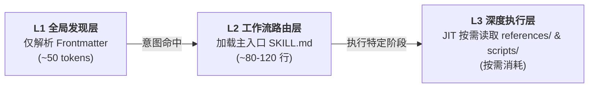
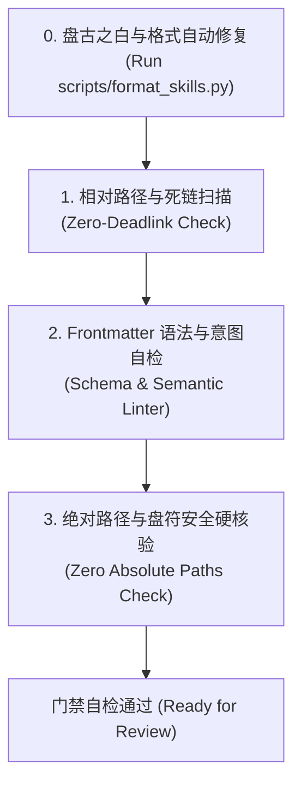

# 国际开放 Agent 研发工程规范与跨生态准则 (Universal Agent Engineering Specification)

本项目严格遵循全球主流 AI 基础设施与 Agent 开放软件工程标准（包括 Linux Foundation 开放标准体系、Agent Plugins Org 清单标准、Open Agent Skills Specification 以及 Anthropic / Linux Foundation Model Context Protocol 官方规范）。

无论运行在 Antigravity、Cursor、Claude Code、Codex、Windsurf 还是 OpenClaw 等任何兼容开放标准的现代 AI 客户端中，所有操作本项目的 Agent **必须严格执行以下源于行业真实实践的技术规范，坚决杜绝任何厂商私有锁定 (Vendor Lock-in)**。

---

## 1. 核心宗旨：中立开放标准体系 (Vendor-Neutral Standards Mandate)

本仓库构建的是**原生通用技能与能力库**，而非针对单一客户端的专有适配层。

- **严禁厂商私有兼容补丁**：坚决禁止创建任何单一宿主专属的隐藏适配目录（如严禁创建 `.claude-plugin/`、`.cursor/` 等专有路径）。
- **统一国际开放规范源头**：
  1. **技能包标准**：遵循 **Open Agent Skills Specification**（`skills/<name>/SKILL.md` 标准组织模型）；
  2. **插件元数据标准**：遵循 **Agent Plugins Specification 1.0.0**（`agent-plugins.org` 国际清单标准）；
  3. **工具协议标准**：遵循开源 **Model Context Protocol (MCP)** 标准；
  4. **工程指导规范**：遵循中立开放的 `.agents/AGENTS.md` 上下文引导标准。

---

## 2. 技能微内核架构规范 (Agent Skills Specification Benchmark)

### 2.1 物理目录拓扑与职责分离 (Directory Layout)
每一个位于 `skills/` 下的子技能必须遵循物理自闭环的原子结构，实现完全解耦：

```text
skills/<skill-name>/
├── SKILL.md                  # [必需] 核心编排入口：元数据声明、主干阶段状态机与知识地图路由
├── references/               # [推荐] 深度知识层（面向 Agent 输入上下文）：执行协议、行业标准、数据手册
│   ├── protocols/            # 交互/分批/核验协议
│   └── templates/            # 交付级文档或代码模版
├── scripts/                  # [可选] 自动化脚本层：确定性可执行代码（必须跨平台）
├── examples/                 # [可选] 案例样本层：标准输入输出样例与真实案例
└── assets/                   # [可选] 静态资产层（面向交付物输出，严禁预先载入上下文）：模板代码、脚手架、图标
```

#### 2.1.1 资产层 (`assets/`) 与知识层 (`references/`) 的严格职责隔离
- **`references/`（输入型知识）**：专供 Agent 在执行具体工作流阶段时**读入上下文 (Read into Context)**，用于指导深度思考、协议遵循与规范校验。
- **`assets/`（输出型资产）**：专供 Agent **直接复制或生成至用户项目 (Used in Output)** 的静态文件（如 React 样板、样式表、字体图片）。**严禁将 `assets/` 作为提示词全文预加载进模型上下文**，必须通过系统工具按需提取或直接复制，从物理机制上彻底切断大型样板对 Token 窗口的侵占。

#### 2.1.2 技能目录纯粹性与反模式防范红线 (What NOT to Include)
技能目录是 Agent 运行时的纯净执行空间，唯一的元数据声明与主干入口就是 `SKILL.md`。
- **严禁面向人类的冗余文档**：**坚决禁止在技能目录下创建 `README.md`、`INSTALLATION.md`、`CHANGELOG.md`、`QUICK_REFERENCE.md` 等辅助性文档**；
- **防污染逻辑**：外生说明文档不仅对大模型执行任务毫无增益，还会严重干扰 Agent 在全局发现期的语义路由、污染文件检索向量，并导致无效的 Token 膨胀。

### 2.2 三级渐进式披露生命周期 (Three-Tier Progressive Disclosure Lifecycle)
为了防止一次性加载导致上下文窗口膨胀、模型注意力分散（Attention Degradation）与 Token 成本浪费，所有技能必须严格遵守行业成熟的**三级渐进式披露模型**：



1. **L1 全局发现层 (Discovery Phase)**：
   - 宿主与 Agent 在启动时仅索引技能目录下的 Frontmatter（`name` 与 `description`），单技能消耗控制在 ~50 tokens 内。
2. **L2 工作流路由层 (Routing Phase)**：
   - 仅当用户意图匹配该技能时，Agent 方可读取 `SKILL.md`。
   - **主入口轻量化红线**：`SKILL.md` 仅作为“主干状态机调度引擎”，**正文行数严格控制在 80~120 行内**。
   - **知识下沉原则**：凡超过 30 行的具体协议文本、超过 50 行的文档/代码模版、详尽的数据参数字典，**一律强制下沉至 `references/` 目录**。
3. **L3 深度执行层 (Execution Phase / JIT)**：
   - 主入口仅保留指向 `references/` 的相对路径超链接。Agent 在未进入对应执行阶段前，**严禁预先盲目读取深层知识**，唯有在推进到具体工作流节点时方可 JIT（Just-In-Time）按需加载对应文件。

#### 2.2.1 引用扁平化与长文档结构化纪律
- **单层扁平引用红线 (Single-Level References Rule)**：所有 `references/` 必须由主入口 `SKILL.md` 直接以标准相对路径链接（Keep references one level deep）。**严禁在参考文档之间形成级联深层跳链（如 A 引用 B，B 引用 C）**，防止 Agent 在深层递归跳转中发生上下文迷失。
- **长参考文档目录结构化 (TOC Baseline for > 100 Lines)**：凡行数超过 100 行的 `references/` 深度文档，必须在顶部显式提供 Markdown 目录（Table of Contents），确保 Agent 在切片预览（`view_file`）时能秒级建立全局知识图谱，无需遍历全篇。

### 2.3 Frontmatter 元数据与触发工程 (Frontmatter Specification & Trigger Engineering)
YAML Frontmatter 是 Agent 在全库发现和语义路由时的唯一索引。严格遵循 Open Agent Skills 国际工业基准：

```yaml
---
# === 核心必需字段 (Core Required) ===
name: at-<skill-name>
description: 当用户需要 [高频业务场景动词/触发意图] 时使用此技能。提供 [核心技术能力/方法论/执行引擎]，交付 [标准化输出形态]。

# === 调度与交互控制字段 (Optional Execution Controls) ===
disable-model-invocation: false    # [可选] 为 true 时禁止 LLM 自发调用，仅供用户显式斜杠命令触发
disable-slash-command: false       # [可选] 为 true 时不注册为用户斜杠命令，仅作为 Agent 内部路由技能
argument-hint: "[param-pattern]"   # [可选] 斜杠命令参数提示（如 "[branch-name]" 或 "<file-path>"）

# === 权限与安全边界字段 (Optional Sandboxing) ===
allowed-tools:                     # [可选] 最小特权原则白名单（限制该技能激活期间允许调用的工具集）
  - view_file
  - run_command

# === 许可与分发元数据 (Optional Distribution Metadata) ===
license: Apache-2.0                # [可选] 开源许可证标识符（如 Apache-2.0、MIT）
metadata:                          # [可选] 结构化扩展字典
  author: Ateng
  version: 1.0.0
  tags: [architecture, technical-doc]
  icon: document-edit
---
```

#### 2.3.1 字段字典与硬性校验基线 (Field Dictionary & Validation Constraints)
- **`name`** (string, **必需**)：
  - **长度硬顶**：最大 64 字符（≤ 64 chars）；
  - **格式约束**：必须为 kebab-case，仅包含小写字母、数字与单连字符（正则基准：`^[a-z0-9]+(-[a-z0-9]+)*$`），严禁首尾连字符，严禁连续连字符 `--`；
  - **命名空间隔离**：建议携带组织/项目前缀（本项目统一以 `at-` 开头），杜绝跨插件全局命名冲突。
- **`description`** (string, **必需**)：
  - **长度硬顶**：最大 1024 字符（≤ 1024 chars）；
  - **语法红线**：严禁包含 `<` 或 `>` 尖括号，防止与客户端 Prompt 模板标签及 XML/HTML 解析冲突；
  - **第三人称视角**：严禁使用第一人称（“I can...”、“我能...”），必须使用客观陈述句（“当用户需要...时使用此技能”）；
  - **触发排他性收敛**：所有“何时使用此技能”的判断依据必须 100% 收敛在 `description` 中，严禁在正文 Body 中开设“何时使用”小节（因为未命中触发前 Body 不会被读入上下文）；
  - **意图动词全覆盖**：必须涵盖至少 4~6 个真实开发者提问的高频意图动词（如“编写”、“架构设计”、“分析”、“审查”、“生成”、“重构”）。
- **`disable-model-invocation`** (boolean, 可选, 默认 `false`)：
  - **行业用途**：用于需要人类介入决策或交互式的命令（如 `/grill-me-matt`、`/wizard`、`/to-tickets`），彻底阻断 Agent 在自主规划过程中递归唤醒或产生逻辑死循环。
- **`disable-slash-command`** (boolean, 可选, 默认 `false`)：
  - **行业用途**：用于底层纯内部技能或隐式辅助逻辑，防止客户端界面输入框被过多内部技能的斜杠命令刷屏干扰。
- **`argument-hint`** (string, 可选)：
  - **行业用途**：斜杠命令参数占位符（如 `[ticket-id]`、`<spec-file>`），提升 CLI/IDE 用户输入交互指引体验。
- **`allowed-tools`** (list of strings, 可选)：
  - **行业用途**：执行最小特权原则 (Principle of Least Privilege)。对于只读调研、设计类无需执行终端或写文件的技能，限定可用工具白名单，防止 Agent 越权产生破坏性操作。
- **`license`** (string, 可选)：
  - **行业用途**：声明技能包开源许可证（如 `Apache-2.0`、`MIT`），与仓库根目录许可证保持语义一致。
- **`metadata`** (object, 可选)：
  - **行业用途**：结构化开放元数据映射，支持 `author`、`version`、`tags`、`icon`、`category` 等自由扩展。
- **属性白名单校验原则**：除上述标准属性及 `metadata` 下的嵌套字段外，**严禁在顶层肆意平铺非标自定义属性**。

### 2.4 文档中立排版与通用可视化红线 (Markdown & Visualization)
- **通用 Markdown 语法**：严格遵循 GitHub Flavored Markdown (GFM) 标准。
- **Mermaid 开放可视化**：流程图、时序图、状态图、实体关系图等所有图表，**必须 100% 采用开放标准 Mermaid 语法编写**，严禁依赖专有图表插件或第三方在线图片链接。
- **Mermaid 防御语法**：节点文本若包含特殊字符（括号、斜杠、中文标点），必须显式使用双引号包裹，例如 `Node["网关服务 (Gateway)"]`。
- **零绝对路径红线**：正文中严禁写入带本地盘符或协议头的绝对路径（如 `file:///`、`C:/`、`D:/`）。文档内部互链必须 100% 采用标准相对路径（`./` 或 `../`）。

---

## 3. 跨平台脚本与可执行工具准则 (Script Portability & Tooling)

若仓库或具体技能内包含 `scripts/` 自动化脚本，必须遵循行业跨平台可移植性标准：

### 3.1 核心运行时与环境基线 (Runtime Baseline)
1. **标准运行时基线**：
   - 优先使用 **Node.js (>= 18)** 或 **Python (>= 3.10)** 编写可执行逻辑；
   - **零额外依赖红线 (Zero-Dependency)**：脚本应当完全依托语言原生标准库（如 Node 原生 `node:fs`、`node:path`，Python 原生 `urllib`、`json`、`pathlib`），杜绝需要前置 `npm install` 或 `pip install` 才能运行的外部依赖。
2. **环境与路径中立性 (Path & Environment Neutrality)**：
   - 路径处理统一使用语言原生路径模块（如 `path.join()`、`pathlib.Path`）或统一使用标准正斜杠 `/`，严禁硬编码 Windows 反斜杠 `\`；
   - 凭据与配置统一从系统环境变量中读取，严禁硬编码操作系统特定路径。
3. **Shell 脚本降级原则**：若包含 Shell 脚本，必须遵循 POSIX `sh` 标准，严禁依赖 Bash 5+ 或特定 Linux 发行版专属特性。

### 3.2 仓库工程工具链标准拓扑 (Repository Toolchain Layout)
根目录 `scripts/` 承担全库全生命周期工程质量保障职责，形成职责清晰的标准工具集：
- **`scripts/init_skill.py`**：技能脚手架生成器，一键初始化合规的微内核物理拓扑与初始骨架；
- **`scripts/format_skills.py`**：排版自动修复器，在深度保护代码与超链接的前提下批量修复盘古之白空格；
- **`scripts/validate.py`**：DoD 门禁自检器，严格拦截死链、非标 Frontmatter、反模式文件与绝对路径泄漏；
- **`scripts/package_skill.py`**：单技能制品打包器，内置前置质量门禁，导出便携分发归档。

### 3.3 内部私有模块隔离与复用纪律 (Private Common Module)
- **命名空间与访问隔离**：专供各脚本内部复用的通用逻辑（终端排版、YAML 状态机解析、Markdown 结构化扫描），必须抽取至以单下划线 `_` 开头的私有模块（如 `scripts/_common.py`），严禁暴露为对外执行入口。
- **纯标准库自闭环**：私有公共模块同样必须 100% 服从零外部依赖红线，严禁在内部隐式引入第三方包。

### 3.4 终端视觉呈现与管道降级纪律 (TTY & Color Neutrality)
为了兼顾人机交互友好性与自动化流水线纯净度，所有 CLI 工具的终端输出必须遵循以下控制纪律：
- **智能 TTY 探测**：通过 `sys.stdout.isatty()` 与 `NO_COLOR` 环境变量自适应探测当前输出环境；
- **环境安全降级**：当输出被重定向至文件、CI 管道或被其他进程捕获时，**必须自动剥离 ANSI 颜色转义序列**，输出纯文本，严禁破损的 `\033[...]` 控制码污染日志；
- **交互终端色彩增强**：在真实交互终端中，支持 Windows 10+ 虚拟终端（VT100）序列激活，通过彩色状态徽标（`[✔ 成功]`、`[✖ 失败]`、`[⚠ 警告]`、`[ℹ 信息]`）与结构化边框表格呈现高清晰度报告。

---

## 4. 插件元数据与打包规范 (Agent Plugins Specification Benchmark)

### 4.1 全库插件清单规范 (agent-plugins.org 清单标准)
本项目遵循开放的 `agent-plugins.org` 1.0.0 清单规范：

1. **文件唯一性**：根目录 `plugin.json` 是全库唯一的插件描述文件。
2. **标准 Schema 校验**：顶层必须显式声明开放标准 Schema：
   ```json
   {
     "$schema": "https://agent-plugins.org/schemas/1.0.0/plugin.schema.json",
     "name": "ateng-skills",
     "version": "1.0.0",
     "description": "...",
     "author": { "name": "Ateng", "url": "https://github.com/atengk" },
     "repository": "https://github.com/atengk/skills",
     "license": "Apache-2.0",
     "keywords": ["agent-skills", "agent-plugin", "engineering"]
   }
   ```
3. **厂商扩展隔离机制 (Extensions Namespace)**：
   若未来针对特定宿主提供专有增强元数据（如 Antigravity 的卡片提示词），**必须按照国际规范收口于 `extensions` 命名空间对象内**，严禁在顶层肆意平铺非标字段：
   ```json
   "extensions": {
     "antigravity": {
       "suggestedPrompts": ["..."]
     }
   }
   ```

### 4.2 单技能便携归档制品规范 (.skill Package Benchmark)
为了支持将单个技能跨项目、跨开发者独立分发与便携安装，单技能制品导出必须严格遵循国际 Open Agent Skills 归档标准：
1. **物理格式基准**：基于通用 Zip 压缩标准，文件扩展名统一规范为 `.skill`；
2. **制品命名标准**：必须遵循 `<skill-name>-v<version>.skill` 模式（其中版本号自动从技能 `SKILL.md` 的 `metadata.version` 中解析提取）；
3. **归档内部拓扑**：归档内根节点必须保留该技能的顶层目录名（例如 `at-tech-doc/SKILL.md`），严禁将文件散列平铺在压缩包根目录，确保解压后物理自闭环；
4. **强绑定打包前门禁 (Pre-packaging Gate)**：只有 100% 通过死链、Frontmatter 与排版校验的技能才允许打包导出，坚决杜绝缺陷制品向外扩散；
5. **环境噪音物理过滤**：打包过程必须物理排除 `.DS_Store`、`Thumbs.db`、`desktop.ini`、`__pycache__` 等开发环境临时噪音文件。

---

## 5. 工具服务规范 (Open Model Context Protocol Standards)

若技能扩展 MCP 工具集成，必须严格遵守 Linux Foundation / Anthropic 的开放 MCP 协议标准：

1. **配置中立性**：使用标准 JSON 结构，统一采用标准的 `mcpServers` 顶层键，配置 `command`/`args`/`env`（本地 stdio 传输）或 `serverUrl`（远程 sse/HTTP 传输）。
2. **工具命名空间隔离**：公开给 Agent 的 MCP 工具名必须统一携带前缀（如 `<namespace>_<tool_name>`），防止与宿主或其他插件的原生工具发生全局同名冲突。
3. **幂等性与防御设计**：所有工具调用结果必须包含清晰的结构化状态输出与错误边界（`isError: true` 或结构化异常响应），不依赖调用方的特定交互上下文。

---

## 6. 技能工程质量门禁与交付基线 (Definition of Done)

在任何 AI 助手声称“新技能开发完成”或“存量技能重构完成”之前，必须完成以下**四道不可逾越的质量门禁**：



0. **盘古之白与排版自动化修复 (Auto-Formatting)**：
   - 在进入硬性质量门禁核验前，必须主动执行 `python scripts/format_skills.py`，自动为汉字与西文、数字之间补齐半角空格，消除人工排版瑕疵。
1. **相对路径、死链与反模式扫描 (Zero-Deadlink & Anti-Pattern Check)**：
   - 检查 `SKILL.md` 中引用的每一个 `./references/...` 文件，确保其在物理文件系统中 100% 存在，严禁任何悬空链接或失效引用；
   - 检查技能物理目录纯粹性，严禁出现任何违规的 `README.md`、`CHANGELOG.md` 等冗余人类文档。
2. **Frontmatter 语法与意图自检 (Schema & Semantic Linter)**：
   - 验证顶层属性是否严格在标准白名单集合内（禁止未授权的非标顶层键）；
   - 验证 `name` 格式（kebab-case、长度 ≤ 64 字符、无首尾/连续短横线且带命名空间前缀）；
   - 验证 `description` 质量（第三人称客观叙述、无 `<` 和 `>` 尖括号、长度 ≤ 1024 字符且涵盖充足高频意图动词）；
   - 验证控制标志（`disable-model-invocation`、`disable-slash-command`）与 `allowed-tools` 等扩展字段的类型合法性。
3. **零绝对路径与盘符硬编码安全硬核验 (Zero Absolute Paths Check)**：
   - 严格保证 Markdown 正文与活动链接中无任何 `file:///`、`C:/`、`D:/` 等本地盘符绝对路径泄漏。

---

### 6.1 自动化验证与交付原则
- **自动化门禁核验**：通过统一门禁脚本 `python scripts/validate.py` 自动化执行上述所有硬核验，确保 100% 绿灯；
- **Git 显式两级授权原则**：所有修改必须停留在工作区供人类开发者审阅，未收到用户显式指令（“提交”或“推送”）前严禁自主执行 Git 提交或推送；
- **本地私有资产隔离**：本地环境定制脚本统一收口于 `.local/`，受 `.gitignore` 保护，严禁入库。
