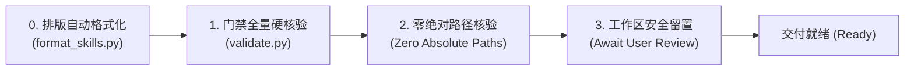

# 国际开放 Agent 研发工程规范与跨生态准则 (Universal Agent Engineering Specification)

本项目遵循全球主流 AI 基础设施与 Agent 开放软件工程标准（Open Agent Skills、agent-plugins.org、MCP）。所有操作本项目的 Agent 必须严格执行以下工程规范，坚决杜绝厂商私有锁定 (Vendor-Neutral)。

---

## 1. 架构定位：中立开放标准体系 (Vendor-Neutral Standards)

本仓库构建的是**跨客户端原生的通用技能与能力库**，杜绝针对单一宿主的专有适配：
- **开放规范源头**：技能遵循 **Open Agent Skills Specification**，插件元数据遵循 **Agent Plugins Specification 1.0.0**，工具遵循 **Model Context Protocol (MCP)**；
- **禁止私有补丁**：严禁创建单一宿主专属的隐藏适配目录（如 `.claude-plugin/`、`.cursor/` 等）。

---

## 2. 技能微内核架构规范 (Microkernel Skill Architecture)

### 2.1 物理目录拓扑与职责解耦
位于 `skills/` 下的每一个子技能必须遵循物理自闭环的原子结构：

```text
skills/<skill-name>/
├── SKILL.md                  # [必需] 核心编排入口：元数据声明、主干状态机与知识地图路由
├── references/               # [推荐] 输入型知识层（Agent 读入上下文）：执行协议、行业标准、交付模板
│   ├── protocols/            # 交互/分批/核验协议
│   └── templates/            # 交付级文档或代码模板
├── scripts/                  # [可选] 确定性可执行脚本（跨平台、零依赖）
├── examples/                 # [可选] 案例样本层：输入输出样例与真实案例
└── assets/                   # [可选] 输出型资产层（仅用于向用户输出，严禁预载入上下文）：样板代码、图标
```

- **输入知识 (`references/`) 与输出资产 (`assets/`) 严格隔离**：`references/` 专供 Agent 在特定执行阶段 JIT 读入上下文指导推演；`assets/` 仅由 Agent 在产出阶段直接复制或生成至用户项目，**严禁将其作为提示词预加载进上下文**。
- **目录纯粹性 (What NOT to Include)**：`SKILL.md` 是技能目录下唯一的文档入口。**严禁在技能目录下创建 `README.md`、`INSTALLATION.md`、`CHANGELOG.md` 等人类辅助文档**，防止污染语义路由与检索向量。

### 2.2 三级渐进式披露生命周期 (Three-Tier Progressive Disclosure)
为防止一次性加载引发上下文膨胀与注意力衰减，所有技能必须服从渐进式披露模型：

1. **L1 全局发现层 (Discovery Phase)**：启动时仅索引 Frontmatter（`name` 与 `description`），单技能消耗控制在 ~50 tokens 内；
2. **L2 工作流路由层 (Routing Phase)**：意图命中时仅加载 `SKILL.md` 主入口。
   - **轻量状态机红线**：`SKILL.md` 正文严格控制在 **80~120 行内**；
   - **知识下沉原则**：凡超 30 行的具体协议、超 50 行的文档/代码模板，**一律下沉至 `references/`**；
3. **L3 深度执行层 (Execution Phase / JIT)**：仅在推进到对应工作流节点时，方可按需加载 `SKILL.md` 引用的 `references/` 深度文档。

### 2.3 引用扁平化与长文档结构化
- **单层扁平引用 (Single-Level References)**：所有 `references/` 文档必须由 `SKILL.md` 一级直链（Keep references one level deep），**严禁在参考文档之间形成级联深层跳转**；
- **长文档目录基线**：凡超过 100 行的 `references/` 深度文档，顶部必须显式提供 Markdown 目录 (TOC)，便于按需切片加载。

---

## 3. Frontmatter 元数据契约 (Frontmatter Specification)

YAML Frontmatter 是 Agent 全库语义路由的唯一索引，仅允许使用标准白名单属性：

```yaml
---
name: at-<skill-name>
description: 当用户需要 [高频场景动词] 时使用此技能。提供 [核心能力]，交付 [标准化输出]。
disable-model-invocation: false    # [可选] 为 true 时仅限人工显式斜杠命令触发，禁止模型自发唤醒
disable-slash-command: false       # [可选] 为 true 时不注册为斜杠命令，仅作为内部隐式技能
argument-hint: "[param-pattern]"   # [可选] 斜杠命令参数提示符
allowed-tools:                     # [可选] 最小特权原则工具白名单
  - view_file
  - run_command
license: Apache-2.0                # [可选] 开源许可证
metadata:                          # [可选] 扩展元数据
  author: Ateng
  version: 1.0.0
  tags: [architecture, technical-doc]
---
```

### 3.1 字段约束与触发工程基线
- **`name`** (string, **必需**)：最大 64 字符，严格遵循 kebab-case（`^[a-z0-9]+(-[a-z0-9]+)*$`），统一使用组织命名空间前缀 `at-`；
- **`description`** (string, **必需**)：最大 1024 字符，客观第三人称陈述（“当用户需要...时使用”）；严禁使用 `<` 或 `>` 尖括号；涵盖 4~6 个高频业务意图动词；触发判断依据 100% 收敛于 description 中，禁止在正文 Body 开设“何时使用”小节；
- **顶层白名单防御**：除上述标准属性外，严禁在 Frontmatter 顶层平铺非标自定义属性。

---

## 4. Markdown 排版与通用可视化红线 (Markdown Standards)

- **盘古之白排版**：严格在中文字符与西文字符、数字之间保留一个半角空格；
- **标准相对路径互链**：文档内部互链 100% 采用标准相对路径（`./` 或 `../`）；**严禁写入 `file:///`、`C:/`、`D:/` 等本地绝对路径与物理盘符**；
- **Mermaid 开放可视化**：图表 100% 采用开放标准 Mermaid 语法编写；节点文本包含括号或特殊字符时显式使用双引号包裹，如 `Node["服务网关 (Gateway)"]`。

---

## 5. 跨平台脚本与可执行工具准则 (Script Portability & Tooling)

### 5.1 运行时与环境基线
- **运行时基线**：优先使用 Python (>= 3.10) 或 Node.js (>= 18)；
- **零额外依赖红线 (Zero-Dependency)**：完全依托语言原生标准库（如 Python `urllib`、`pathlib`、`json`），**坚决杜绝需要前置 `pip install` 或 `npm install` 的外部依赖**；
- **路径与环境抽象**：统一使用原生路径模块（`pathlib.Path`）或标准正斜杠 `/`，严禁硬编码 Windows 反斜杠 `\`；配置与凭据统一从环境变量读取。

### 5.2 内部公共模块与终端输出纪律
- **私有公共模块隔离**：跨脚本共享的通用基础设施统一抽取至以下划线 `_` 开头的内部私有模块（如 `scripts/_common.py`），严禁暴露为独立 CLI 入口；
- **终端环境自适应与管道降级 (TTY & Color Neutrality)**：
  - 必须检测 `sys.stdout.isatty()` 与 `NO_COLOR` 环境变量；
  - 输出重定向至文件、CI 管道或被其他进程捕获时，**必须自动剥离 ANSI 颜色转义序列**，输出纯文本，严禁控制码污染日志；
  - 交互终端支持 Windows 10+ 虚拟终端激活，通过彩色状态徽标与结构化表格呈现高清晰度报告。

---

## 6. 插件元数据与制品标准 (Plugin & Package Benchmark)

- **插件清单规范**：根目录 `plugin.json` 严格遵循 `agent-plugins.org` 1.0.0 清单标准；厂商特定扩展元数据收口于 `extensions.<host>` 命名空间；
- **单技能制品规范 (.skill)**：
  - 基于标准 Zip 压缩归档，统一命名为 `<skill-name>-v<version>.skill`；
  - 归档内根节点保留技能顶层目录名（如 `at-tech-doc/SKILL.md`），解压后物理自闭环；
  - 强绑定前置门禁：只有 100% 通过死链、Frontmatter 与排版校验的技能允许打包导出；
  - 打包过程物理排除 `.DS_Store`、`Thumbs.db`、`desktop.ini`、`__pycache__` 等环境噪音文件。

---

## 7. 质量门禁与交付基线 (Definition of Done)

在声明“新技能开发完成”或“存量技能重构完成”之前，必须完成以下闭环门禁自检：



### 7.1 可检验完成指标 (Checkable Completion Criteria)
1. **排版格式合规**：执行 `python scripts/format_skills.py --check` 返回退出码 0（所有中西文/数字间空格合规）；
2. **质量门禁 100% 绿灯**：执行 `python scripts/validate.py` 返回退出码 0（死链 0 处、Frontmatter 100% 合规、无反模式冗余文件）；
3. **零绝对路径泄漏**：Markdown 正文与活动链接无任何 `file:///` 或本地盘符泄漏；
4. **Git 两级显式授权原则**：所有修改默认停留在工作区供人类审阅；**未收到用户显式指令（“提交”或“推送”）前，严禁自主执行 `git commit` 或 `git push`**；
5. **本地私有资产隔离**：本地环境定制脚本统一收口于 `.local/`，受 `.gitignore` 保护，严禁入库。
