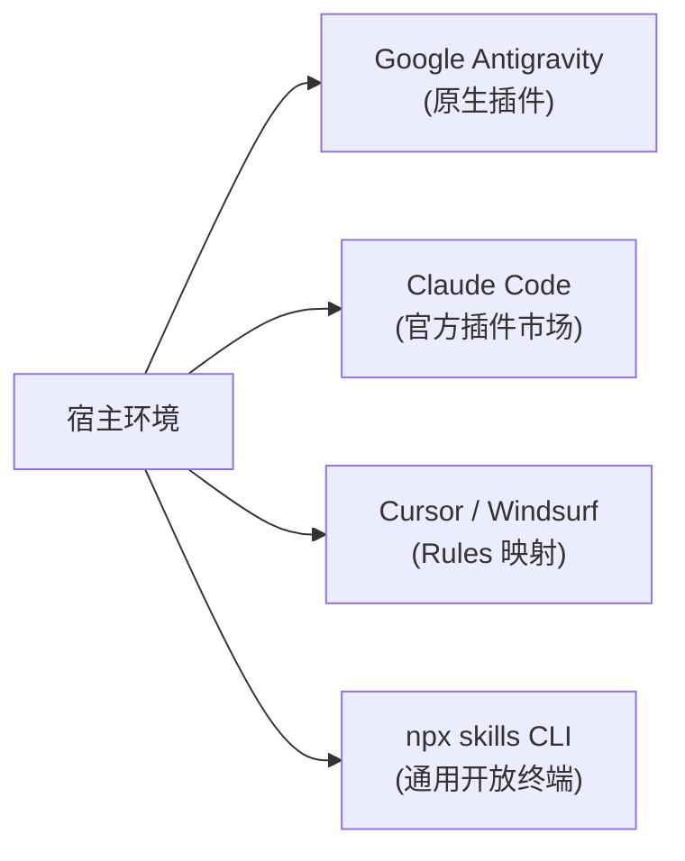
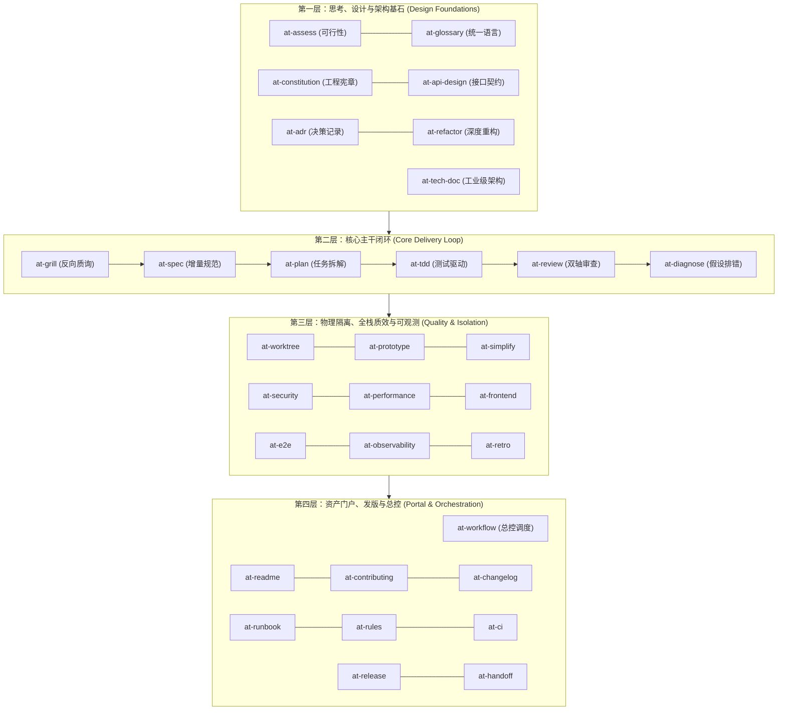

# Ateng Skills (全生命周期 AI Agent 软件工程技能库)

<div align="center">

[](https://github.com/atengk/skills/actions)
[](LICENSE)
[](https://www.python.org/)
[](https://agent-plugins.org)
[](#6-31-项全生命周期技能全景索引大表格)
[](#7-工程质量门禁与自律准则)

**跨客户端原生 (Vendor-Neutral) · 31 项微内核技能 · 30 篇伴随手册 · 5 大实战配方 · 工业级质量门禁**

让你的 AI 编程助手（Google Antigravity、Claude Code、Cursor、Windsurf、Cline、Aider 等）具备资深架构师与全栈工程师级别的全生命周期软件工程能力。

</div>

---

## 1. 项目核心定位与设计哲学

本项目（`atengk/skills`）严格遵循 **Open Agent Skills Specification** 国际标准与 **Agent Plugins Specification 1.0.0** 规范，是一套面向全生命周期软件工程的专业级 AI Agent 技能与能力库。坚决杜绝针对单一宿主的私有补丁或平台锁定，恪守以下三大工程哲学：

- **微内核与三级渐进式披露 (Three-Tier Progressive Disclosure)**：
  - **L1 全局发现层**：启动时仅索引 YAML Frontmatter（`name` 与 `description`），单技能仅消耗 ~50 tokens；
  - **L2 工作流路由层**：意图命中时仅加载 `SKILL.md`，正文严格控制在 **80~83 行** 的极精简状态机；
  - **L3 深度执行层**：推进到对应工作流节点时，通过内置工具按需（JIT）读入 `references/` 深度协议，从根源上杜绝注意力衰减与上下文爆炸。
- **原子解耦与输入/输出物理隔离**：
  - 输入型知识（`references/`）指导 Agent 思考推演；
  - 输出型资产（`assets/`）仅供向用户项目导出交付，严禁预载污染上下文；
  - 目录极致纯粹，杜绝反模式冗余文件。
- **刚性质量门禁与防腐纪律 (Rigorous DoD)**：
  - 强制全流程测试驱动开发（TDD 先红后绿）；
  - 标准与规格双轴严格代码审查；
  - 全库盘古之白排版、零死链与零本地绝对路径泄漏；
  - Git 两级显式授权原则：未获人类字面指令严禁越权提交或推送。

---

## 2. 30 秒极速上手与多端安装 (Quickstart)

无论你使用哪款现代 AI 编程客户端，均可在 30 秒内完成一键安装：



### 2.1 主流平台一键安装指令

| 宿主客户端 | 一键安装 / 挂载命令 | 详细安装指南直达 |
| :--- | :--- | :--- |
| **Google Antigravity** | `agy plugin install https://github.com/atengk/skills` | [Antigravity 安装指南](docs/install/antigravity.md) |
| **Claude Code** | `claude plugin add https://github.com/atengk/skills` | [Claude Code 安装指南](docs/install/claude-code.md) |
| **Cursor / Windsurf** | 映射 `.cursor/rules/` 规则并挂载 `docs/` 知识库 | [Cursor & Windsurf 接入指南](docs/install/cursor-windsurf.md) |
| **通用跨端 (Cline / Aider)** | `npx skills add atengk/skills` | [通用 CLI 分发指南](docs/install/open-skills-cli.md) |

### 2.2 首轮连通性验证
安装完成后，在对话窗口输入以下指令验证连通性：

```bash
# 唤醒总控路由器场景向导菜单
/at-workflow menu

# 或查看任意技能的五段式速查卡片
/at-workflow help at-tdd
```

---

## 3. 场景化实战配方导航 (Cookbook Cards)

面向高频工程研发场景，我们沉淀了 5 大标准化实战工作流配方（Cookbook）。每篇配方均包含场景定位、Mermaid 状态机、交互提示词、端到端演进样例与踩坑预警：

| 配方卡片 | 核心业务场景 | 串联技能链路 | 配方手册直达 |
| :--- | :--- | :--- | :---: |
| **🚀 配方 1：全新特性敏捷研发流** | 新需求从模糊想法到生产上线 | `/at-grill` ➔ `/at-spec` ➔ `/at-plan` ➔ `/at-worktree` ➔ `/at-tdd` ➔ `/at-review` ➔ `/at-release` | [查看配方 1](docs/workflows/01-feature-development.md) |
| **🐛 配方 2：线上缺陷排查与热修流** | 生产突发故障、偶发 Bug 科学定位与止血 | `/at-diagnose` ➔ `/at-worktree` ➔ `/at-tdd` (红灯复现) ➔ `/at-tdd` (转绿) ➔ `/at-review` ➔ `/at-retro` | [查看配方 2](docs/workflows/02-hotfix-debugging.md) |
| **⚡ 配方 3：存量代码治理与重构流** | 消除上帝类、圈复杂度压降与领域防腐 | `/at-glossary` ➔ `/at-adr` ➔ `/at-refactor` ➔ `/at-simplify` ➔ `/at-tdd` | [查看配方 3](docs/workflows/03-legacy-refactoring.md) |
| **🛡️ 配方 4：开源门面与规约建设流** | 规范项目主门面、贡献指引与 CI 门禁 | `/at-constitution` ➔ `/at-readme` ➔ `/at-contributing` ➔ `/at-rules` ➔ `/at-ci` | [查看配方 4](docs/workflows/04-open-source-portal.md) |
| **📦 配方 5：跨会话大任务长跑自治流** | 超长任务接力、上下文压缩与断点恢复 | `/at-plan` ➔ `/at-worktree` ➔ `/at-handoff` ➔ 新会话一键唤醒 | [查看配方 5](docs/workflows/05-autonomous-handoff.md) |

---

## 4. 四层金字塔架构全景 (Architecture Topology)

全库 31 项微内核技能按照软件工程生命周期解耦为清晰的四层金字塔架构：



---

## 5. 目录拓扑与文件结构 (Repository Structure)

```text
skills/
├── .github/workflows/        # GitHub Actions CI 自动化流水线
├── AGENTS.md                 # 国际开放 Agent 研发工程规范与跨生态准则
├── plugin.json               # 插件元数据契约清单 (agent-plugins.org 1.0.0)
├── docs/                     # 人类伴随文档与知识中心
│   ├── install/              # 多端安装与配置指南 (Antigravity / Claude / Cursor / CLI)
│   ├── workflows/            # 场景化实战工作流配方库 (5 大高频 Cookbook)
│   └── skills/               # 全量微内核技能伴随使用指南 (五段式参考手册)
├── scripts/                  # 自动化工程工具链 (Python 标准库零外部依赖)
│   ├── _common.py            # 底层终端引擎、YAML 状态机与 Markdown 扫描器
│   ├── format_skills.py      # 盘古之白中西文空格与排版自动修复器 (支持 --check)
│   ├── validate.py           # DoD 质量门禁全量校验器 (清单/拓扑/死链/绝对路径)
│   ├── init_skill.py         # 新技能微内核拓扑脚手架生成器
│   └── package_skill.py      # 单技能打包导出器 (.skill 开放制品)
└── skills/                   # 核心微内核技能集合 (31 项独立原子自闭环目录)
    ├── at-workflow/          # 全生命周期研发工作流总控路由技能
    ├── at-tech-doc/          # 工业级技术文档与架构设计方案生成技能
    ├── at-grill/             # 苏格拉底式反向质询与需求压力测试技能
    └── ... (其余 28 项微内核技能目录)
```

---

## 6. 31 项全生命周期技能全景索引大表格

| 层次分类 | 技能标识 | 触发命令 | 核心工程职责 | 伴随手册直达 |
| :--- | :--- | :--- | :--- | :---: |
| **L1 架构基石** | `at-assess` | `/at-assess` | 创意可行性预研与五维量化 Spike 评估分析 | [查看手册](docs/skills/at-assess.md) |
| **L1 架构基石** | `at-glossary` | `/at-glossary` | DDD 领域统一语言提炼与根目录 `GLOSSARY.md` 防腐治理 | [查看手册](docs/skills/at-glossary.md) |
| **L1 架构基石** | `at-constitution` | `/at-constitution` | 刚性工程宪章确立与前置架构熔断守卫治理 | [查看手册](docs/skills/at-constitution.md) |
| **L1 架构基石** | `at-api-design` | `/at-api-design` | 现代 RESTful 接口契约设计与 API-First 标准化 | [查看手册](docs/skills/at-api-design.md) |
| **L1 架构基石** | `at-adr` | `/at-adr` | 架构决策记录治理与 MADR 3.0 生命周期管理 | [查看手册](docs/skills/at-adr.md) |
| **L1 架构基石** | `at-refactor` | `/at-refactor` | 深度模块架构演进与架构异味增量微重构 | [查看手册](docs/skills/at-refactor.md) |
| **L1 架构基石** | `at-tech-doc` | `/at-tech-doc` | 工业级技术方案、特性 RFC、数据库设计与技术文档生成 | [查看入口](skills/at-tech-doc/SKILL.md) |
| **L2 核心闭环** | `at-grill` | `/at-grill` | 苏格拉底式反向压迫质询与构建者视角反审压力测试 | [查看手册](docs/skills/at-grill.md) |
| **L2 核心闭环** | `at-spec` | `/at-spec` | 增量变更契约拟定与变更原子化定义规格书 | [查看手册](docs/skills/at-spec.md) |
| **L2 核心闭环** | `at-plan` | `/at-plan` | 拓扑依赖感知微任务拆解与示踪弹编排 | [查看手册](docs/skills/at-plan.md) |
| **L2 核心闭环** | `at-tdd` | `/at-tdd` | 强纪律测试驱动开发与变异测试坏味道消除 | [查看手册](docs/skills/at-tdd.md) |
| **L2 核心闭环** | `at-review` | `/at-review` | 标准与规格双轴代码审查门禁与缺陷拦截 | [查看手册](docs/skills/at-review.md) |
| **L2 核心闭环** | `at-diagnose` | `/at-diagnose` | 科学假设驱动排错与根因定位状态机推演 | [查看手册](docs/skills/at-diagnose.md) |
| **L3 质效隔离** | `at-worktree` | `/at-worktree` | 基于 Git Worktree 的物理独立环境隔离与多任务并行 | [查看手册](docs/skills/at-worktree.md) |
| **L3 质效隔离** | `at-prototype` | `/at-prototype` | 复杂状态机单文件低成本抛弃型原型验证探针 | [查看手册](docs/skills/at-prototype.md) |
| **L3 质效隔离** | `at-simplify` | `/at-simplify` | 奥卡姆剃刀代码极简主义、前置卫语句与控制流扁平化 | [查看手册](docs/skills/at-simplify.md) |
| **L3 质效隔离** | `at-security` | `/at-security` | OWASP Top 10 全栈安全加固、IDOR 防御与零明文凭据治理 | [查看手册](docs/skills/at-security.md) |
| **L3 质效隔离** | `at-performance` | `/at-performance` | 全栈性能瓶颈剖析、SQL 执行计划调优与多级缓存架构 | [查看手册](docs/skills/at-performance.md) |
| **L3 质效隔离** | `at-frontend` | `/at-frontend` | 现代前端受控组件分层、状态机驱动与 WCAG 2.1 AA 无障碍 | [查看手册](docs/skills/at-frontend.md) |
| **L3 质效隔离** | `at-e2e` | `/at-e2e` | 端到端全链路自动化验收、Playwright 黄金旅程与 Trace 留痕 | [查看手册](docs/skills/at-e2e.md) |
| **L3 质效隔离** | `at-observability` | `/at-observability` | 生产级三位一体可观测性设计（RED/USE 指标、分布式链路与探针） | [查看手册](docs/skills/at-observability.md) |
| **L3 质效隔离** | `at-retro` | `/at-retro` | 5 Whys 故障根因溯源、无指责事后复盘与工程防腐改进 | [查看手册](docs/skills/at-retro.md) |
| **L4 门户总控** | `at-workflow` | `/at-workflow` | 全生命周期研发工作流总控路由、场景意图向导与端内帮助 | [查看手册](docs/skills/at-workflow.md) |
| **L4 门户总控** | `at-readme` | `/at-readme` | 工业级项目门面与全景导航生成（状态徽标、架构图、快速开始） | [查看手册](docs/skills/at-readme.md) |
| **L4 门户总控** | `at-contributing` | `/at-contributing` | 标准化开源贡献指南与开发者工作流（PR 规范、分支策略） | [查看手册](docs/skills/at-contributing.md) |
| **L4 门户总控** | `at-changelog` | `/at-changelog` | Keep a Changelog 规范的版本变更日志自动化维护与 SemVer 绑定 | [查看手册](docs/skills/at-changelog.md) |
| **L4 门户总控** | `at-runbook` | `/at-runbook` | 生产运维排错与应急响应操作手册（SOP、告警止血、应急降级） | [查看手册](docs/skills/at-runbook.md) |
| **L4 门户总控** | `at-rules` | `/at-rules` | Agent 工程行为规约与项目级规则编排（`AGENTS.md` / rules 维护） | [查看手册](docs/skills/at-rules.md) |
| **L4 门户总控** | `at-ci` | `/at-ci` | GitHub Actions / 现代 CI 流水线门禁配置与自动化质量核验 | [查看手册](docs/skills/at-ci.md) |
| **L4 门户总控** | `at-release` | `/at-release` | 上线起飞检查清单核查、SemVer 版本锁定与增量规范归档 | [查看手册](docs/skills/at-release.md) |
| **L4 门户总控** | `at-handoff` | `/at-handoff` | 跨会话上下文无损压缩、四象限信息提炼与自解释长跑交接棒 | [查看手册](docs/skills/at-handoff.md) |

---

## 7. 工程质量门禁与自律准则 (Engineering Benchmark)

本项目在自动化流水线中配置了严格的 Definition of Done (DoD) 四道质量防线，开发者与外部贡献者可依托本地内置工具链一键校验：

### 7.1 排版门禁与盘古之白
严格保证中文字符与西文字符、数字之间保留一个半角空格，消除人工排版负担：
```bash
# 检查全库 Markdown 排版合规性
python scripts/format_skills.py --check

# 一键自动排版修复
python scripts/format_skills.py
```

### 7.2 质量门禁全量自检 (validate.py)
在代码提交或 PR 合并前，执行全库静态门禁自检：
```bash
# 执行完整门禁自检
python scripts/validate.py
```
- **门禁 1**：根目录 `plugin.json` 清单标准契约校验；
- **门禁 2 & 3**：31 项技能 YAML Frontmatter 白名单、Kebab-case 命名与 `SKILL.md` 正文 80~83 行微内核红线校验；
- **门禁 4**：全库交付物零本地绝对路径、零物理盘符与 `file:///` 协议泄漏检测；
- **门禁 5**：`docs/` 知识库与全技能参考文档物理相对死链 100% 连通校验。

### 7.3 单技能制品导出与打包 (.skill)
```bash
# 打包导出指定技能
python scripts/package_skill.py skills/at-tdd

# 批量打包导出全库所有技能
python scripts/package_skill.py --all
```

---

## 8. 开源协作与行为守则 (Contributing & Community)

- **研发规范与行为准则**：参与贡献前，请仔细阅读 [AGENTS.md](AGENTS.md)，严格遵守盘古之白排版、相对路径互链与 Git 两级显式授权原则；
- **贡献者指南参考**：详见 [at-contributing 技能手册](docs/skills/at-contributing.md)；
- **开源许可证**：本项目采用 [Apache-2.0](LICENSE) 国际开源许可证。
