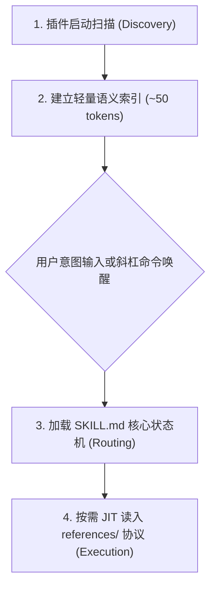

# Google Antigravity 原生环境插件与技能配置指南

本文档指导开发者在 Google Antigravity (AGY) 2.0 及 Antigravity IDE 原生环境中接入、配置、验证与升级 `atengk/skills` 工业级全生命周期软件工程技能库。

---

## 1. 生态定位与原生架构优势

Google Antigravity 采用先进的 Agent 微内核架构，原生支持技能（Skills）、规则（Rules）、插件（Plugins）与 MCP 扩展体系。接入 `atengk/skills` 技能库后，开发者可在 Antigravity 环境中获得以下原生增强：
- **原生三级渐进式披露**：启动时仅建立轻量级 Frontmatter 语义路由索引（~50 tokens / 技能），任务推进时按需加载 `SKILL.md` 与深度 `references/` 协议，杜绝大模型注意力衰减与上下文膨胀；
- **斜杠命令与自然语言双模触发**：既支持显式输入 `/at-workflow`、`/at-plan`、`/at-tdd` 等斜杠命令直接唤醒，也支持在日常对话中由模型根据意图自动检索激活；
- **最小特权工具契约**：严格限定每个技能的 `allowed-tools` 白名单，隔离沙箱与高危系统命令；
- **跨平台与零额外依赖**：全库内置脚本依托 Python 3.10+ 标准库，在 Windows、macOS 与 Linux 上开箱即用。

---

## 2. 极速安装与配置方式

### 2.1 方式一：Antigravity CLI 一键远程安装 (推荐)

在终端中执行官方插件安装命令，直接从 GitHub 仓库拉取最新发布版本：

```bash
# 从官方 GitHub 仓库安装技能插件包
agy plugin install https://github.com/atengk/skills

# 查看已成功加载的插件列表与版本状态
agy plugin list
```

### 2.2 方式二：本地研发模式工作区挂载 (面向贡献者与内网开发者)

若您在本地克隆了本项目或处于局域网/离线环境，可在工作区根目录执行本地软链接或安装：

```bash
# 克隆仓库至本地开发目录
git clone https://github.com/atengk/skills.git
cd skills

# 以本地路径形式挂载至 Antigravity 插件注册表
agy plugin install .

# 或直接复制至 Antigravity 全局插件存储路径
# Windows: %USERPROFILE%\.gemini\antigravity\plugins\ateng-skills
# macOS/Linux: ~/.gemini/antigravity/plugins/ateng-skills
```

### 2.3 方式三：项目级工程嵌入 (.agents/skills)

如果您希望将特定技能私有化绑定至当前具体工程代码库：
1. 在目标项目根目录下创建 `.agents/skills/` 目录；
2. 将本库中的 `skills/` 下所需子目录（如 `at-workflow/`、`at-tdd/`）直接复制至该目录；
3. Antigravity 启动时将优先索引项目级 `.agents/skills/`，实现工程私有化覆盖。

---

## 3. 插件清单与技能自动发现机制

本仓库根目录内置符合 `agent-plugins.org` 规范的 [plugin.json](../../plugin.json) 契约清单。Antigravity 的发现引擎遵循以下三级生命周期：



1. **L1 全局发现层**：Antigravity 读取每个技能的 YAML Frontmatter（`name`、`description`），注入会话路由表；
2. **L2 工作流路由层**：命中意图或输入 `/at-<skill-name>` 时，加载 80~83 行的轻量状态机正文；
3. **L3 深度执行层**：推进到对应工作流节点时，通过内置 `view_file` 工具 JIT 读取 `references/` 协议与模板。

---

## 4. 首轮激活与连通性验证

安装完成后，打开 Antigravity 会话窗口，执行以下验证测试：

### 4.1 测试一：检查插件装载状态与斜杠命令补全
在对话输入框中键入斜杠 `/`，观察自动联想列表：
- 是否出现 `/at-workflow`、`/at-plan`、`/at-grill`、`/at-tdd` 等技能提示；
- 提示参数是否正确显示（如 `/at-workflow [guide|menu|recipe|help [skill]|orchestrate]`）。

### 4.2 测试二：唤醒总控路由诊断向导
发送以下指令唤醒总控路由：

```text
/at-workflow menu
```

**预期输出**：Antigravity 应在会话中渲染结构化的场景选择卡片（新特性流、热修流、重构流、开源门面流、发版交接流），并等待您的选择。

### 4.3 测试三：单技能帮助参数响应
发送以下指令测试即时帮助响应：

```text
/at-workflow help at-tdd
```

**预期输出**：直接在会话中渲染 `at-tdd` 技能的五段式卡片摘要（定位、适用场景、三步循环工作流、输入输出契约与伴随手册直链）。

---

## 5. 权限配置与工具白名单说明

Antigravity 遵循最小特权原则（PoLP）。每个技能在其 `SKILL.md` 中声明了 `allowed-tools` 白名单：
- **只读分析技能**（如 `at-assess`、`at-review`）：通常仅申请 `view_file` 与代码扫描能力；
- **执行与重构技能**（如 `at-tdd`、`at-simplify`、`at-ci`）：申请 `view_file`、`replace_file_content`、`write_to_file` 与 `run_command`；
- **网络与外部协作技能**：按需申请 MCP 工具。

> [!NOTE]
> 在执行具备修改行为的技能时，Antigravity 会根据环境配置弹出工具调用授权弹窗。建议对受信任的项目目录开启自动放行，以保证流畅的研发体验。

---

## 6. 版本更新、排错与卸载

### 6.1 更新至最新版本
```bash
# 检查更新并拉取远端最新版本
agy plugin update ateng-skills
```

### 6.2 常见问题排错 (Troubleshooting)

| 异常现象 | 可能诱因 | 解决方案 |
| :--- | :--- | :--- |
| 输入 `/at-` 未出现自动补全 | 插件未被激活或缓存未刷新 | 执行 `agy plugin list` 确认状态；重启 Antigravity 会话窗口 |
| 执行脚本提示 Python 命令未找到 | 系统环境变量缺失 Python 3.10+ | 安装 Python 3.10+ 并确保 `python` / `python3` 位于系统 `PATH` 中 |
| 提示工具调用权限被拒绝 | `allowed-tools` 限制或客户端拦截 | 在 Antigravity 设置中检查工作区工具权限策略，允许读写与命令执行 |

### 6.3 卸载插件
```bash
# 卸载技能插件包
agy plugin uninstall ateng-skills
```

---

## 7. 相关资源与延伸阅读

- [全生命周期研发工作流向导手册](../skills/at-workflow.md)
- [配方 1：全新特性从零到一敏捷开发流](../workflows/01-feature-development.md)
- [基于 npx skills CLI 的跨端通用分发指南](./open-skills-cli.md)
