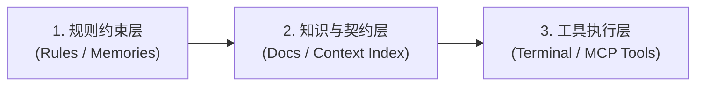

# Cursor 与 Windsurf 现代 AI IDE 环境接入指南

本文档指导开发者在 Cursor IDE 与 Codeium Windsurf 等基于 VS Code 架构的现代 AI 辅助研发环境中接入、映射与使用 `atengk/skills` 软件工程技能库。

---

## 1. 架构原理与 IDE 接入机制

Cursor 与 Windsurf 提供了强大的上下文感知、规则约束与 Agent 编码循环能力。将本技能库与这些 IDE 结合时，主要依托以下三层架构：



1. **规则约束层 (Rules Layer)**：通过 `.cursor/rules/`（Cursor）或全局/工作区规则（Windsurf），将技能库核心纪律（盘古之白排版、TDD 强纪律、零绝对路径、Git 两级授权）固化为底座准则；
2. **知识与契约层 (Context Layer)**：将本库的 `skills/` 与 `docs/` 挂载为 IDE 知识库或文件上下文，让 IDE Agent 能按需阅读 `references/` 下的协议与模板；
3. **工具执行层 (Execution Layer)**：借助 IDE 原生终端或 MCP (Model Context Protocol) 插件系统，执行自动化单测、门禁校验脚本与 Git 操作。

---

## 2. Cursor IDE 接入与配置

### 2.1 规则映射配置 (.cursor/rules/)

在您的业务项目根目录下创建 `.cursor/rules/agent-skills.mdc` 文件，将本库的核心工程规约注入 Cursor 上下文：

```markdown
---
description: 遵循国际开放 Agent 软件工程技能库规范与纪律
globs: *
alwaysApply: true
---

# 研发纪律与技能调度总则

在执行本项目的架构设计、编码与重构任务时，严格服从以下工作流规范：
1. **需求明确前前置质询**：遇到模糊需求时，必须主动使用反向质询思维（参考 `at-grill` 协议），澄清业务边界与异常分支，严禁擅自假定；
2. **测试驱动开发 (TDD)**：编写新功能或修复 Bug 时，严格执行 `at-tdd` 三步循环（红灯测试先行 -> 编写最简实现 -> 重构与坏味道清理）；
3. **架构与代码极简**：严格遵循 `at-refactor` 与 `at-simplify` 原则，消灭大而全上帝类，控制函数圈复杂度，消除多层深嵌套；
4. **Git 两级显式授权**：所有代码修改仅保留在工作区供人类开发者审阅，严禁自主执行 `git commit` 或 `git push`；
5. **排版与路径约束**：中文与西文/数字之间保留半角空格，文档内 100% 采用相对路径，严禁泄露本地绝对物理路径。
```

### 2.2 在 Cursor Docs 中挂载技能参考手册
1. 打开 Cursor 设置面板（Settings -> Features -> Docs）；
2. 点击 **Add new doc**；
3. 将本地 `docs/` 或 GitHub 在线文档地址（`https://github.com/atengk/skills`）添加为文档索引源；
4. 在 Cursor Composer（`Ctrl + I` 或 `Cmd + I`）中，即可通过 `@docs` 快速检索 31 项技能与实战配方。

---

## 3. Windsurf IDE 接入与配置

### 3.1 工作区规则与记忆管理 (Workspace Rules & Memories)

在业务项目的根目录创建 `.windsurfrules` 文件：

```markdown
# Windsurf 全局软件工程行为准则

- 遇到复杂架构任务时，主动查阅并遵循 `atengk/skills` 技能库推荐的六大流水线配方；
- 编写代码前必须先建立单元测试保障；
- 模块设计遵循单一职责与深度模块原则，杜绝无意义的微小文件碎片化与庞大上帝类；
- 遇到超过当前会话容量的长时任务，在结束前生成遵循 `at-handoff` 格式的上下文交接备忘录。
```

### 3.2 上下文文件精准引用
在 Windsurf Cascade 对话框中，可以通过 `@` 符号精准引用特定技能规范：
- 输入 `@skills/at-api-design/SKILL.md`：让 Windsurf 遵循 API-First 设计规范编写 OpenAPI 契约；
- 输入 `@skills/at-tdd/SKILL.md`：让 Windsurf 启动红绿重构严密单测循环。

---

## 4. MCP 工具链联动配置 (Model Context Protocol)

Cursor 与 Windsurf 均原生支持 MCP 协议。为了让 IDE Agent 能够充分发挥外部工具能力，可在 `cursor-settings.json` 或 `mcp.json` 中配置相关服务器：

```json
{
  "mcpServers": {
    "git-tools": {
      "command": "npx",
      "args": ["-y", "@modelcontextprotocol/server-git"]
    },
    "filesystem": {
      "command": "npx",
      "args": ["-y", "@modelcontextprotocol/server-filesystem", "./"]
    }
  }
}
```

配置后，IDE 即可在执行 `at-worktree`（隔离分支管理）、`at-ci`（流水线调试）等技能时获得底层原生工具支撑。

---

## 5. 常见问题与最佳实践

### 5.1 如何避免 IDE 一次性加载过多技能造成上下文超限？
- 遵循三级渐进式披露原则：在 Rules 中仅声明关键原则与技能索引；
- 仅在具体执行某阶段时，使用 `@` 引用具体的 `SKILL.md`；
- 避免在提示词中全量粘入所有技能的 `references/` 协议。

### 5.2 如何在 IDE 终端运行本库内置门禁脚本？
在 IDE 的内置终端中，直接运行：
```bash
# 检查排版合规性
python scripts/format_skills.py --check

# 执行全库质量门禁自检
python scripts/validate.py
```

---

## 6. 相关资源与延伸阅读

- [Google Antigravity 原生环境插件与技能配置指南](./antigravity.md)
- [Claude Code 官方环境插件与配置指南](./claude-code.md)
- [配方 3：遗留存量代码治理与架构防腐流](../workflows/03-legacy-refactoring.md)
