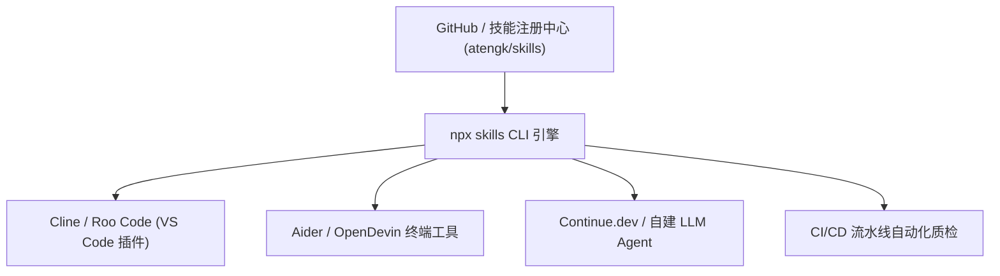

# 基于 npx skills CLI 的跨端通用分发指南

本文档指导开发者通过国际通用的 Agent 技能分发包管理工具（`skills` CLI / `npx skills`）在各类开放 Agent 环境（如 Cline、Roo Code、Aider、OpenDevin、Continue 等）中一键安装、更新与离线部署 `atengk/skills` 软件工程技能库。

---

## 1. 开放 Agent 规范与通用分发架构

为了打破各 AI 宿主厂商的私有生态壁垒，本项目严格遵循 **Open Agent Skills Specification** 开放标准协议。依托标准化的 `skills` CLI，开发者无需手动复制文件或针对单一平台编写适配脚本：



- **免全局安装 (Zero Footprint)**：利用 `npx` 即用即走特性，无需前置安装重型运行时依赖；
- **跨平台完全一致**：在 Windows、macOS 与 Linux 操作系统上提供一致的命令行行为；
- **确定性与原子化解耦**：每个微内核技能在安装时均保持物理目录独立自闭环。

---

## 2. 快速安装与环境接入

### 2.1 一键安装全量技能包 (推荐)

在项目工程根目录或用户主目录下运行以下命令：

```bash
# 从官方 GitHub 仓库拉取并安装全部 31 项微内核技能
npx skills add atengk/skills

# 查看当前已成功安装并注册的技能列表
npx skills list
```

### 2.2 选择性按需安装特定技能
如果您的工程仅需要某几个核心研发闭环能力，可以指定具体技能名称进行轻量化安装：

```bash
# 仅安装 TDD 与双轴代码审查技能
npx skills add atengk/skills --skill at-tdd --skill at-review

# 仅安装总控路由器与任务拆解技能
npx skills add atengk/skills --skill at-workflow --skill at-plan
```

### 2.3 检查安装状态与健康度
```bash
# 验证已安装技能的 YAML Frontmatter 与协议完整性
npx skills verify
```

---

## 3. 在主流开放 Agent 客户端中的挂载实践

### 3.1 Cline / Roo Code (VS Code / Cursor 扩展)
Cline 与 Roo Code 默认支持扫描工作区与全局自定义指令：
1. 运行 `npx skills add atengk/skills` 后，技能文件将被默认安装在 `.agents/skills/` 目录下；
2. 在 Cline 的 **Custom Instructions** 或工作区系统提示词中增加如下指令：
   ```text
   本工作区已挂载 atengk/skills 技能库。请优先阅读 .agents/skills/at-workflow/SKILL.md，
   并根据任务类型按需遵循对应技能的 references/ 执行协议。
   ```
3. 在对话中即可通过自然语言无缝触发对应技能的工作流。

### 3.2 Aider 终端编程助手
在 Aider 会话中，可以通过将核心规范加入对话上下文：
```bash
# 启动 Aider 并直接载入总控路由入口
aider --read skills/at-workflow/SKILL.md
```

### 3.3 Continue.dev 开发者插件
在 Continue 的 `config.json` 中配置自定义 Prompt 模板或 Context Provider：
```json
{
  "customCommands": [
    {
      "name": "workflow",
      "prompt": "请读取技能库 skills/at-workflow/SKILL.md，并针对当前打开的文件与需求评估执行路线。",
      "description": "唤醒全生命周期研发工作流向导"
    }
  ]
}
```

---

## 4. 版本更新、缓存管理与卸载

### 4.1 更新至最新发布版本
```bash
# 检测远程仓库是否有新版本提交并自动更新
npx skills update atengk/skills
```

### 4.2 清理缓存与强制重新拉取
```bash
# 清空本地技能包缓存并重新安装
npx skills cache clean
npx skills add atengk/skills --force
```

### 4.3 卸载技能包
```bash
# 移除已安装的技能库
npx skills remove atengk/skills
```

---

## 5. 企业内网与离线私有源部署

在金融、政企等无法直接访问 GitHub 公网的企业局域网环境中，可以通过以下方案实现私有化部署：

### 5.1 本地 Zip 制品导出与导入
本项目支持将经过完整门禁校验的技能归档为独立的 `.skill` 制品：

```bash
# 在联网构建机上打包归档
git clone https://github.com/atengk/skills.git
cd skills
# 执行质量门禁校验
python scripts/validate.py
# 压缩为离线包
git archive --format=zip --output=ateng-skills-latest.skill HEAD
```

在内网开发机上执行解压导入：
```bash
# 将离线包导入当前项目的技能目录
npx skills add ./ateng-skills-latest.skill
```

### 5.2 企业私有 Git 镜像源
若企业内部搭建了 GitLab、Gitea 或自建 Git 服务，可将官方仓库同步至私有源后直接拉取：
```bash
# 从企业内部私有 Git 镜像安装
npx skills add git@git.internal.example.com:ai/skills.git
```

---

## 6. 相关资源与延伸阅读

- [Google Antigravity 原生环境插件与技能配置指南](./antigravity.md)
- [Claude Code 官方环境插件与配置指南](./claude-code.md)
- [Cursor 与 Windsurf 现代 AI IDE 环境接入指南](./cursor-windsurf.md)
- [配方 4：开源门面装修与工程规约建设流](../workflows/04-open-source-portal.md)
