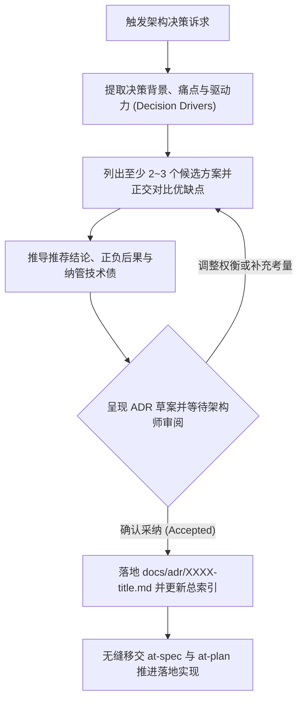

# `at-adr` 技能使用指南：架构决策记录治理与生命周期管理

`at-adr` 是一项践行轻量级架构治理（遵循 MADR 3.0 工业标准）的技能。它将复杂技术选型、重大架构路线变更与 Trade-off 权衡过程固化为结构化、可追溯的《架构决策记录》（ADR），通过状态机全生命周期管辖（Proposed / Accepted / Deprecated / Superseded）与显式技术债纳管，为团队与多 Agent 协同筑牢“为什么这样设计”的知识防线。

---

## 1. 何时使用 (When to Use)

- **核心技术栈选型与替换**：如选择 RocksDB 还是 Redis、引入 Kafka 还是 RocketMQ、选用 GraphQL 还是 REST；
- **重大架构拓扑演进**：单体向微服务拆分、引入事件驱动架构（EDA）、多租户数据隔离方案选型；
- **记录架构折衷与妥协 (Trade-offs)**：面对交付压力选择临时方案时，显式记录技术债务并确立还款时间盒；
- **推翻或升级历史决策**：随着业务发展推翻历史 ADR 时，通过新的 ADR 标记 `Superseded` 替代历史方案，保持架构演进脉络清晰。

---

## 2. 调用语法与参数 (Syntax & Triggers)

### 自然语言唤醒 (推荐)
- “我们决定在会话状态机中引入 RocksDB，请起草一份 MADR 3.0 规范的架构决策记录。”
- “帮我为单体系统拆分服务网关的方案编写一份 ADR，对比 Traefik、Envoy 与 APISIX。”
- “运行 at-adr，记录我们针对分布式事务最终一致性方案的技术选型决策与 Trade-off 权衡。”

### 显式斜杠命令 (若平台支持)
```bash
/at-adr [决策主题或拟记录的选型]
```

---

## 3. 前置依赖输入 (Prerequisites & Inputs)

- **决策背景或痛点说明**：为什么需要做出此项决策、当前系统瓶颈与核心约束；
- **存量 ADR 资产（Agent 自动扫描）**：既有 `docs/adr/` 目录下的历史编号与上下文由 Agent 自主探查。

---

## 4. 执行过程交互 (Execution Flow & Human Interactions)

`at-adr` 执行过程严格遵循诱因提炼、多方案权衡、人机评审与生命周期归档：



1. **自动提炼驱动力**：识别延迟、吞吐量、成本、运维负担等关键核心约束；
2. **正交选项利弊剖析**：必须列出 2~3 个具竞争力的备选路线（含拟采纳方案与现状/主流替代），客观剖析 Good 与 Bad；
3. **人类审阅确认**：展示决策核心理由与正负后果，等待人类架构师确认后以 `Accepted` 状态落盘。

---

## 5. 交付产物与标准 (Outputs & Standards)

执行完毕后交付以下标准化产物：
- **ADR 主文件**：`docs/adr/XXXX-[kebab-case-title].md`（如 `0004-use-rocksdb-for-state-machine.md`）；
- **全局索引更新**：同步更新 `docs/adr/README.md` 的总决策目录索引表；
- **技术债台账**：若包含权宜折衷，生成附带偿还期限的技术债任务；
- **下游工程输入**：平滑移交 `at-spec` 编写承接该决策的功能规格，并由 `at-plan` 拆解落地工序。
