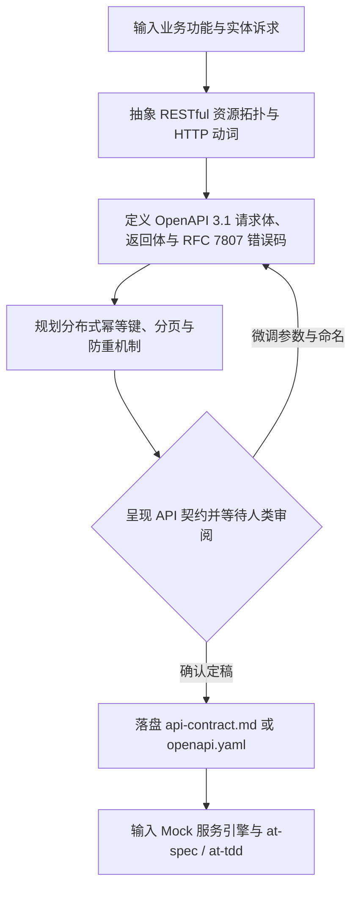

# `at-api-design` 技能使用指南：现代 API 契约设计与演进

`at-api-design` 是一项践行 API-First 工程哲学的现代接口契约设计技能。它将业务需求与领域模型抽象为规范的 RESTful 资源拓扑与 OpenAPI 3.1 规格，内置 RFC 7807 统一错误码、分布式幂等性 Token 机制、游标与偏移分页、向后兼容演进策略，为跨端协同与微服务交互筑牢契约防线。

---

## 1. 何时使用 (When to Use)

- **新业务功能开发前接口定稿 (API-First)**：在编写后端实现代码前，先敲定接口路径、输入参数校验与返回结构，供前端与下游服务并行联调；
- **微服务间 RPC/HTTP 交互契约制定**：跨团队或跨服务交互，需要明确定义状态码、错误类型与重试幂等键；
- **旧接口标准化重构**：存量系统返回体混乱（如各种自定义 `{ code, msg, data }` 或无脑返回 200），需平滑迁移至 RFC 7807 与标准 HTTP 语义；
- **防重复提交与资产资金安全**：设计扣款、退款、下单等关键资金接口时，制定强一致分布式幂等键（`Idempotency-Key`）交互协议。

---

## 2. 调用语法与参数 (Syntax & Triggers)

### 自然语言唤醒 (推荐)
- “请帮我设计一套电商交易订单与支付扣款的 RESTful API 契约。”
- “针对现有用户中心，规划一套 OpenAPI 3.1 规格的个人资料与安全设置接口。”
- “运行 at-api-design，为批量导出和异步任务查询设计符合规范的接口交互流程。”

### 显式斜杠命令 (若平台支持)
```bash
/at-api-design [业务实体或接口范围描述]
```

---

## 3. 前置依赖输入 (Prerequisites & Inputs)

- **业务场景或领域实体说明**：需暴露的业务能力、参与实体及其生命周期状态；
- **存量网关与路由规范（Agent 自动扫描）**：既有工程的前缀路径、鉴权请求头与异常结构由 Agent 自主探查。

---

## 4. 执行过程交互 (Execution Flow & Human Interactions)

`at-api-design` 执行过程严格遵循资源建模、防御推演、人机确认与工具链对接：



1. **自动扫描工程基线**：探测网关路由约定与认证头风格；
2. **正交契约推演**：
   - **资源拓扑**：小写复数名词与层级划分；
   - **语义化状态码**：严格按 200/201/204/400/404/409 处理；
   - **防御机制**：`Idempotency-Key` 校验、分页游标设计、敏感信息脱敏；
3. **人类审阅确认**：展示 OpenAPI 规格与核心参数表，等待人类审阅确认。

---

## 5. 交付产物与标准 (Outputs & Standards)

执行完毕后交付以下标准化产物：
- **API 契约主文档**：`api-contract.md`（或 `openapi.yaml`）；
- **OpenAPI 3.1 结构化规格**：可直接导入 Swagger/Apipost/Prism 启动 Mock 与自动化契约测试；
- **RFC 7807 错误码字典**：业务语义明确的错误映射表；
- **下游工程输入**：无缝驱动 `at-spec`（Given-When-Then 规格）与 `at-tdd`（自动化端到端测试用例）。
