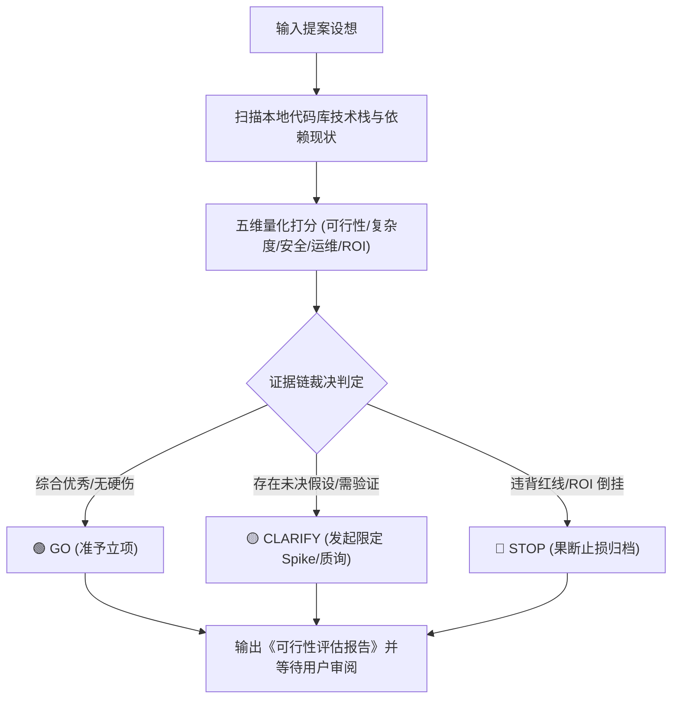

# `at-assess` 技能使用指南：创意可行性预研与技术 Spike 评估

`at-assess` 是一项面向新功能创意、重大重构方案或第三方依赖引入的前置可行性预研技能。它源自 GitHub Spec-Kit 的 `assess` 思想，依托本地工程代码基线核查与五维风险量化模型，输出证据驱动的“Go / Clarify / Stop”明确裁决，及早阻断低效投入。

---

## 1. 何时使用 (When to Use)

- **评估引入第三方新组件/框架**：如考虑引入 GraphQL、WebFlux、Flink 或替换持久层框架，需要提前摸排技术兼容性与迁移代价；
- **重大架构重构或分库分表前**：在动工前全方位评估改动复杂度、爆炸半径、事务一致性与 APM 运维排障风险；
- **业务新点子技术把关**：产品提出前瞻性业务创意，需要资深技术视角评估技术可行性与投入产出比（ROI）；
- **及早止损 (Fail Fast)**：在陷入数周编码泥潭前，通过最小时间盒（Spike）排查是否存在致命技术死锁。

---

## 2. 调用语法与参数 (Syntax & Triggers)

### 自然语言唤醒 (推荐)
- “请评估一下我们在现有单体系统中引入消息队列 Kafka 的可行性。”
- “帮我评估这个重构方案的可行性：将 MySQL 存量数据双写迁移至 MongoDB。”
- “运行 at-assess，分析一下把当前 API 网关全量改用 Rust 重写的可行性与 ROI。”

### 显式斜杠命令 (若平台支持)
```bash
/at-assess [提案描述或方案链接]
```

---

## 3. 前置依赖输入 (Prerequisites & Inputs)

- **提案概述或技术设想**：拟解决的问题、期望达成的效果与初步选型思路；
- **本地工程现状（Agent 自动扫描）**：构建工具、现有框架版本、依赖冲突情况由 Agent 自动探查，**无需人工手动提供**。

---

## 4. 执行过程交互 (Execution Flow & Human Interactions)

`at-assess` 执行过程中严格遵循基线探查、五维量化与决策三态裁决：



1. **自动扫描基线**：探查本地中间件版本与核心模块结构；
2. **正交五维打分**：
   - **技术可行性 (Feasibility)**：生态适配、依赖冲突；
   - **改动复杂度 (Complexity)**：爆炸半径、涉及类数；
   - **安全与合规 (Security)**：注入风险、数据合规；
   - **维护与运维 (Operability)**：APM 链路追踪、单点容灾；
   - **投入产出比 (ROI)**：工时代价 vs 性能/业务收益；
3. **输出三态裁决**：明确给出 GO（立项）、CLARIFY（澄清）、STOP（止损）。

---

## 5. 交付物与下一步推荐 (Deliverables & Next Steps)

### 核心交付物
- **《方案可行性评估报告》**：直观输出或落盘为 `docs/spikes/XXXX-title.md`，内含五维评分卡、证据链出处、风险缓释预案与明确结论。

### 下一步工程流转
- **若裁决为 GO**：若涉及重大架构选型，推荐唤起 `at-adr` 记录架构决策；随后移交 `at-spec` 拟定增量契约；
- **若裁决为 CLARIFY**：移交 `at-grill` 针对未决分歧展开压迫式质询，或制定最小 Spike 探针；
- **若裁决为 STOP**：方案就地归档留痕，避免团队重复推演无效思路。
