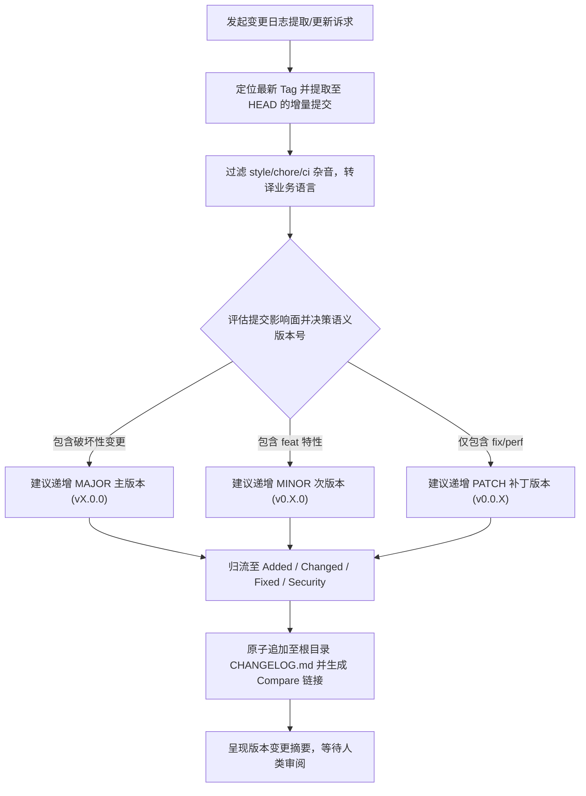

# `at-changelog` 技能使用指南：变更日志自动化提取与维护

`at-changelog` 是一项专用于维护高质量项目变更日志 `CHANGELOG.md` 的版本工程技能。它严格遵循国际公认的 Keep a Changelog 1.1.0 规范与 SemVer 语义化版本标准，通过自动扫描 Git 提交历史，精准过滤杂音，将提交自动归流至 `Added`、`Changed`、`Deprecated`、`Removed`、`Fixed`、`Security` 6 大标准分节，并智能评估语义化版本升级（Major/Minor/Patch），生成清晰透明的版本演进记录与 GitHub Compare 比对链接。

---

## 1. 何时使用 (When to Use)

- **新版本发版前准备 (Release Preparation)**：即将打 Tag 发版，需要自动聚合从上一个 Tag 至今的所有功能与 Bug 修复；
- **规范化重构存量 CHANGELOG.md**：既有变更日志格式混乱、非结构化或缺乏规范分节，需一键标准化升级；
- **评估语义化版本号升级**：通过扫描历史提交中是否存在破坏性变更（Breaking Changes）或新功能（feat），智能决策下一个版本号；
- **日常维护 `[Unreleased]` 增量**：在特性合并后，自动化追加待发布特性至顶部未发布分节；
- **生成面向用户的 Release Notes**：剥离琐碎的内部重构与 CI 杂音，生成面向下游使用者的高质量版本公告。

---

## 2. 调用语法与参数 (Syntax & Triggers)

### 自然语言唤醒 (推荐)
- “请帮我扫描从上一个 Tag 至今的 Git 提交，并更新 CHANGELOG.md 准备发布新版本。”
- “使用 at-changelog 分析历史提交，评估下一个版本号应该是 Minor 还是 Major。”
- “运行 at-changelog，将最近合并的几个 PR 整理追加到 CHANGELOG.md 的 [Unreleased] 小节中。”

### 显式斜杠命令 (若平台支持)
```bash
/at-changelog [目标版本号(可选)] [基准Tag或提交(可选)]
```

---

## 3. 前置依赖输入 (Prerequisites & Inputs)

- **Git 历史提交（Agent 自动扫描）**：建议遵循 Conventional Commits 规范以获得最高精准度；
- **目标发布版本（可选）**：若未指定，Agent 将根据提交内容自动建议 SemVer 版本；
- **Issue/PR 关联平台（可选）**：代码托管仓库基地址（用于生成 Issue/PR 与 Diff 链接）。

---

## 4. 执行过程交互 (Execution Flow & Human Interactions)

`at-changelog` 执行过程严格遵循增量差分检索、杂音过滤、标准 6 分节归流与原子追加：



1. **增量自动捕获**：自动基于 Tag 锚定差分区间，杜绝漏记变更；
2. **剔除内部杂音**：过滤格式化与日常杂务提交，聚焦用户价值；
3. **SemVer 智能决策**：依据 Conventional Commits 契约精准推导版本升级幅度；
4. **标准化格式交付**：严格契合 Keep a Changelog 格式规范。

---

## 5. 交付产物与标准 (Outputs & Standards)

执行完毕后交付以下标准化产物：
- **更新后的 CHANGELOG.md**：具备规范 6 分节、Markdown 超链接与底部 Compare URL 的版本日志；
- **SemVer 版本推荐说明**：包含判定理由与破坏性变更预警的决策报告；
- **干净的工作区 Git Diff**：修改严格收口于 `CHANGELOG.md`，等待人类显式指令提交。
