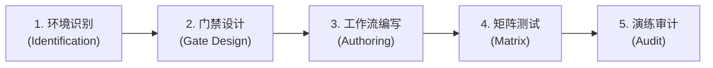

# at-ci 技能手册：持续集成流水线与自动化门禁指南

本文档为 `at-ci` 技能的伴随使用与维护手册，指导开发者与 DevOps 工程师快速搭建现代化、快速失败（Fail-Fast）、安全合规的持续集成与自动化流水线门禁。

---

## 1. 技能定位与核心价值

在快节奏的敏捷协作与开源社区中，持续集成流水线是守护代码质量和防止技术债务扩散的唯一自动化防线。`at-ci` 技能提供标准化的 CI/CD 编排与门禁体系：
- **快速失败四级漏斗**：由轻到重组织格式化、静态检查、单测和制品构建任务，最快在 30 秒内反馈语法缺陷；
- **智能缓存与性能提速**：自动配置依赖哈希缓存与无用并发作业取消机制，将集成耗时压缩在 5 分钟以内；
- **安全与最小特权**：默认收紧工作流执行权限，内嵌凭据扫描阻断机制，杜绝生产机密泄露风险。

---

## 2. 架构拓扑与微内核设计

`at-ci` 遵循微内核架构设计，物理目录保持清晰与高内聚：

```text
skills/at-ci/
├── SKILL.md                                          # 核心编排入口（81 行轻量状态机）
├── references/                                       # 输入型知识层（按需 JIT 加载）
│   ├── protocols/
│   │   └── ci-gate-protocol.md                       # 质量门禁分层与覆盖率熔断协议
│   └── templates/
│       └── github-actions-ci-template.md             # GitHub Actions 标准化流水线模板
└── examples/                                         # 案例样本层
    └── sample-ci-workflow.md                         # 跨平台矩阵测试与发布门禁实战样本
```

---

## 3. 渐进式工作流与状态机推演

`at-ci` 采用五阶段工作流指导流水线设计与落地：



1. **环境识别**：识别目标工程的构建系统、测试套件与执行环境依赖；
2. **门禁设计**：规划格式化、静态安全、单元测试与构建门禁的通过准则；
3. **工作流编写**：基于声明式语法编写 YAML，配置依赖缓存与权限隔离；
4. **矩阵测试**：针对多操作系统或多版本运行时编排并行测试作业；
5. **演练审计**：验证本地与 CI 执行一致性，审计凭据安全与告警机制。

---

## 4. 核心协议与模板参考

- **门禁协议**：[CI Gate Protocol](../../skills/at-ci/references/protocols/ci-gate-protocol.md) 规定了四级漏斗门禁、覆盖率硬熔断红线及依赖缓存优化规范；
- **流水线模板**：[GitHub Actions CI Template](../../skills/at-ci/references/templates/github-actions-ci-template.md) 提供了开箱即用的声明式 CI 配置骨架；
- **实战样例**：[Sample CI Workflow](../../skills/at-ci/examples/sample-ci-workflow.md) 呈现了包含多环境矩阵与质量门禁的真实开源级工作流。

---

## 5. 质量保证与度量指标

流水线交付前必须通过以下质量基线核验：
- **Fail-Fast 有效性**：格式与语法错误必须在第一阶段（< 30 秒）阻断，禁止拖延至后续构建阶段；
- **凭据零泄露**：工作流配置中严禁包含明文 Secret，全部凭据通过加密环境变量注入；
- **排版与规范自闭环**：伴随文档与工作流说明 100% 遵循盘古之白规范，链接使用相对路径且零死链。
