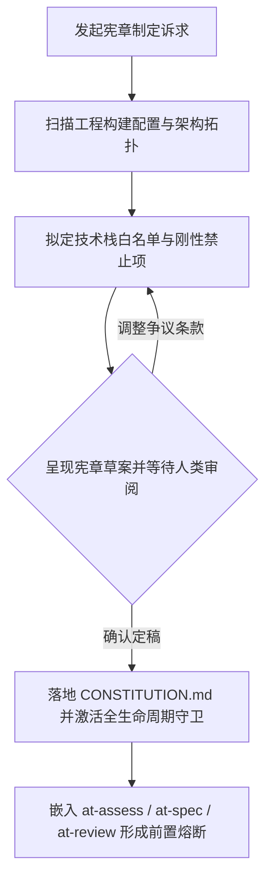

# `at-constitution` 技能使用指南：项目刚性工程宪章与守卫治理

`at-constitution` 是一项为代码库确立最高法律地位工程宪章（`CONSTITUTION.md`）的元治理技能。它源自 Google 与 Open Agent Standards 的工程规范治理哲学，依托存量代码库基线探测与刚性红线拟定，确立技术栈准入白名单、架构分层隔离、空安全与零明文凭据底线，为人类开发者与多 Agent 自治协同提供不可逾越的守卫防护网。

---

## 1. 何时使用 (When to Use)

- **新工程规范筑基**：新建系统或模块时，确立顶层架构分层规范、受管技术栈版本与反模式禁止项；
- **治理存量代码腐化**：系统出现依赖泛滥、Controller 越级穿透、N+1 循环穿透数据库等劣化现象时，立下刚性法律红线；
- **多 Agent 自治协同长跑**：在无人工全天候介入的长程编码中，提供前置熔断守卫，防止 Agent 野蛮引入非标依赖或破坏单例无状态性；
- **确立特批豁免与技术债台账**：为团队提供清晰、受控的特批豁免流程与 ADR 技术债登记机制。

---

## 2. 调用语法与参数 (Syntax & Triggers)

### 自然语言唤醒 (推荐)
- “请为我们的微服务工程制定一份刚性工程宪章 CONSTITUTION.md。”
- “帮我们梳理当前项目的技术栈白名单与禁止反模式，确立工程红线。”
- “调用 at-constitution，针对当前代码库拟定架构分层边界与前置熔断规则。”

### 显式斜杠命令 (若平台支持)
```bash
/at-constitution [宪章范围或特定治理诉求]
```

---

## 3. 前置依赖输入 (Prerequisites & Inputs)

- **存量工程代码（Agent 自动扫描）**：构建配置文件（`pom.xml` / `package.json`）、架构目录拓扑与现有规范；
- **团队战略诉求（可选提供）**：拟淘汰的旧技术栈、强制推行的新标准或特定合规要求。

---

## 4. 执行过程交互 (Execution Flow & Human Interactions)

`at-constitution` 执行过程严格遵循基线探查、红线拟定、人机核验与守卫激活：



1. **自动扫描基线**：探查既有技术栈版本、依赖冲突与代码分层现状；
2. **正交红线拟定**：
   - **技术栈白名单**：明确准入框架与组件版本；
   - **架构分层流向**：严禁越级穿透与循环依赖；
   - **健壮性契约**：集合返回非空、单例无状态、杜绝 N+1 循环调用；
   - **信息安全红线**：零明文密码、API Token 与物理绝对路径。
3. **人类审阅确认**：展示核心条款矩阵，等待人类确认后落盘。

---

## 5. 交付产物与标准 (Outputs & Standards)

执行完毕后交付以下标准化产物：
- **工程宪章主文件**：落地于工程根目录的 `CONSTITUTION.md`；
- **前置熔断规约**：使后续的 `at-spec`、`at-plan`、`at-tdd` 与 `at-review` 自动继承宪章约束；
- **特批豁免机制**：配套的 ADR 架构偏离登记通道与技术债还款追踪计划。
