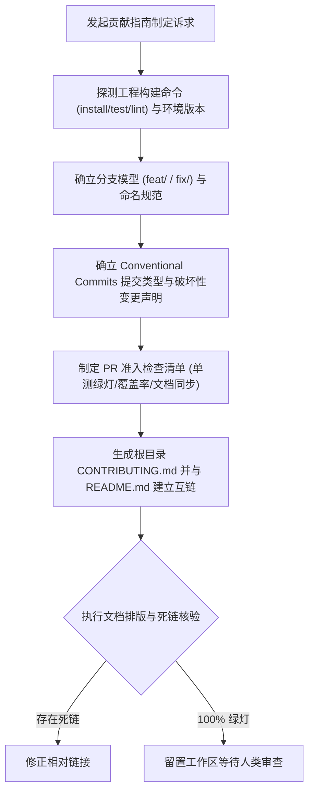

# `at-contributing` 技能使用指南：开源贡献指南与协作规范

`at-contributing` 是一项专用于制定与维护项目协作契约 `CONTRIBUTING.md` 的工程规范技能。它遵循国际开源协作标准与 Conventional Commits 1.0.0 规范，帮助团队消除新贡献者“环境搭建困难”、“Git 分支随意混乱”、“提交信息缺乏机器可读性”与“代码合并质量参差不齐”等协作摩擦，建立包含环境准备、分支模型、提交规范、单测门禁与 PR 准入清单的专业协同体系。

---

## 1. 何时使用 (When to Use)

- **开源项目启动社区化运作**：项目拟对外开源或接受外部贡献，需规范化告知贡献者协作流程；
- **企业团队统一工程协同标准**：团队内部协作出现 Git 提交混乱、分支命名各行其是，需制定统一规范；
- **建立自动化发版与 Changelog 基石**：引入 Semantic Release 或自动化更新日志前，必须强纪律落实 Conventional Commits；
- **提升 Pull Request 准入质量**：PR 经常缺少单元测试、破坏现有功能或遗留机密，需在前置检查清单中明确门禁红线。

---

## 2. 调用语法与参数 (Syntax & Triggers)

### 自然语言唤醒 (推荐)
- “请帮我们团队编写一份 CONTRIBUTING.md，包含环境搭建步骤、Conventional Commits 规范和 PR 检查清单。”
- “使用 at-contributing 梳理项目的分支策略与提交信息规范，并生成标准贡献指南。”
- “运行 at-contributing，补充开源项目的行为准则 (Code of Conduct) 与 PR 准入红线。”

### 显式斜杠命令 (若平台支持)
```bash
/at-contributing [协作模式/单测覆盖率要求(可选)]
```

---

## 3. 前置依赖输入 (Prerequisites & Inputs)

- **构建与测试指令（Agent 自动扫描）**：工程的安装、构建、测试与 Lint 命令；
- **分支协同模型（可选）**：指定团队偏好主干开发 (Trunk-based) 还是特性分支 (Feature-branch)；
- **单测覆盖率基线（可选）**：指示团队的单测准入行覆盖率（如 ≥ 80%）。

---

## 4. 执行过程交互 (Execution Flow & Human Interactions)

`at-contributing` 执行过程严格遵循工程环境探测、提交规约映射、PR 门禁制定与文档对齐闭环：



1. **环境开箱即用**：提取确定性的安装与本地启动测试命令，消除新成员踩坑；
2. **规范提交契约**：明确 `feat`、`fix`、`refactor`、`perf` 等边界与 Scope 规范；
3. **全流程质量门禁**：PR 检查清单对齐自动化流水线，杜绝未测代码合入；
4. **生态闭环互链**：自动在 `README.md` 中关联贡献指引，打造闭环知识门户。

---

## 5. 交付产物与标准 (Outputs & Standards)

执行完毕后交付以下标准化产物：
- **开源贡献指南**：根目录下内容规范、格式清晰的 `CONTRIBUTING.md`；
- **提交与分支规约指南**：包含详细 Conventional Commits 与分支命名范例的文档；
- **PR 准入核对表**：开箱即用的 GitHub / GitLab Pull Request 检查单；
- **干净的工作区 Git Diff**：零敏感凭据泄漏，修改严格聚焦规范文档，等待人类显式指令提交。
