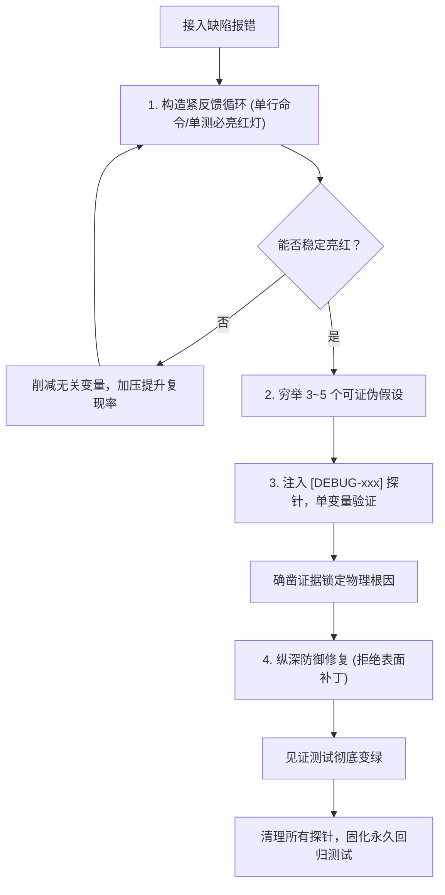

# `at-diagnose` 技能使用指南：系统化根因排错与纵深防御

`at-diagnose` 是一项针对疑难 Bug、偶发并发缺陷与诡异异常报错的科学根因排查技能。它吸收了 Superpowers 的“无紧反馈循环不推测根因”铁律与可证伪假设推演法，拒绝盲目看代码瞎猜与表面打补丁，输出具备确凿证据链的诊断报告与永久回归测试。

---

## 1. 何时使用 (When to Use)

- **遇到难以解释的疑难 Bug**：异常信息复杂、偶发出现、涉及异步并发或多模块交互；
- **排查性能断崖与资源泄漏**：接口延迟突增、数据库连接池耗尽、内存或 CPU 占用异常；
- **测试环境持续报错但缺乏抓手**：堆栈信息模糊，需要通过科学假设与临时探针逐步收敛范围；
- **杜绝表面打补丁**：不满足于简单的空指针容错或 `try-catch` 掩盖问题，追求直击物理根因。

---

## 2. 调用语法与参数 (Syntax & Triggers)

### 自然语言唤醒 (推荐)
- “请帮我诊断这个报错：NullPointerException，附带堆栈信息。”
- “测试环境出现偶发脏读，请启动 at-diagnose 系统化排查。”
- “帮我 debug 一下为什么订单支付后状态没有扭转，构建一个紧反馈循环。”

### 显式斜杠命令 (若平台支持)
```bash
/at-diagnose [报错摘要或测试用例名]
```

---

## 3. 前置依赖输入 (Prerequisites & Inputs)

- **故障表象描述**：发生问题的场景、预期行为与实际异常表现；
- **真实报错日志或堆栈**：脱敏后的堆栈日志、HTTP 返回值或错误提示；
- **本地工程与测试环境**：可运行测试或脚本的本地代码库（Agent 自主探查）。

---

## 4. 执行过程交互 (Execution Flow & Human Interactions)

`at-diagnose` 执行过程中严格遵循四步法科学推演：



1. **构建紧反馈循环**：绝不盲目猜原因，优先写出单行能够稳定触发红灯报错的单测或脚本；
2. **假设可证伪化**：提出 3~5 个有明确预测的假设（“若原因为 A，改变 B 时必将表现为 C”）；
3. **探针单变量验证**：使用带唯一前缀的临时日志（如 `[DEBUG-xxxx]`）捕获证据链；
4. **纵深防御修复**：从源头斩断错误产生可能，彻底杜绝无意义包裹 `try-catch`；
5. **清理与回归归档**：一键清除探针，将复现测试转为永久回归测试。

---

## 5. 交付物与下一步推荐 (Deliverables & Next Steps)

### 核心交付物
- **《缺陷根因诊断报告》**：直观输出或落盘为 `diagnostic-report.md`，内含复现命令、假设树、证据链因果分析与防范建议；
- **永久回归测试用例**：沉淀于工程 `test/` 目录下，确保未来改动绝不复发同类问题；
- **纵深防御修复源码**：高内聚最小改动，不引入无关代码重排。

### 下一步工程流转
- **发起代码双轴审查**：修复完成后唤起 `at-review`，检查修复代码是否引入新的坏味道或破坏存量契约；
- **架构级加固 RFC 方案**：若根因暴露出系统深层架构缺陷，调用 `at-tech-doc` 编写重构改造方案。
