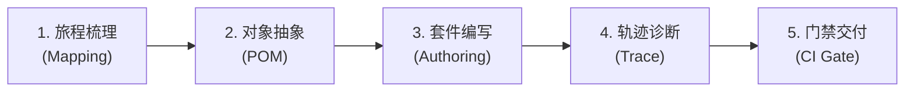

# at-e2e 技能手册：端到端自动化验收与用户旅程验证指南

本文档为 `at-e2e` 技能的伴随使用与维护手册，指导开发者与测试工程师构建高确定性、低脆弱度（Low-Flakiness）、覆盖真实业务用户旅程的端到端自动化验收体系。

---

## 1. 技能定位与核心价值

单元测试与集成测试验证代码逻辑的孤立正确性，但唯有端到端（E2E）测试能够从真实用户视角穿透 UI 界面、网络请求、后端服务与持久化存储。`at-e2e` 技能提供标准化的全链路验收体系：
- **核心用户旅程闭环**：聚焦 P0 级黄金路径（Happy Path），确保系统核心商业闭环在发布前得到 100% 验证；
- **消除测试脆弱度 (Flakiness)**：采用事件驱动显式等待机制，杜绝盲目硬编码休眠，提高 CI 环境执行稳定性；
- **现场痕迹全景回放**：集成 Playwright Trace、视口自动截图与网络请求时序，实现缺陷根因分钟级复现。

---

## 2. 架构拓扑与微内核设计

`at-e2e` 遵循微内核架构设计，物理目录保持清晰与高内聚：

```text
skills/at-e2e/
├── SKILL.md                                          # 核心编排入口（82 行轻量状态机）
├── references/                                       # 输入型知识层（按需 JIT 加载）
│   ├── protocols/
│   │   └── e2e-testing-protocol.md                   # 旅程分级、定位器优先级与 Trace 协议
│   └── templates/
│       └── e2e-suite-template.md                     # Playwright POM 自动化测试套件模板
└── examples/                                         # 案例样本层
    └── sample-e2e-test.md                            # 多租户管理全链路验收实战样例
```

---

## 3. 渐进式工作流与状态机推演

`at-e2e` 采用五阶段工作流指导全链路自动化测试落地：



1. **旅程梳理**：识别业务主干路径与阻断性异常分支，确立验收标准与冒烟测试集；
2. **对象抽象**：利用页面对象模型（POM）解耦页面元素定位与用户业务交互动作；
3. **套件编写**：利用无障碍语义定位器与网络驱动等待编写测试用例，杜绝任意 sleep；
4. **轨迹诊断**：配置失败自动截图与全量 Trace 留痕，排查偶发抖动与逻辑缺陷；
5. **门禁交付**：将 E2E 冒烟测试套件接入 CI 流水线，作为 PR 合并与上线发布的硬性卡点。

---

## 4. 核心协议与模板参考

- **测试协议**：[E2E Testing Protocol](../../skills/at-e2e/references/protocols/e2e-testing-protocol.md) 规定了用户旅程分级准则、稳健定位器优先级与 Trace 采集机制；
- **套件模板**：[E2E Test Suite Template](../../skills/at-e2e/references/templates/e2e-suite-template.md) 提供了标准页面对象模型与 Playwright 测试配置骨架；
- **实战样例**：[Sample E2E Acceptance Test](../../skills/at-e2e/examples/sample-e2e-test.md) 展示了多租户项目创建全生命周期的自动化验收实现。

---

## 5. 质量保证与度量指标

端到端测试套件交付前必须通过以下质量基线核验：
- **确定性等待**：测试代码中零任意休眠（`sleep`），全部依靠网络响应与 DOM 事件驱动同步；
- **用例无状态性**：测试用例支持任意顺序打乱执行与多工作进程并发运行，数据无状态污染；
- **证据链闭环**：CI 运行失败时必须自动生成包含 Trace 文件、DOM 快照与接口时序的证据压缩包；
- **排版与规范自闭环**：文档与测试代码 100% 遵循盘古之白中西文排版与相对路径规范。
