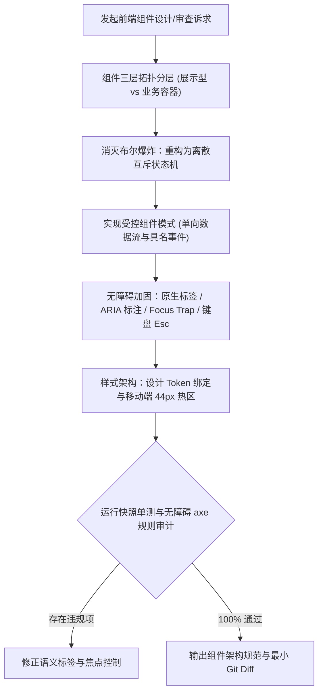

# `at-frontend` 技能使用指南：现代前端 UI 架构与无障碍工程

`at-frontend` 是一项专用于现代前端用户界面工程的架构设计与质量审查技能。它贯彻高内聚低耦合的组件分层原则、状态机驱动交互与 W3C WCAG 2.1 AA 级 Web 无障碍访问（a11y）标准。它帮助开发者治理前端代码中常见的“展示与数据获取逻辑混杂”、“多布尔状态爆炸（Boolean Explosion）”、“Props 逐层透传下钻”与“纯 div 模拟按钮导致键盘与盲人用户无法访问”等核心痛点，交付可维护、可复用且普惠包容的高品质前端资产。

---

## 1. 何时使用 (When to Use)

- **设计与重构复杂 UI 组件**：例如模态弹窗、复杂数据表格、多步骤表单、侧边抽屉，需抽离为纯展示组件与容器组件；
- **治理多布尔状态爆炸**：页面或组件中同时存在 `isLoading`, `isError`, `isSuccess`, `isEmpty` 等多个互相冲突的布尔标记，需重构为离散状态机；
- **实现标准受控组件 (Controlled Component)**：确保组件状态完全由外部驱动，杜绝组件内部私自突变 Props 导致的单向数据流混乱；
- **落实 WCAG 2.1 AA 级无障碍访问**：需要满足企业合规或海外市场标准，支持屏幕阅读器（ARIA 标签）、全键盘导航（Tab 键、Esc 关闭）与焦点捕获（Focus Trap）；
- **建立设计系统 Token 与响应式适配**：收束硬编码像素与色值至 CSS Variables，适配移动端安全区域与点击热区。

---

## 2. 调用语法与参数 (Syntax & Triggers)

### 自然语言唤醒 (推荐)
- “请帮我设计一个符合 WCAG 无障碍标准的受控模态弹窗组件，带 Focus Trap 和 Esc 关闭支持。”
- “这个异步列表组件平铺了 5 个 boolean 状态，容易出现状态冲突，请用 at-frontend 重构为状态机驱动。”
- “运行 at-frontend，审查当前前端界面的语义化 HTML、键盘可访问性与颜色对比度。”

### 显式斜杠命令 (若平台支持)
```bash
/at-frontend [目标组件/页面文件路径或 UI 架构诉求]
```

---

## 3. 前置依赖输入 (Prerequisites & Inputs)

- **目标组件/页面代码或交互原型**：拟设计或重构的前端源码（React / Vue / 原生 Web Components）；
- **技术栈与设计系统规范（可选）**：如 Tailwind CSS、CSS Modules、Radix UI 或 Ant Design 等；
- **无障碍合规级别（可选）**：默认为 WCAG 2.1 AA 级。

---

## 4. 执行过程交互 (Execution Flow & Human Interactions)

`at-frontend` 执行过程严格遵循组件拓扑切分、状态机建模、受控事件流梳理与无障碍交互加固：



1. **三层分层解耦**：基础展示组件 0 网络请求，纯 Props 驱动，极大提升复用率；
2. **状态机终结冲突**：单一时刻仅一个合法状态，从源头消灭异步竞态与非法状态；
3. **全键盘无障碍闭环**：原生 `<button>`、合理配置 `role` 与 `aria-modal`、焦点捕获杜绝逃逸；
4. **设计 Token 与响应式**：消除硬编码像素，遵循移动端视口与无障碍对比度基线。

---

## 5. 交付产物与标准 (Outputs & Standards)

执行完毕后交付以下标准化产物：
- **高韧性受控组件源码**：类型安全、单向数据流与状态机驱动的前端代码；
- **WCAG 2.1 AA 无障碍合规说明**：键盘操作说明、ARIA 属性清单与焦点管理机制；
- **设计 Token 映射文档**：关联的 CSS 变量或 Tailwind 类名规范；
- **干净的工作区 Git Diff**：改动严格聚焦 UI 架构与无障碍提升，等待人类显式指令提交。
