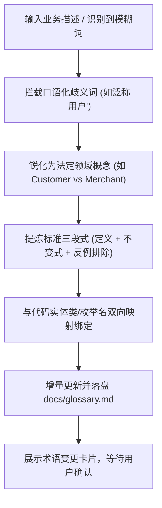

# `at-glossary` 技能使用指南：领域统一语言与防腐治理

`at-glossary` 是一项用于在工程中建立、维护与校验通用领域语言字典（`docs/glossary.md` 或顶层门面 `GLOSSARY.md`）的架构语义治理技能。它源自 DDD 统一语言思想与 Matt Pocock 的术语防腐实践，主动拦截模糊或重载的口语表达，将业务概念、不变式规则与代码中的 Entity/Enum 强制对齐，显著削减跨角色沟通成本与 Agent 上下文 Token 损耗。

---

## 1. 何时使用 (When to Use)

- **新项目立项或领域建模初期**：梳理核心业务概念，明确界定哪些名词属于核心域，哪些属于通用域；
- **消除团队沟通中的“黑话”与歧义**：发现团队中同一个词不同人理解不同（如“用户”既指买家又指卖家，或“取消”既指撤单又指退款）；
- **对齐业务语言与代码命名**：确保代码中的类名（Entity）、方法名与枚举（Enum）严格映射业务概念，杜绝“代码是一套、文档是一套”；
- **为后续 Agent 会话提供 Token 瘦身字典**：一次性建立标准字典，后续提示词直接引用规范术语，无需多轮低效反复解释。

---

## 2. 调用语法与参数 (Syntax & Triggers)

### 自然语言唤醒 (推荐)
- “请帮我们在工程建立一份领域统一语言字典（docs/glossary.md）。”
- “我们系统里‘订单’和‘履约单’容易混淆，请用 at-glossary 做一下概念消歧并更新字典。”
- “扫描当前工程代码，检查实体类和枚举命名是否与既有业务术语表一致。”

### 显式斜杠命令 (若平台支持)
```bash
/at-glossary [术语名称或待梳理子域]
```

---

## 3. 前置依赖输入 (Prerequisites & Inputs)

- **业务需求或领域概念**：正在讨论的特性需求、业务背景文档或一段口语化业务描述；
- **本地工程代码库（Agent 自动扫描）**：代码中的 Entity、Repository、Controller 与 Enum 命名现状（由 Agent 自主检索）。

---

## 4. 执行过程交互 (Execution Flow & Human Interactions)

`at-glossary` 执行过程中严格遵循口语拦截、三段式提炼与代码映射对齐：



1. **歧义词主动拦截**：遇到重载词时立即打断并要求用户明确界限；
2. **提取三段式卡片**：
   - **法定定义 (Definition)**：客观严密；
   - **核心约束 (Invariants)**：不可违背的业务规则；
   - **反例与澄清 (What it is NOT)**：清晰划定排他边界；
3. **代码实体绑定**：显式标注该术语对应的类名或包路径；
4. **增量落盘 `docs/glossary.md`**：保持纯粹业务语义，坚决不渗入底层数据库或中间件配置。

---

## 5. 交付物与下一步推荐 (Deliverables & Next Steps)

### 核心交付物
- **长期资产 `docs/glossary.md`**：全项目共享的权威统一语言字典，内含核心子域词条、不变式约束与废弃词消歧对照表。

### 下一步工程流转
- **进入增量规格拟定**：调用 `at-spec`，要求所有 Delta Spec 接口参数与状态直接引用 `docs/glossary.md` 法定术语；
- **进入测试驱动开发**：调用 `at-tdd`，单测命名与测试断言严格遵循统一语言规范。
