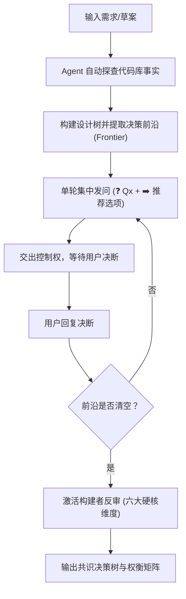

# `at-grill` 技能使用指南：需求深度质询与构建者反审

`at-grill` 是一项面向高不确定性场景的架构与需求反向质询技能。它融合了设计树（Design Tree）动态前沿推进机制与构建者视角（Builder Check）防御性质询，帮助开发者在动笔编码前穷举隐性分支、暴露边界脆弱点并达成深度工程共识。

---

## 1. 何时使用 (When to Use)

- **模糊业务需求接入**：产品经理或业务方给出的需求较为简略，缺乏异常分支、并发指标或边界场景说明；
- **技术选型产生分歧**：在自研 vs 引入第三方组件、SQL vs NoSQL、同步 RPC vs 异步事件驱动等关键分歧点犹豫不决；
- **大型特性/架构方案评审前**：在提交 RFC 方案或技术评审前，需要对自身思路展开全方位的“压力测试 (Stress-test)”；
- **方案缺乏落地感**：方案看起来美好但细节模糊，需要由资深开发视角反向审查“接口、失败域、回滚机制与容量瓶颈”。

---

## 2. 调用语法与参数 (Syntax & Triggers)

### 自然语言唤醒 (推荐)
直接在对话中陈述方案并要求质询，例如：
- “请对我们的用户积分重构方案进行 grill 压力测试。”
- “我们准备用 Redis 实现分布式锁，请反向质询考问一下这个设计。”
- “帮我梳理并挑战一下订单超时未支付取消的架构选型。”

### 显式斜杠命令 (若平台支持)
```bash
/at-grill [方案概述/需求链接]
```

---

## 3. 前置依赖输入 (Prerequisites & Inputs)

- **方案概述或初步想法**：一段业务目标陈述、架构草案大纲或待重构的模块描述；
- **环境客观事实（无需人工提供）**：当前代码库结构、框架版本（如 Spring Boot、Vue 等）、数据库与中间件类型由 Agent 自主在本地探查，**严禁向用户提问代码库已有的客观事实**。

---

## 4. 执行过程交互 (Execution Flow & Human Interactions)

`at-grill` 执行过程中严格遵循分轮次集中交互与构建者反审：



1. **第 1 轮：宏观设计前沿质询**
   - Agent 将当前所有可独立判定的决策点集中发问；
   - 每个问题均附带选项代价对比与明确的推荐方案（`➡️ 推荐决策`）；
2. **多轮推进与剪枝**
   - 收到答复后，Agent 固化已选节点、剪裁无效分支，解锁下一层决策前沿并继续发问；
3. **构建者反审 (Builder Check)**
   - 前沿清空后，Agent 自动切换为落地研发视角，审查极端异常、接口强类型、降级熔断、回滚代价与性能天花板。

---

## 5. 交付物与下一步推荐 (Deliverables & Next Steps)

### 核心交付物
- **《架构共识决策备忘录》**：收敛后的设计树最终形态与无遗漏的前提清单；
- **《权衡决策矩阵 (Trade-offs Matrix)》**：详尽记录采纳方案、备选方案、选定依据及生产风险防范预案。

### 下一步工程流转
- **进入增量契约拟定**：建议调用 `at-spec` 编写增量规格契约（Delta Specs）；
- **进入微任务工序拆解**：若方案清晰度已达标，建议调用 `at-plan` 拆解 2~5 分钟原子开发任务清单；
- **编写全量系统设计方案**：若需要输出标准工业级 RFC，建议调用 `at-tech-doc`。
