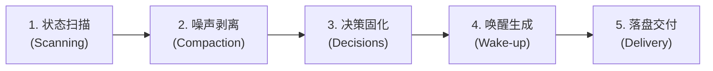

# at-handoff 技能手册：跨会话上下文压缩与长时交接棒指南

本文档为 `at-handoff` 技能的伴随使用与维护手册，指导开发者与多 Agent 协同系统在长对话窗口衰减、任务阶段演进或实例轮换时，实现高保真度、无损且即插即用的任务接力。

---

## 1. 技能定位与核心价值

当大模型对话轮次剧增时，注意力衰减与上下文污染是引发幻觉和逻辑漂移的关键诱因。`at-handoff` 技能提供标准化的长时自治交接工程体系：
- **四象限深度无损提炼**：严谨提炼已落地成果、排他性架构共识、当前工作树断点与优先级待办清单；
- **深度去噪与信息保真**：彻底剔除试错调试日志与无效寒暄，保留确定性接口、配置参数与关键行号；
- **自解释一键唤醒指令**：提供可供人类或流水线一键 Copy & Paste 的热启动指令，让新接棒 Agent 毫秒级进入战斗状态。

---

## 2. 架构拓扑与微内核设计

`at-handoff` 遵循微内核架构设计，物理目录保持清晰与高内聚：

```text
skills/at-handoff/
├── SKILL.md                                          # 核心编排入口（81 行轻量状态机）
├── references/                                       # 输入型知识层（按需 JIT 加载）
│   ├── protocols/
│   │   └── context-compaction-protocol.md            # 四象限提炼、噪声剥离与持久化协议
│   └── templates/
│       └── handoff-document-template.md              # 跨 Agent 结构化交接棒 Markdown 标准模板
└── examples/                                         # 案例样本层
    └── sample-handoff.md                             # 架构预研转入编码实现交接实战样例
```

---

## 3. 渐进式工作流与状态机推演

`at-handoff` 采用五阶段工作流指导交接任务推进：



1. **状态扫描**：监测当前会话 Token 水位与研发阶段跃迁事件，探查 Git 工作树与最近提交；
2. **噪声剥离**：依据四象限模型筛选高密度事实资产，剔除中间报错日志与废弃探讨；
3. **决策固化**：归纳核心架构共识与反面论证，精确记录当前修改的代码断点行号；
4. **唤醒生成**：排布待办依赖拓扑，生成携带规范继承约束的自解释一键唤醒提示词；
5. **落盘交付**：将交接棒写入特性工件目录 `.specs/<feature-slug>/HANDOFF.md`，在 `.gitignore` 中声明防护，执行凭据脱敏审计与相对路径合规自检。

---

## 4. 核心协议与模板参考

- **压缩协议**：[Context Compaction Protocol](../../skills/at-handoff/references/protocols/context-compaction-protocol.md) 规定了触发时机、四象限要素、噪声过滤与唤醒词工程基线；
- **交接模板**：[Handoff Document Template](../../skills/at-handoff/references/templates/handoff-document-template.md) 提供了标准成果看板、断点现场、待办表格与唤醒词骨架；
- **实战样例**：[Sample Handoff Design to Coding](../../skills/at-handoff/examples/sample-handoff.md) 记录了任务调度系统从方案论证转入 TDD 编码的真实交接过程。

---

## 5. 质量保证与度量指标

交接棒文档交付前必须通过以下质量基线核验：
- **高信息密度**：交接文档严禁保留大段报错堆栈，文字精炼，聚焦结构化事实；
- **排他性决策闭环**：关键选型必须阐明为何否决备选项，杜绝接棒者倒退重提已否决方案；
- **零冷启动摩擦**：新会话使用唤醒词启动后，能直接定位到具体文件和行号立即开工；
- **排版与规范自闭环**：交接文档 100% 遵循盘古之白排版规范与零绝对路径引用要求。
