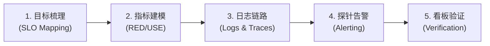

# at-observability 技能手册：生产级系统可观测性与埋点设计指南

本文档为 `at-observability` 技能的伴随使用与维护手册，指导系统架构师、后端开发者与 SRE 工程师构建透明、高可用、低开销的生产级系统可观测性与度量告警体系。

---

## 1. 技能定位与核心价值

当复杂分布式系统在生产环境面临高并发流量与网络抖动时，传统的黑盒排查极易导致故障扩散与排障时间（MTTR）居高不下。`at-observability` 技能提供标准化的可观测性工程体系：
- **四位一体立体感知**：深度串联指标度量（Metrics）、结构化日志（Logging）、分布式链路（Tracing）与健康探针（Health Probes）；
- **RED/USE 黄金工程法则**：从吞吐量、错误率、响应耗时及资源饱和度多维度量系统真实运行状态；
- **防高基数与敏感信息脱敏**：严格管控 Prometheus 标签基数，内嵌鉴权信息与用户隐私字段自动脱敏机制。

---

## 2. 架构拓扑与微内核设计

`at-observability` 遵循微内核架构设计，物理目录保持清晰与高内聚：

```text
skills/at-observability/
├── SKILL.md                                          # 核心编排入口（81 行轻量状态机）
├── references/                                       # 输入型知识层（按需 JIT 加载）
│   ├── protocols/
│   │   └── metrics-logging-standards.md              # RED/USE 规范、日志脱敏与健康探针协议
│   └── templates/
│       └── observability-spec-template.md            # 服务级指标矩阵、PromQL 告警与探针模板
└── examples/                                         # 案例样本层
    └── sample-observability-design.md                # 支付网关埋点、链路透传与结构化日志样例
```

---

## 3. 渐进式工作流与状态机推演

`at-observability` 采用五阶段工作流指导可观测性建设全生命周期：



1. **目标梳理**：明确系统核心业务链路，定义服务级别目标（SLO）与错误预算基线；
2. **指标建模**：设计 RED/USE 指标体系，规划低基数标签，杜绝动态变量污染；
3. **日志链路**：规范 JSON 结构化日志输出格式，集成 W3C Trace Context 跨网络链路透传；
4. **探针告警**：制定解耦的容器健康检查探针，配置多级 Prometheus 告警规则；
5. **看板验证**：构建可视化 Grafana 看板，通过压测演练检验告警灵敏度与自愈流程。

---

## 4. 核心协议与模板参考

- **可观测性协议**：[Metrics & Logging Standards](../../skills/at-observability/references/protocols/metrics-logging-standards.md) 规定了指标命名规范、基数防御、日志分级与探针契约；
- **埋点模板**：[Observability Spec Template](../../skills/at-observability/references/templates/observability-spec-template.md) 提供了标准服务级指标矩阵与告警规则骨架；
- **实战样例**：[Sample Observability Design](../../skills/at-observability/examples/sample-observability-design.md) 呈现了在线支付服务埋点、链路上下文注入与日志样例。

---

## 5. 质量保证与度量指标

可观测性体系交付前必须通过以下质量基线核验：
- **零高基数泄漏**：指标维度标签中严禁包含用户 ID、订单号或动态参数，维度基数 < 50；
- **探针防级联故障**：Liveness 存活探针严禁连接外部数据库或下游网络依赖；
- **Trace 上下文完整性**：核心交易业务日志中 Trace ID 覆盖率必须达到 100%；
- **排版与规范自闭环**：文档与配置代码 100% 遵循盘古之白中西文排版与相对路径互链。
