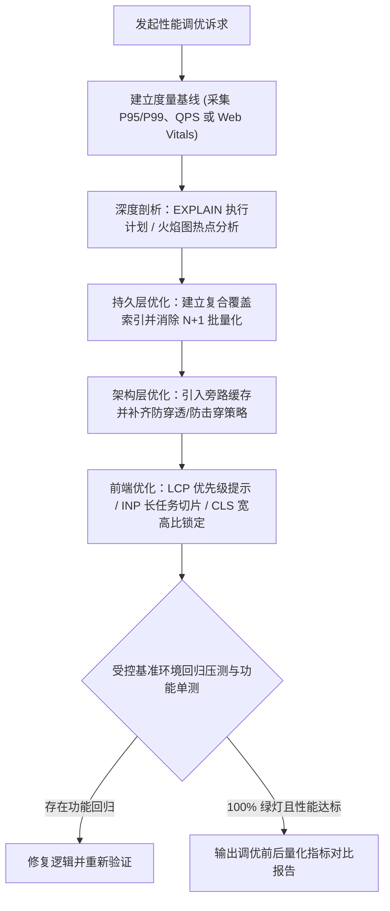

# `at-performance` 技能使用指南：全栈性能瓶颈剖析与调优

`at-performance` 是一项数据驱动的全栈性能工程技能。它针对现代高并发系统与交互式 Web 应用的性能痛点（如后端核心接口延时高、慢 SQL 全表扫描、循环 N+1 查询、缓存击穿雪崩、前端 LCP 缓慢、长任务卡顿 INP 与布局偏移 CLS），提供从度量基线建立、执行计划 (EXPLAIN) 分析、火焰图剖析、复合索引设计、旁路缓存集成到压测验证闭环的全栈调优编排。

---

## 1. 何时使用 (When to Use)

- **后端接口 P95/P99 延时超标**：高频接口在流量增长时响应缓慢，需要定位瓶颈并压降至百毫秒级；
- **数据库慢查询与执行计划优化**：SQL 出现 `ALL` 全表扫描、`Using filesort` 临时排序或缺乏合适联合索引；
- **代码中存在致命 N+1 查询**：在循环体内频繁单条查询数据库或发起外部 RPC，导致数据库连接池被耗尽；
- **高并发缓存防崩治理**：需要设计基于 Redis + 本地缓存的多级缓存体系，并防范缓存穿透、击穿与雪崩；
- **前端 Core Web Vitals 达标优化**：首屏 LCP 超过 2.5 秒、长任务阻塞主线程导致 INP 变差或页面元素抖动 CLS 异常。

---

## 2. 调用语法与参数 (Syntax & Triggers)

### 自然语言唤醒 (推荐)
- “这个用户订单列表接口在压测时 P99 达到了 3.5 秒，请用 at-performance 帮我分析慢 SQL、消除 N+1 并设计缓存。”
- “帮我优化首页的首屏性能，分析 Core Web Vitals 指标，将 LCP 压降至 2.5 秒以内。”
- “运行 at-performance，对这个批量导出与统计查询进行执行计划剖析并优化复合索引。”

### 显式斜杠命令 (若平台支持)
```bash
/at-performance [目标接口/SQL/页面URL或性能瓶颈描述]
```

---

## 3. 前置依赖输入 (Prerequisites & Inputs)

- **性能优化目标**：具体的慢接口、慢 SQL 语句、页面组件或瓶颈现象；
- **当前度量指标（可选）**：当前 P95/P99 响应耗时、QPS 吞吐量或 Web Vitals 得分；
- **数据库表结构（若是数据库优化）**：相关数据表的 DDL 语句或既有索引定义。

---

## 4. 执行过程交互 (Execution Flow & Human Interactions)

`at-performance` 执行过程严格遵循基线度量、瓶颈剖析、靶向重构与压测回归闭环：



1. **真实数据说话**：锚定 P95/P99 延时与 Core Web Vitals，拒绝凭感觉猜测；
2. **深度执行计划剖析**：基于 `EXPLAIN` 精准识别全表扫描与临时表排序，设计覆盖索引；
3. **消除 N+1 与长事务**：批量查询替代循环单查，收敛事务持锁时间；
4. **全栈压测验证**：受控基准环境对比压测前后 QPS 与延时收益，保障功能零回退。

---

## 5. 交付产物与标准 (Outputs & Standards)

执行完毕后交付以下标准化产物：
- **优化后源码与 DDL 脚本**：包含高效复合索引、批量化查询与多级缓存落地的工程代码；
- **性能调优量化报告**：调优前后的 P95/P99 延时、吞吐量 QPS、执行计划对比与 Web Vitals 评分；
- **防灾缓存配置**：包含防击穿互斥锁、防穿透空值缓存与雪崩随机 TTL 偏移配置；
- **干净的工作区 Git Diff**：改动严格聚焦性能瓶颈消除，等待人类显式指令提交。
