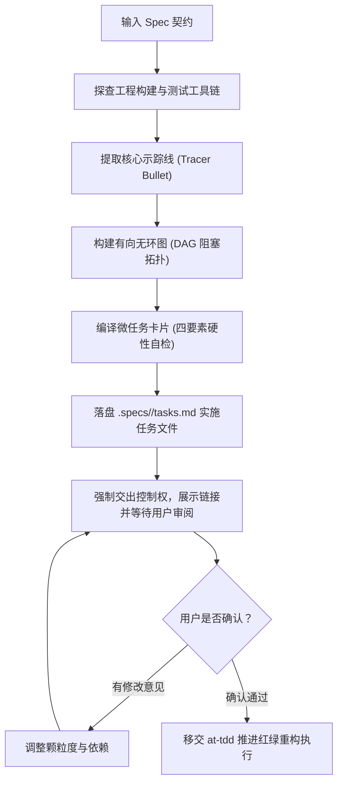

# `at-plan` 技能使用指南：工序拆解与原子微任务编排

`at-plan` 是一项将架构方案与增量规格（Spec）编译为高执行力、自包含、极小颗粒度原子实施计划（`.specs/<feature-slug>/tasks.md`）的工程技能。它结合了 Superpowers 的示踪线（Tracer Bullet）优先推进理念与 Matt Pocock 的原子任务卡片设计，确保每个微任务在 2~5 分钟内可单次验证闭环。

---

## 1. 何时使用 (When to Use)

- **Spec 契约已敲定，准备进入编码**：已获得 `.specs/<feature-slug>/delta.md` 或 RFC 方案，需要将其拆解为具体代码文件与改动工序；
- **防止 Agent 在长任务中失控**：大任务如果不拆解，Agent 容易一次性改动数十个文件而导致上下文崩溃或遗漏关键实现；
- **需要精确掌握关键路径与依赖关系**：复杂的跨模块特性需要明确哪些任务阻塞哪些任务，以及哪些任务可以并行启动；
- **支持跨会话断点续做**：任务清单以 `- [ ]` 打卡状态持久化，会话中断或切换代理后可毫秒级恢复进度。

---

## 2. 调用语法与参数 (Syntax & Triggers)

### 自然语言唤醒 (推荐)
- “请根据刚写好的增量规格，拆解一份 2~5 分钟颗粒度的实施任务清单（tasks.md）。”
- “帮我为这个需求做工序拆解，优先规划示踪线（Tracer Bullet）。”
- “把这份方案编译为带有自检命令的微任务 DAG 计划。”

### 显式斜杠命令 (若平台支持)
```bash
/at-plan [规格文件路径或特性名称]
```

---

## 3. 前置依赖输入 (Prerequisites & Inputs)

- **增量规格或架构方案**：前序通过 `at-spec` 产生的增量规格文件（如 `.specs/<feature-slug>/delta.md`），或清晰的特性设计文档；
- **工程构建环境**：代码库构建与单测工具链（如 Maven、Gradle、npm、pytest 等），由 Agent 自动探查获取。

---

## 4. 执行过程交互 (Execution Flow & Human Interactions)

`at-plan` 执行过程中严格遵循示踪线提取、DAG 建模与四要素检查：



1. **确立示踪线 (Tracer Bullet)**：优先从数据层到控制层切出垂直主干通路，在前几个任务中验证端到端走通；
2. **四要素硬性检查**：
   - **显式前置依赖**：清晰标明 `Task XX`；
   - **精确相对路径**：具体到文件与包路径；
   - **极简核心动作**：2~5 分钟代码编写意图；
   - **确定性自检命令**：可直接运行的单测试或编译命令；
3. **落盘并等待人类审阅**：一次性落盘 `.specs/<feature-slug>/tasks.md`，提供直达链接并等待用户确认。

---

## 5. 交付物与下一步推荐 (Deliverables & Next Steps)

### 核心交付物
- **`.specs/<feature-slug>/tasks.md`**：结构化原子实施任务文档，内含 Mermaid 依赖拓扑图、分阶段微任务卡片以及端到端 DoD 验收清单。

### 下一步工程流转
- **进入测试驱动开发**：唤起 `at-tdd` 技能，严格依循任务清单自上而下推进红绿灯循环；
- **全部任务完成后的审查**：所有任务打卡完毕后，唤起 `at-review` 开展双轴代码质量体检；
- **疑难问题排错**：若执行过程中单测意外受阻，唤起 `at-diagnose` 追踪根因。
