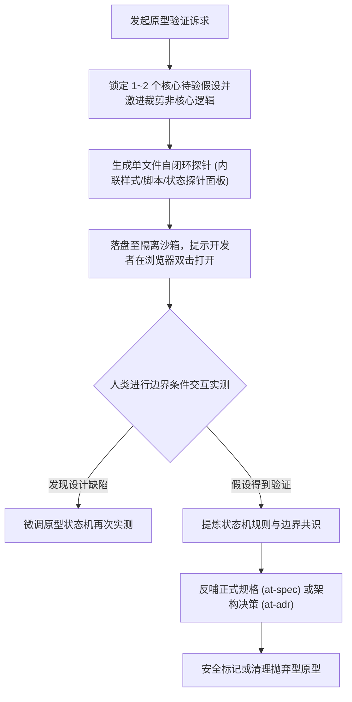

# `at-prototype` 技能使用指南：抛弃型原型沙箱探针

`at-prototype` 是一项专用于在需求模糊或架构未决时期，以极低成本构建单文件抛弃型原型（Throwaway Prototype）的探索技能。它贯彻“抛弃型不变量”，拒绝在原型阶段追求复杂的工程脚手架与全量防御代码；聚焦核心待验假设，通过零构建单文件交互模型与实时状态探针，帮助开发者在几分钟内直观验证状态机流转与交互体感，并将共识经验沉淀为正式规格。

---

## 1. 何时使用 (When to Use)

- **复杂状态机流转不确定**：例如多步骤向导、异步轮询补偿、竞态中断场景，需要直观验证状态迁移逻辑是否自洽；
- **前端交互或用户体验分歧**：团队对某种操作流（如抽屉式编辑 vs 弹窗式向导）各持己见，需快速用可点击的原型对比手感；
- **新算法或复杂数据结构探索**：例如无限级树结构折叠展开、画布拖拽碰撞检测等，用单脚本快速验证逻辑正确性；
- **评估技术库或 API 人体工学**：快速编写小探针验证某个第三方 SDK 的链式调用是否顺手。

---

## 2. 调用语法与参数 (Syntax & Triggers)

### 自然语言唤醒 (推荐)
- “我们正在讨论订单支付超时取消的状态机，请用 at-prototype 帮我写一个单文件 HTML 原型，带状态探针。”
- “帮我快速构建一个抛弃型原型，验证多标签页筛选与分页联动的交互逻辑。”
- “运行 at-prototype，针对文件分片上传重试流做一个单文件探针。”

### 显式斜杠命令 (若平台支持)
```bash
/at-prototype [待验假设/状态机场景描述]
```

---

## 3. 前置依赖输入 (Prerequisites & Inputs)

- **核心待验假设**：需要证明或证伪的具体问题（如“竞态时状态是否会错乱”）；
- **简化交互模型**：涉及的关键状态集合与操作事件（如 INIT、PENDING、SUCCESS、FAILED 等）；
- **沙箱隔离路径（可选）**：指定落盘目录，默认输出至隔离的临时或沙箱目录，严禁写入生产源码树。

---

## 4. 执行过程交互 (Execution Flow & Human Interactions)

`at-prototype` 执行过程严格遵循假设萃取、单文件构建、人机实测与结论沉淀：



1. **激进范围裁剪**：砍掉鉴权、持久化数据库和无意义的复杂样式，仅保留验证骨干；
2. **零构建单文件**：单文件自闭环，双击即在浏览器原生运行，自带实时状态监视器；
3. **真实体感测试**：开发者通过点击交互实测极端场景（快速连续点击、网络超时模拟）；
4. **决策反哺闭环**：验证通过后将成果提炼为正式规范，严禁将原型代码直接转正。

---

## 5. 交付产物与标准 (Outputs & Standards)

执行完毕后交付以下标准化产物：
- **单文件自闭环原型**：`prototype-<name>.html`（带有非生产警告注释与实时状态监视器）；
- **交互验证与决策记录**：包含假设验证结论、意外发现边界与选型决策的说明；
- **正式规格输入物**：提炼完毕的离散状态机转换表或 API 签名草案，可直接作为 `at-spec` 输入。
