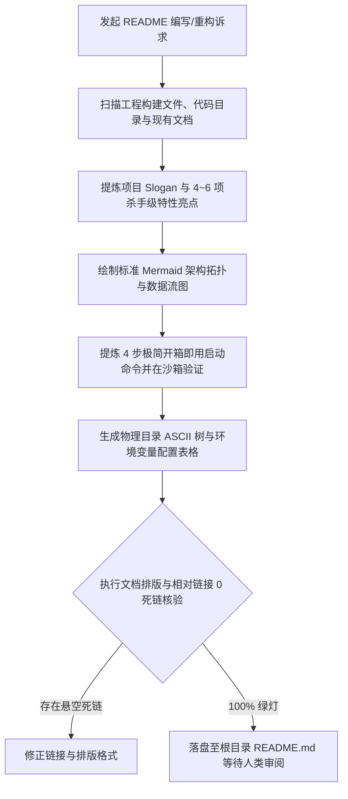

# `at-readme` 技能使用指南：项目核心门户与全景导航

`at-readme` 是一项专用于构建与持续同步工业级代码仓库第一门面 `README.md` 的文档工程技能。它遵循“黄金 5 秒法则”与顶级开源项目排版标准，帮助开发者快速提炼项目核心价值主张、设计标准 Shields.io 状态徽标、绘制 Mermaid 架构拓扑图、编写开箱即用快速启动指南并规整物理目录与配置矩阵，打造高品质、低上手门槛且值得信赖的项目知识门户。

---

## 1. 何时使用 (When to Use)

- **新项目初始化建立门面**：新代码仓库刚搭建，需要快速生成专业、结构完整的项目 `README.md`；
- **存量项目门面大重构**：既有 `README.md` 年久失修、描述空洞、启动指令报错或严重缺乏架构说明；
- **重大版本发布同步**：发布重大功能版本时，同步更新特性列表、架构拓扑与配置字典；
- **开源项目国际化与正规化**：补充 CI 构建状态徽标、开源许可证、中英双语导流与贡献者指引；
- **多包仓库 (Monorepo) 子模块文档**：为 Monorepo 下各微服务或独立 SDK 编写标准化自闭环 README。

---

## 2. 调用语法与参数 (Syntax & Triggers)

### 自然语言唤醒 (推荐)
- “请帮我为当前仓库生成一份工业级的 README.md，包含架构拓扑图、快速开始和配置矩阵。”
- “使用 at-readme 重构项目门面，提炼核心亮点，并添加 Shields.io 状态徽标。”
- “运行 at-readme，检查并同步 README 中的目录树与环境变量配置说明。”

### 显式斜杠命令 (若平台支持)
```bash
/at-readme [项目定位/重点特色/目标受众(可选)]
```

---

## 3. 前置依赖输入 (Prerequisites & Inputs)

- **代码仓库上下文（Agent 自动扫描）**：构建配置文件（`package.json`/`pom.xml`/`Cargo.toml`）、核心入口代码与现有文档；
- **项目定位描述（可选）**：业务目标、核心受众与主要杀手级特性；
- **外部链接信息（可选）**：在线演示 Demo 地址、官方文档站点或部署地址。

---

## 4. 执行过程交互 (Execution Flow & Human Interactions)

`at-readme` 执行过程严格遵循代码库认知扫描、架构拓扑生成、启动命令实测与质量门禁核验：



1. **精准价值提炼**：一句话中英双语 Slogan 与 4~6 个核心特性，第一眼抓住眼球；
2. **可视化架构图**：Mermaid 流程图展示核心分层与调用拓扑，免去复杂画图工具；
3. **真实可复制指令**：四步启动命令在沙箱验证，拒绝“按 README 跑不起来”；
4. **全链路死链自检**：相对路径与锚点自动检测，确保 0 死链。

---

## 5. 交付产物与标准 (Outputs & Standards)

执行完毕后交付以下标准化产物：
- **工业级项目门户**：根目录下结构完整、图文并茂的 `README.md`；
- **架构拓扑代码块**：标准 Mermaid 流程图源码；
- **开箱即用配置矩阵**：结构化环境变量与运行参数说明表格；
- **干净的工作区 Git Diff**：零敏感凭据泄漏，修改严格聚焦文档，等待人类显式指令提交。
