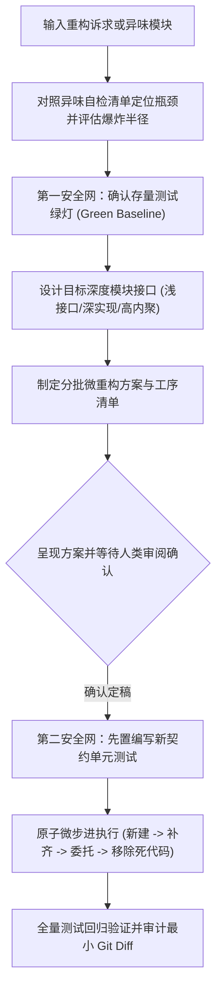

# `at-refactor` 技能使用指南：深度模块架构演进与微重构

`at-refactor` 是一项践行《软件设计的哲学》“深度模块 (Deep Module)”设计理念与安全微步进重构协议的工程技能。它帮助开发者识别与诊断系统中的架构异味（如上帝类膨胀、浅模块与过度碎片化、依恋情结、散弹式修改），以“浅接口、深实现”为核心原则设计新模块缝隙，并依托双安全网测试实施原子级受控微重构，在最小爆炸半径下恢复代码库的生机。

---

## 1. 何时使用 (When to Use)

- **治理历史“上帝类”或巨型文件**：存量代码文件膨胀至数千行、承担多重业务职责时，通过绞杀者模式外拆专用深度模块；
- **接口过于繁琐或抽象泄漏 (浅模块)**：接口方法成堆但内部只是简单透传，需要重新收敛接口、隐藏内部复杂性；
- **纠正形式主义过度碎片化**：滥用模式将简单逻辑机械拆成十几个微文件导致开发迷失，需就地折叠并高内聚重组；
- **消除散弹式修改与依恋情结**：改动某一业务点需同时修改 8 个文件，需将共变逻辑归拢于同一模块；
- **安全微步进重构演进**：在已有单测保护下，小步快跑实施无破坏性的架构演进。

---

## 2. 调用语法与参数 (Syntax & Triggers)

### 自然语言唤醒 (推荐)
- “OrderServiceImpl 已经超过 1500 行，承担了过多职责，请帮我规划并执行深模块重构。”
- “帮我诊断当前鉴权与权限模块的架构异味，设计一个浅接口深实现的 Token 管理深度模块。”
- “运行 at-refactor，消除这组类之间的散弹式修改问题，并拆解微重构步骤。”

### 显式斜杠命令 (若平台支持)
```bash
/at-refactor [目标类/模块名称或异味描述]
```

---

## 3. 前置依赖输入 (Prerequisites & Inputs)

- **目标重构对象**：拟重构的类、方法、模块路径或痛点现象；
- **存量测试套件（Agent 自动扫描）**：既有单测覆盖情况由 Agent 自动核查；若缺失测试，Agent 将强制提示前置补充特征测试（第一安全网）。

---

## 4. 执行过程交互 (Execution Flow & Human Interactions)

`at-refactor` 执行过程严格遵循异味诊断、深度缝隙设计、双安全网筑牢与微步推进：



1. **自动诊断异味**：分析上帝类、浅模块、依赖循环与圈复杂度；
2. **深度缝隙设计**：提炼极简的高层语义接口，将复杂性（事务、缓存、并发、外部调用）深锁在内部；
3. **人类审阅确认**：展示重构方案与微步骤拆解，等待人类确认；
4. **受控微步执行**：每一步原子化执行并立即跑测，严禁全量推倒重写。

---

## 5. 交付产物与标准 (Outputs & Standards)

执行完毕后交付以下标准化产物：
- **重构方案文档**：`refactor-plan.md`（包含异味诊断、深接口契约、微步骤工序）；
- **第二安全网单测**：针对新深度模块的高覆盖契约测试用例；
- **重构代码落地**：演进后的新深度模块与存量委托调用点；
- **干净的工作区 Diff**：所有改动严格聚焦于重构范围，等待人类显式指令提交。
