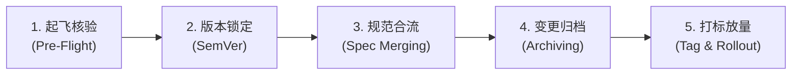

# at-release 技能手册：安全发布与规范归档演进指南

本文档为 `at-release` 技能的伴随使用与维护手册，指导工程技术团队、发布主管与 DevOps 工程师执行上线起飞核验、语义化版本锁定（SemVer）与增量规范向主干规格的合并归档。

---

## 1. 技能定位与核心价值

版本发布是软件研发全生命周期中最具风险的阶段。`at-release` 技能建立高确定性的渐进发版与资产归档体系：
- **六维起飞检查核验 (Pre-Flight)**：系统化核对代码状态、自动化门禁、供应链安全、数据迁移与回滚预案，阻断带病上线；
- **规范驱动闭环归档 (Spec Archiving)**：将阶段性增量变更规范（Specs）汇流至主干真实信源（SSOT），并将历史包归档至 `specs/archive/` 留痕；
- **严格 SemVer 与 Git 附注打标**：基于特性影响面严格计算版本号晋升，生成语义清晰的带注释版本标签。

---

## 2. 架构拓扑与微内核设计

`at-release` 遵循微内核架构设计，物理目录保持清晰与高内聚：

```text
skills/at-release/
├── SKILL.md                                          # 核心编排入口（81 行轻量状态机）
├── references/                                       # 输入型知识层（按需 JIT 加载）
│   ├── checklists/
│   │   └── pre-flight-launch-checklist.md            # 六维起飞检查、依赖审计与回滚协议
│   └── protocols/
│       └── spec-archiving-protocol.md                # 增量汇流、归档目录与 SemVer 打标协议
└── examples/                                         # 案例样本层
    └── sample-release-workflow.md                    # v1.2.0 正式发布全流程实战操作样例
```

---

## 3. 渐进式工作流与状态机推演

`at-release` 采用五阶段工作流指导发布全流程推进：



1. **起飞核验**：执行六维检查清单审计，确认 CI 门禁全绿、依赖零高危漏洞与回滚方案就绪；
2. **版本锁定**：评估破坏性与兼容性，确定 MAJOR/MINOR/PATCH 版本号并更新工程元数据；
3. **规范合流**：将本次发布的增量 API 契约与数据模型设计合并至系统全局主干规格书；
4. **变更归档**：将增量变更目录完整归档至 `specs/archive/vX.Y.Z/`，对齐并更新 `CHANGELOG.md`；
5. **打标放量**：创建 Git 附注标签，按金丝雀比例推进渐进发布与指标观测。

---

## 4. 核心协议与模板参考

- **起飞检查协议**：[Pre-Flight Launch Checklist](../../skills/at-release/references/checklists/pre-flight-launch-checklist.md) 详细定义了分支、门禁、CVE 审计、DDL 双向兼容与回滚标准；
- **规范归档协议**：[Spec Archiving Protocol](../../skills/at-release/references/protocols/spec-archiving-protocol.md) 规定了增量规范合并、历史归档拓扑与 SemVer 计算规则；
- **实战样例**：[Sample Release Workflow](../../skills/at-release/examples/sample-release-workflow.md) 呈现了包含起飞核验、目录迁移与 Git 打标的真实发布样例。

---

## 5. 质量保证与度量指标

发布流程与交付物必须通过以下质量基线核验：
- **零高危脆弱性泄漏**：生产构建前依赖审计结果必须为 0 High/Critical CVE；
- **数据平滑演进**：数据库变更必须遵循 Expand and Contract 双向兼容，且有现成可执行的反向脚本；
- **工作区整洁性**：增量设计文档归档后，`specs/changes/` 仅保留下一周期未发布的提案；
- **排版与规范自闭环**：所有发布文档与版本日志 100% 遵循盘古之白排版与相对路径规范。
