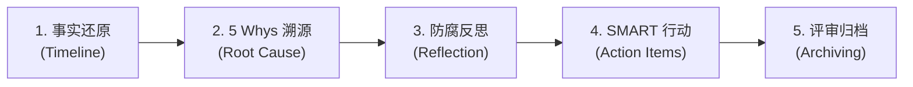

# at-retro 技能手册：事故复盘与工程防腐演进指南

本文档为 `at-retro` 技能的伴随使用与维护手册，指导工程技术团队、SRE 与架构师组织无指责事后复盘（Postmortem），运用 5 Whys 溯源分析法深挖工程缺陷根因，并制定落地闭环的防腐整改机制。

---

## 1. 技能定位与核心价值

任何系统在面对真实生产负载与不可预测的复杂网络环境时，都有发生故障的可能。`at-retro` 技能建立长效的学习型复盘工程体系：
- **无指责文化 (Blameless Culture)**：将排障视角从“找替罪羊”彻底转变为“发现系统与流程机制脆弱性”，保护团队信任与坦诚度；
- **5 Whys 穿透式因果溯源**：层层追问深层原因，阻断浮于表面的偶发性定性，直达门禁缺失与架构漏洞；
- **工程防腐三问与闭环治理**：深入反思“何种测试、契约或监控本可阻止缺陷”，产出符合 SMART 原则的高质量行动项。

---

## 2. 架构拓扑与微内核设计

`at-retro` 遵循微内核架构设计，物理目录保持清晰与高内聚：

```text
skills/at-retro/
├── SKILL.md                                          # 核心编排入口（81 行轻量状态机）
├── references/                                       # 输入型知识层（按需 JIT 加载）
│   ├── protocols/
│   │   └── five-whys-protocol.md                     # 无指责原则、5 Whys 追问与防腐三问协议
│   └── templates/
│       └── postmortem-report-template.md             # 生产级事后复盘报告与 SMART 行动项模板
└── examples/                                         # 案例样本层
    └── sample-postmortem.md                          # 缓存击穿与数据库雪崩故障复盘实战样例
```

---

## 3. 渐进式工作流与状态机推演

`at-retro` 采用五阶段工作流指导复盘会议与改进机制落地：



1. **事实还原**：基于监控指标与审计日志，以分钟为粒度客观还原故障演进全生命周期；
2. **5 Whys 溯源**：自表象症状由浅入深追溯 5 层因果关系，定位底层工程机制缺失；
3. **防腐反思**：回答“何种测试本可拦截、何种契约本可阻止、何种监控本可预警”防腐三问；
4. **SMART 行动**：制定职责清晰、指标明确、具备截止时限的技术整改工单清单；
5. **评审归档**：召开跨职能评审会达成共识，将反思规则固化至团队门禁与架构规范中。

---

## 4. 核心协议与模板参考

- **复盘协议**：[Five Whys Retro Protocol](../../skills/at-retro/references/protocols/five-whys-protocol.md) 规定了无指责文化、5 Whys 深度追问范式与 SMART 行动项标准；
- **复盘模板**：[Postmortem Report Template](../../skills/at-retro/references/templates/postmortem-report-template.md) 提供了标准事故概要、时间线还原、根因分析与工单骨架；
- **实战样例**：[Sample Postmortem Incident](../../skills/at-retro/examples/sample-postmortem.md) 记录了秒杀大促期间缓存击穿雪崩的真实复盘全流程。

---

## 5. 质量保证与度量指标

复盘报告交付前必须通过以下质量基线核验：
- **无指责合规**：严禁包含任何归咎个人的措辞，全部转化为流程、机制与自动化层面的防腐；
- **因果链条严密性**：5 Whys 的每一层推导必须由客观技术事实支撑，禁止主观推测；
- **行动项可闭环**：100% 行动项满足 SMART 准则并绑定具体工单编号，禁止空泛的“加强管理”；
- **排版与规范自闭环**：报告与文档 100% 遵循盘古之白中西文排版与相对路径规范。
