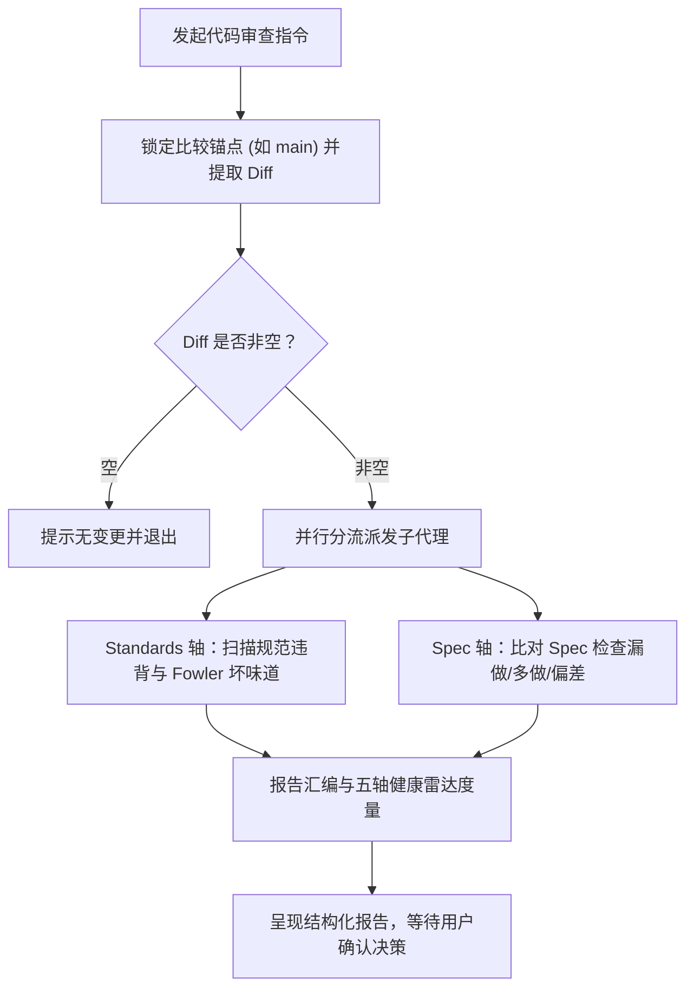

# `at-review` 技能使用指南：代码双轴审查与五轴健康雷达

`at-review` 是一项面向 Git 变更集（Diff / PR / Commit）的高维度代码审查技能。它融合了 Matt Pocock 的双轴（Standards 规范轴 + Spec 契约轴）并行隔离审查机制与 Addy Osmani 的五轴健康雷达模型，消除评审偏见，严防规范与需求相互掩盖。

---

## 1. 何时使用 (When to Use)

- **分支合流或 Pull Request 提交前**：对即将合并到主干的代码进行最后一道质量闸门体检；
- **排查代码规范与经典坏味道**：识别神秘命名、重复逻辑、依恋情结、循环内 SQL 查询等潜在技术债；
- **核验需求规格契约是否完整落地**：对照关联的 Issue 或 `spec-delta.md`，排查是否有“要求了但漏写”或“没要求却擅自扩充（Scope Creep）”；
- **多维度架构健康度评估**：从契约正确性、可维护性、安全性、性能效率、测试健壮度五个维度全面打分。

---

## 2. 调用语法与参数 (Syntax & Triggers)

### 自然语言唤醒 (推荐)
- “请对当前分支相对 main 的变更做一次代码审查（Review）。”
- “帮我审查最近 3 个 commit 的代码，检查规范和 Spec 完成度。”
- “运行双轴 review，看看这段改动有没有阻断性问题。”

### 显式斜杠命令 (若平台支持)
```bash
/at-review [fixed-point] # 如 /at-review main 或 /at-review HEAD~3
```

---

## 3. 前置依赖输入 (Prerequisites & Inputs)

- **审查基准锚点 (Fixed Point)**：一个确定的分支名、Tag 或 Commit SHA（若不提供，Agent 自动提取 `git merge-base origin/main HEAD`）；
- **非空 Git Diff**：当前工作区或提交历史与锚点之间存在真实代码改动；
- **关联需求契约 (可选但推荐)**：`spec-delta.md`、需求 RFC 或 Issue 文本。

---

## 4. 执行过程交互 (Execution Flow & Human Interactions)

`at-review` 执行过程中严格遵循双轴正交隔离派发与并置汇总：



1. **自动提取三点 Diff**：`git diff <fixed-point>...HEAD`；
2. **双轴并行独立分析**：
   - **Standards 轴**：仅专注代码规范、坏味道清单、空安全、异常处理；
   - **Spec 轴**：仅专注需求覆盖度、范围蔓延与契约逻辑一致性；
3. **汇编五轴健康雷达**：对 5 个维度给出直观评级；
4. **阻断项分级展示**：明确罗列 🔴 Blocker（阻断）、🟠 Major（严重）、🟡 Minor（建议）、⚪ Nit（轻微）。

---

## 5. 交付物与下一步推荐 (Deliverables & Next Steps)

### 核心交付物
- **《代码双轴审查报告》**：会话中直观输出或落盘为 `review-report.md`，内含双轴并置独立报告、五轴健康雷达表格与问题分级指引。

### 下一步工程流转
- **修复 Blocker 阻断项**：调用 `at-tdd` 技能，通过红绿测试驱动循环快速补齐遗漏用例或修复逻辑缺陷；
- **排查疑难隐藏 Bug**：若审查暴露了逻辑链路复杂的未知深坑，调用 `at-diagnose` 追踪定位根因；
- **通过后准备发布**：若结论为 `APPROVED`，可安全进行分支合并与代码提交。
