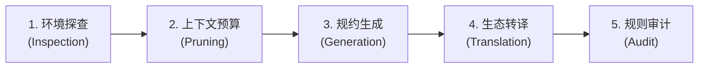

# at-rules 技能手册：智能体工程规约与行为治理指南

本文档为 `at-rules` 技能的伴随使用与维护手册，指导开发者与多智能体系统构建中立、开放、抗漂移的 AI Agent 工程行为规约与上下文体系。

---

## 1. 技能定位与核心价值

在多模型与多种 AI 编码助手共存的软件工程环境中，各模型因提示词格式差异极易产生行为不一致、越权提交代码或泄露生产凭据等风险。`at-rules` 技能旨在提供标准化的规约治理工具链：
- **中立开放标准**：以中立的 `AGENTS.md` 为核心规范源头，兼容 Claude、Cursor、Windsurf 等各类 AI 工具链；
- **分层上下文治理**：建立“全局基础准则 - 技术栈领域层 - 局部目录层”的三层金字塔体系，严格把控 Token 预算；
- **防御性红线固化**：显式注入 Git 两级授权、凭据零泄漏、最小破坏半径等工程纪律，确保智能体行为可预测。

---

## 2. 架构拓扑与微内核设计

`at-rules` 遵循微内核架构与关注点分离原则，物理目录保持自闭环：

```text
skills/at-rules/
├── SKILL.md                                          # 核心编排入口（81 行轻量状态机）
├── references/                                       # 输入型知识层（按需 JIT 加载）
│   ├── protocols/
│   │   └── prompt-governance-protocol.md             # 提示词治理与上下文预算协议
│   └── templates/
│       └── agents-md-template.md                     # AGENTS.md 标准化生产模板
└── examples/                                         # 案例样本层
    └── sample-agents-spec.md                         # 电商中台实战规约样例
```

---

## 3. 渐进式工作流与状态机推演

`at-rules` 的执行遵循五阶段渐进式推演流水线：



1. **环境探查**：分析项目依赖文件（Maven/Gradle/npm/pip 等）、架构分层与历史 Git 提交特征；
2. **上下文预算**：计算 Token 预算，识别需前置拦截的负向红线；
3. **规约生成**：填充项目元数据，结合特定技术栈特征生成 `AGENTS.md`；
4. **生态转译**：建立面向各类 AI 助手的无损同源映射；
5. **规则审计**：静态检测死链、本地路径泄露与语义互斥风险。

---

## 4. 核心协议与模板参考

- **治理协议**：[Prompt Governance Protocol](../../skills/at-rules/references/protocols/prompt-governance-protocol.md) 详细约定了规约层级划分、防漂移法则及脱敏纪律；
- **交付模板**：[AGENTS.md Template](../../skills/at-rules/references/templates/agents-md-template.md) 提供了覆盖交互规范、代码质量、Git 授权与安全防护的开箱即用模板；
- **落地样板**：[Sample Agents Spec](../../skills/at-rules/examples/sample-agents-spec.md) 呈现了在生产级微服务中落地领域特定规约的实践形态。

---

## 5. 质量保证与度量指标

为确保规约的工程可用性，每次发布前必须达成以下指标：
- **Token 紧凑度**：全局 `AGENTS.md` 正文控制在 150 行以内，首屏提示词开销 < 1,500 tokens；
- **零环境依赖**：规约文档中 100% 杜绝本地绝对路径（如 `C:/` 或 `file:///`）；
- **排版与链接完整性**：所有中西文与数字保留盘古之白空格，交叉引用保持单层扁平且零死链。
