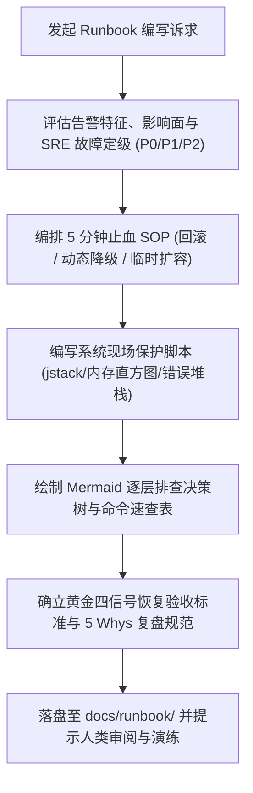

# `at-runbook` 技能使用指南：运维应急排错手册与故障响应

`at-runbook` 是一项践行 SRE（站点可靠性工程）理念的故障应急响应与运维排错工程技能。它遵循“1-5-10 故障响应原则”与“先止血后排障”铁律，帮助研发与运维值班团队将分散零碎的排障经验转化为标准化、可执行的 `docs/runbook/` 应急操作手册。在突发线上 P0/P1 故障时，指导值班人员在 10 分钟内完成一键回滚、动态降级或流量切换止血，随后按部就班抓取现场快照并根除故障。

---

## 1. 何时使用 (When to Use)

- **核心服务上线前准备应急预案**：新微服务或重要支付/交易链路投产前，需沉淀标准故障应急处理手册；
- **生产发生高频告警/反复故障**：数据库连接池满载、内存泄漏（OOM）、高并发线程死锁等高频场景，需要标准化止血 SOP；
- **突发黑天鹅事故应急处置**：线上接口突然大量报错、延时陡增，指导值班人员优先回滚/降级止血；
- **建立 SRE 值班交接与演练机制**：配合混沌工程与定期桌面推演，沉淀防故障再发生的肌肉记忆。

---

## 2. 调用语法与参数 (Syntax & Triggers)

### 自然语言唤醒 (推荐)
- “请帮我为订单服务编写一份数据库连接池耗尽的应急排错手册 (Runbook)，包含止血回滚指令。”
- “使用 at-runbook 梳理 Redis 缓存击穿与雪崩的故障排查决策树，并输出标准 SOP 手册。”
- “运行 at-runbook，为网关服务制定针对 HTTP 504 上游超时的应急响应手册。”

### 显式斜杠命令 (若平台支持)
```bash
/at-runbook [故障现象/目标服务名称/告警规则]
```

---

## 3. 前置依赖输入 (Prerequisites & Inputs)

- **目标服务名称与部署形态**：Kubernetes Deployment、ECS 容器或传统主机环境；
- **典型告警特征与阈值**：如 Prometheus 告警规则、错误日志关键字；
- **止血应急开关（可选）**：配置中心降级 Key、发布系统回滚命令。

---

## 4. 执行过程交互 (Execution Flow & Human Interactions)

`at-runbook` 执行过程严格遵循故障定级、先止血 SOP、决策树排查与验收固化：



1. **先止血后排障**：回滚与降级指令置顶，严禁初期陷在代码调试中；
2. **命令零歧义**：每条排查与止血指令参数清晰、无绝对机密，开箱即复制；
3. **现场快照保护**：自动生成现场抓取脚本，防范实例自动重启冲刷案发现场；
4. **黄金指标验收**：明确延迟、流量、错误、饱和度的量化恢复基准。

---

## 5. 交付产物与标准 (Outputs & Standards)

执行完毕后交付以下标准化产物：
- **标准化运维应急手册**：`docs/runbook/<incident-type>.md`（包含分级、止血命令与排查树）；
- **排障诊断决策树图**：标准 Mermaid 流程图；
- **现场保护与自愈脚本命令速查**：安全无副作用的终端排查命令；
- **干净的工作区 Git Diff**：零敏感凭据泄漏，修改严格聚焦文档，等待人类显式指令提交。
