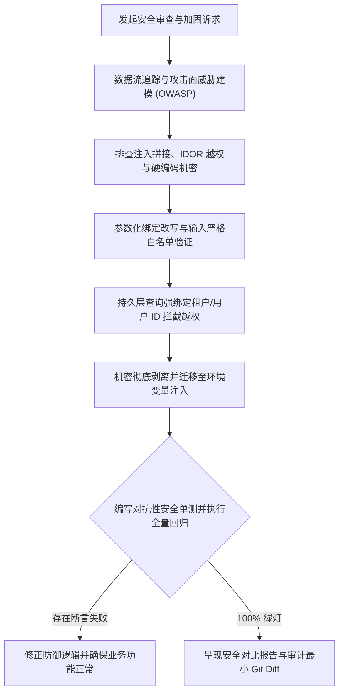

# `at-security` 技能使用指南：全栈安全审查与威胁加固

`at-security` 是一项围绕 OWASP Top 10 威胁模型与纵深防御（Defense-in-Depth）理念构建的全栈代码安全工程技能。它帮助开发者系统性扫描与修复常见高危漏洞（如 SQL/NoSQL 注入、跨站脚本 XSS、水平/垂直越权 IDOR、硬编码机密泄露与不安全的反序列化），通过参数化绑定、输入白名单模式校验、租户强隔离与环境变量机密注入，交付具备工业级安全韧性的健壮代码。

---

## 1. 何时使用 (When to Use)

- **SQL 注入与动态查询排查**：存在动态拼接 SQL、字符串插值或动态 `ORDER BY` 字段，需重构为预编译参数化绑定；
- **越权漏洞 (IDOR) 防御**：按 ID 查询或更新资源的 API 端点未校验当前登录用户的租户或所有权，需补充水平越权防御；
- **代码机密脱敏治理**：代码、配置文件或单元测试桩中疑似硬编码了明文密码、API Token、私钥，需收口至环境变量与 KMS；
- **前端 XSS 与模板安全加固**：渲染不可信富文本或操作原生 DOM 时，需集成 DOMPurify 白名单过滤与 CSP 策略；
- **第三方依赖安全审计**：检查并修复 `package.json`、`pom.xml` 或 `requirements.txt` 中存在的已知高危 CVE 漏洞组件。

---

## 2. 调用语法与参数 (Syntax & Triggers)

### 自然语言唤醒 (推荐)
- “请帮我审查 OrderController.java 和相关 Mapper，排查 SQL 注入与越权漏洞，并完成安全加固。”
- “运行 at-security 扫描当前服务，清除所有硬编码机密并改为从环境变量注入。”
- “使用 at-security 针对这个对外开放的 Webhook 接口进行威胁建模与安全加固。”

### 显式斜杠命令 (若平台支持)
```bash
/at-security [目标类/接口/文件路径或漏洞类型]
```

---

## 3. 前置依赖输入 (Prerequisites & Inputs)

- **目标代码/接口范围**：需要进行安全审查与加固的 Controller、Service、Mapper 或前端组件路径；
- **威胁关注点（可选）**：指定重点审计的维度（如“注入防御”、“越权防范”、“机密脱敏”等）；
- **环境凭据规范（可选）**：指示团队通用的环境变量命名规范或密钥管理器协议。

---

## 4. 执行过程交互 (Execution Flow & Human Interactions)

`at-security` 执行过程严格遵循威胁建模、防注入与越权加固、机密收口与安全回归：



1. **攻击面拓扑追踪**：从不可信外部输入入口追踪至持久层与下游系统；
2. **防注入与越权拦截**：参数化占位符消灭 SQLi，查询强制注入 `tenant_id` 消灭 IDOR；
3. **零明文机密治理**：彻底消灭源代码中的敏感凭据，模板采用大写占位符；
4. **对抗测试保障**：编写对抗测试用例（恶意 Payload 探测），验证防御生效且业务无损。

---

## 5. 交付产物与标准 (Outputs & Standards)

执行完毕后交付以下标准化产物：
- **安全加固源码**：全量参数化查询、严格输入净化与租户隔离的安全代码；
- **安全审计与加固报告**：包含漏洞成因、加固措施、CVE 修复清单与残存风险评估；
- **对抗性安全单测套件**：验证注入与越权被成功拦截的自动化测试用例；
- **干净合规的 Git Diff**：零敏感凭据泄漏，修改严格聚焦安全加固。
