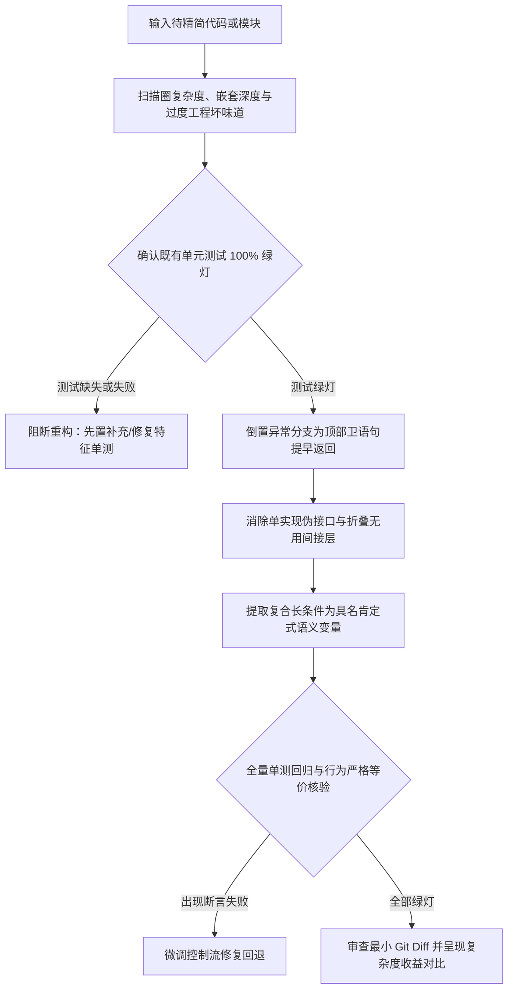

# `at-simplify` 技能使用指南：代码极致精简与控制流扁平化

`at-simplify` 是一项践行奥卡姆剃刀“清晰胜过炫技”哲学的代码重构技能。它专门治理软件开发中常见的“深层条件嵌套（箭头反模式）”、“投机性过度工程（YAGNI 违背）”、“单一实现的伪接口”与“晦涩长布尔表达式”。通过卫语句提早返回、消除深层 `else` 块、提取自解释命名变量与折叠无用间接层，在单元测试全绿灯保护下将代码心智负担降至最低。

---

## 1. 何时使用 (When to Use)

- **代码出现箭头金字塔嵌套**：嵌套层级超过 3 层，阅读时需要不断横向滚动并记忆前置分支状态；
- **消除悬挂 else 与深层分支**：函数末尾拖着一连串的 `else { ... }` 异常块，需将其倒置为顶部卫语句并提早返回；
- **清理形式主义过度设计**：系统仅有一种业务逻辑，却机械式套用策略模式、抽象工厂或单实现接口，需将其就地内聚折叠；
- **长布尔表达式难以理解**：`if` 条件包含多行 `&&`、`||` 甚至双重否定，需提取为自然语义肯定的解释性变量；
- **循环体内缩进过深**：长循环体内包裹大段 `if` 判断，需通过 `continue` 提早过滤无关数据项。

---

## 2. 调用语法与参数 (Syntax & Triggers)

### 自然语言唤醒 (推荐)
- “这个优惠券核销方法嵌套了 5 层 if-else，请用 at-simplify 帮我用卫语句扁平化。”
- “帮我精简当前函数，消除过度抽象和深层嵌套，要求保持原有单测 100% 绿灯。”
- “运行 at-simplify，检查并优化这段支付回调逻辑中的圈复杂度与复合表达式。”

### 显式斜杠命令 (若平台支持)
```bash
/at-simplify [目标函数/文件路径或代码段]
```

---

## 3. 前置依赖输入 (Prerequisites & Inputs)

- **目标代码片段或文件路径**：需要实施极简重构的目标类、方法或模块；
- **既有单元测试套件（Agent 自动核验）**：必须具备绿灯测试用例；若测试缺失，Agent 将强制提示前置补充特征测试；
- **重构范围约束（可选）**：指示是否允许修改包内可见性或私有辅助类。

---

## 4. 执行过程交互 (Execution Flow & Human Interactions)

`at-simplify` 执行过程严格遵循复杂度扫描、测试安全网确认、卫语句重组与等价性回归：



1. **圈复杂度扫描**：精准定位嵌套深度超过 3 层的代码段与箭头反模式；
2. **测试安全网筑牢**：在测试保护下重构，坚决杜绝改坏业务逻辑；
3. **卫语句与左对齐**：异常分支顶部抛出/退出，主逻辑顶格左对齐，视觉极度舒适；
4. **布尔自解释降噪**：肯定命名表达意图，消除双重否定与反直觉心智消耗。

---

## 5. 交付产物与标准 (Outputs & Standards)

执行完毕后交付以下标准化产物：
- **扁平极简源码**：最大嵌套深度 ≤ 3 层且主逻辑左对齐的等价代码；
- **圈复杂度对比报告**：精简前后的缩进深度、圈复杂度分值与可读性收益；
- **100% 绿灯单测回归证据**：所有既有单元测试无任何修改且全部通过；
- **干净的 Git Diff**：改动严格聚焦于控制流精简，无无关格式化污染。
