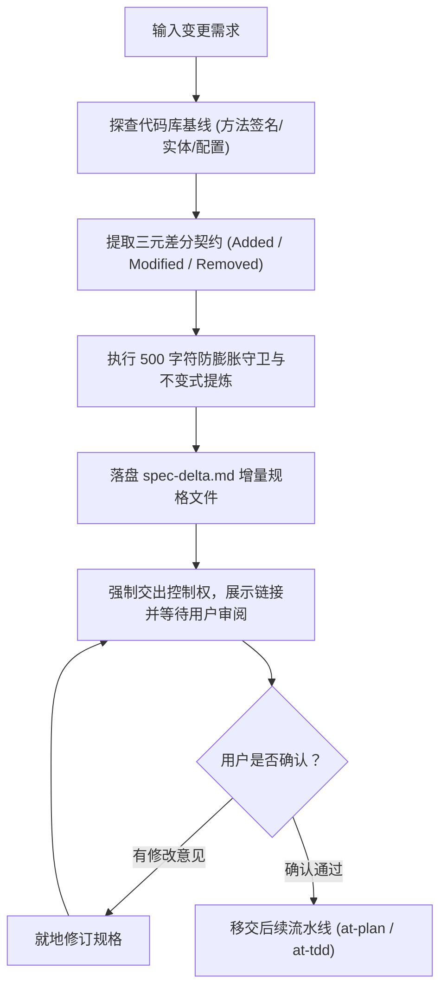

# `at-spec` 技能使用指南：增量规格契约与防膨胀规范

`at-spec` 是一项面向存量业务演进与新特性规格定义的增量设计技能。它吸收了 OpenSpec 的 Delta Specs 差分理念与 500 字符原子防膨胀守卫，只描述本次改动与存量代码基线的差异，生成机器可读、可转化为测试断言的高质量持久化契约。

---

## 1. 何时使用 (When to Use)

- **存量系统增量功能迭代**：需要对既有系统新增字段、扩充接口分支或调整状态机流转，避免重新撰写庞大的全量文档；
- **重构或废弃接口**：对现有公共 API 进行软废弃（Deprecated）或替换，需要明确“新老行为差异 (Before vs After)”与兼容性过渡方案；
- **为 TDD 准备确定性输入**：在测试驱动开发之前，需要将自然语言需求编译为具名的 `Given-When-Then` 边界契约；
- **防止设计文档脱节漂移**：解决传统文档“写完即失效”的痛点，通过 Delta 差分模型与 Git Diff 粒度对齐。

---

## 2. 调用语法与参数 (Syntax & Triggers)

### 自然语言唤醒 (推荐)
- “请为注销冷静期功能拟定增量规格契约（Delta Spec）。”
- “帮我写一份提现风控拦截的增量接口契约，注意不要写全量大文档。”
- “基于我们刚才讨论的共识，生成本次重构的 Delta Spec。”

### 显式斜杠命令 (若平台支持)
```bash
/at-spec [特性名称或功能描述]
```

---

## 3. 前置依赖输入 (Prerequisites & Inputs)

- **需求共识或变更目标**：前序通过 `at-grill` 质询收敛的决策树，或人类明确的特性需求描述；
- **代码库现有实现（基线真理）**：Agent 会自动扫描本地工程的现有方法签名、Controller 与 Entity，**无需用户手动复制粘贴存量代码**。

---

## 4. 执行过程交互 (Execution Flow & Human Interactions)

`at-spec` 执行过程中严格遵循基线探查、差分提取与人机确认闸门：



1. **自动探查基线与爆炸半径**：扫描本地代码库，标定直接影响与间接影响的组件范围；
2. **提取 Delta 三元组**：
   - **Added (新增)**：新接口、新 DTO、新配置；
   - **Modified (变更)**：存量接口改动（Before vs After 对比）；
   - **Removed (废弃)**：废弃调用的替代迁移指引；
3. **不变式与故障域兜底**：明确系统核心守恒律与极端异常时的状态码和容错表现；
4. **单轮交付并等待确认**：一次性落盘增量规格文件，提供点击链接并等待用户验收。

---

## 5. 交付物与下一步推荐 (Deliverables & Next Steps)

### 核心交付物
- **`spec-delta.md`（或 `.specs/<feature-id>-delta.md`）**：机器与人类双重可读的增量规格契约文件，内含元数据头、Delta 矩阵、系统不变式与故障域表格。

### 下一步工程流转
- **进入工序与微任务拆解**：直接调用 `at-plan` 技能，将每个原子 Delta 编译为 2~5 分钟的微任务清单；
- **进入测试驱动开发**：直接调用 `at-tdd` 技能，将契约中的输入输出与不变式转化为红绿灯测试断言；
- **系统级宏观方案撰写**：若变动跨越多个大型系统，需撰写全景方案，可调用 `at-tech-doc`。
