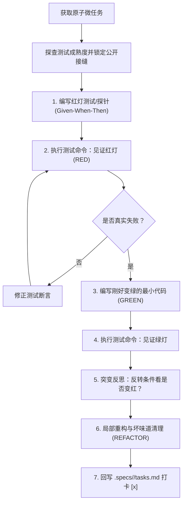

# `at-tdd` 技能使用指南：测试驱动开发与突变检验

`at-tdd` 是一项践行严苛软件工程纪律的测试驱动开发（TDD）技能。它融合了存量代码防误删保护红线、三级测试成熟度自适应模型与 Addy Osmani 的思维突变测试（Mutation Reflection）反思机制，确保交付的每一行代码均具备真实可自验证的防卫网，杜绝假通过与虚假覆盖率。

---

## 1. 何时使用 (When to Use)

- **新业务功能实现**：依据前序 `.specs/<feature-slug>/tasks.md` 微任务清单编写具体业务代码时，强制驱动测试先行；
- **缺陷修复 (Bug Fixing)**：修复任何已知 Bug 前，必须先编写一个能够稳定复现该缺陷的红灯单测；
- **防范虚假覆盖率**：担心单测虽然绿灯但断言软弱（如仅断言非空，漏测核心业务计算与边界）；
- **遗留代码重构**：在修改历史遗留模块前，先在公开接缝（Public Seams）补齐红绿自验证测试保护网。

---

## 2. 调用语法与参数 (Syntax & Triggers)

### 自然语言唤醒 (推荐)
- “请使用 TDD 模式开始执行 Task 02，注意严格红绿循环。”
- “帮我以测试驱动的方式实现这个方法，先写红灯测试，别直接写业务代码。”
- “针对刚才的实现做一个突变反思，看看单测敏感度够不够。”

### 显式斜杠命令 (若平台支持)
```bash
/at-tdd [任务编号或目标方法]
```

---

## 3. 前置依赖输入 (Prerequisites & Inputs)

- **待实现的原子微任务**：前序通过 `at-plan` 产生的任务卡片（包含目标文件与自检命令），或明确的单方法需求；
- **公开接缝契约**：目标公共接口、Controller 或 Service 的方法入参与返回值定义；
- **本地测试运行环境**：JUnit、Pytest、Vitest 等已配置的工程测试执行环境（或遗留工程脚本探针）。

---

## 4. 执行过程交互 (Execution Flow & Human Interactions)

`at-tdd` 执行过程中严格遵循成熟度探查、红灯验证、绿灯最小实现与突变反思三部曲：



1. **存量代码防误删保护红线**：修改存量工程时严禁未经授权物理删除既有代码或已编写的功能实现；若存在未测先写代码，应针对其公开接口补充测试覆盖；任何破坏性清理必须经过人类显式授权；
2. **三级测试成熟度自适应**：依据目标项目测试基建现状匹配策略（Level 1 完备单测红绿循环 / Level 2 集成与慢速测试桩契约断言 / Level 3 无单测遗留工程特征探针、最小 main 验证或 cURL 脚本），严禁因缺乏单测陷入卡死；
3. **公开接缝保护**：只在公共 API 编写测试，坚决杜绝测试私有方法与内部反射；
4. **真实红灯见证**：在终端实际运行命令（多模块中使用模块裁剪参数），亲眼见证失败且失败原因契合预期；
5. **最小实现绿灯**：只编写刚好满足当前测试的代码，杜绝过度设计；
6. **突变反思**：思维反转核心判断条件，确保测试能敏锐杀死突变体。

---

## 5. 交付物与下一步推荐 (Deliverables & Next Steps)

### 核心交付物
- **自验证单元测试代码**：位于规范的 `test/` 目录下，断言严密且通过突变检验；
- **高韧性生产代码**：位于 `main/` 目录下，代码量精炼克制，零冗余死代码；
- **更新后的任务清单**：位于 `.specs/<feature-slug>/tasks.md`，完成的微任务状态已自动回写勾选为 `- [x]`。

### 下一步工程流转
- **推进下一个原子任务**：依序执行 `.specs/<feature-slug>/tasks.md` 中的后续微任务；
- **进入双轴代码审查**：当所有任务打卡完毕后，调用 `at-review` 开展全景代码质量审查；
- **排查疑难报错**：若红灯原因异常复杂且不符合预期，调用 `at-diagnose` 追踪根因。
