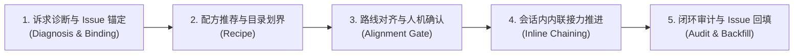

# at-workflow 技能手册：全生命周期研发工作流总控路由指南

本文档为 `at-workflow` 技能的伴随使用与维护手册，指导开发者与多 Agent 协同系统根据当前研发情境（新特性、热修、重构、门面治理、发版交接）实现智能场景诊断、远程 Issue 自动联动、路线推荐、会话内内联接力调度与结项闭环回填。

---

## 1. 技能定位与核心价值

当技能库扩展至 31 个全生命周期专业技能且全量关闭模型自主唤醒后，开发者需要一个统一的总调度中枢。`at-workflow` 作为全库总控编排器：
- **场景意图与 Issue 智能联动**：支持解析远程 Issue（`#<id>` 或 URL），自动将特性工件锚定至 `.specs/issue-<id>-<slug>/` 命名空间；
- **会话内授权内联接力推进 (Inline Chaining)**：在人机确认闸门通过后，Agent 自动在当前会话内加载下一阶段技能协议继续推演，无需开发者反复退出重新输入斜杠命令；
- **目标工程一键初始化 (/at-workflow init)**：智能探查技术栈，一键生成项目 `AGENTS.md`、`CONSTITUTION.md`、`docs/adr/` 与 `.specs/.gitignore` 治理基座；
- **端内交互式帮助与导航**：支持 `/at-workflow help` 与 `/at-workflow help <skill>`，秒级渲染五段式速查卡片；
- **全流程透明闭环回填**：任务通过双轴审查后，自动生成格式化 Markdown 摘要并支持一键通过 CLI 回贴远程 Issue 评论区。

---

## 2. 架构拓扑与微内核设计

`at-workflow` 遵循微内核架构设计，物理目录保持清晰与高内聚：

```text
skills/at-workflow/
├── SKILL.md                                          # 核心编排入口（轻量状态机）
├── references/                                       # 输入型知识层（按需 JIT 加载）
│   ├── protocols/
│   │   └── workflow-routing-protocol.md              # 四层拓扑、Issue 联动、内联推进与配方矩阵
│   └── templates/
│       └── workflow-menu-template.md                 # 交互菜单、确认闸门、推进看板与回填模板
└── examples/                                         # 案例样本层
    └── sample-workflow-orchestration.md              # 基于 Issue #42 的全链路内联协同实战全流程
```

---

## 3. 渐进式工作流与状态机推演

`at-workflow` 采用五阶段工作流指导全生命周期调度演进：



1. **诉求诊断与 Issue 锚定**：识别 `#<id>` 或自然语言指令，探查代码仓库状态，支持 `/at-workflow init` 一键初始化；
2. **配方推荐与目录划界**：匹配六大经典配方，锚定特性工件目录 `.specs/issue-<id>-<slug>/`，提取最小必要技能子集；
3. **路线对齐与人机确认**：向开发者展示建议调用链路与预期产出物，获取确认后锁定执行蓝图；
4. **会话内内联接力推进**：按依赖拓扑逐步激活子技能，在每个阶段产出物生成后提示开发者确认，确认后自动在当前会话内加载下一阶段协议继续执行；
5. **闭环审计与 Issue 回填**：核对全链路交付物完整性，执行门禁与排版审计，生成 Issue 结项回填摘要与复盘报告。

---

## 4. 核心协议与模板参考

- **路由协议**：[Workflow Routing Protocol](../../skills/at-workflow/references/protocols/workflow-routing-protocol.md) 详细定义了 31 项技能拓扑、Issue 联动契约、内联推进状态机与项目初始化规范；
- **向导模板**：[Workflow Menu Template](../../skills/at-workflow/references/templates/workflow-menu-template.md) 提供了交互式场景菜单、确认闸门卡片、推进看板与 Issue 回填摘要 Markdown 模板；
- **实战样例**：[Sample Workflow Orchestration](../../skills/at-workflow/examples/sample-workflow-orchestration.md) 呈现了基于 GitHub Issue #42 从需求到结项的全流程实战样例。

---

## 5. 质量保证与度量指标

工作流调度执行前必须通过以下质量基线核验：
- **最小特权调度**：推荐技能必须高度精准，严禁无意义堆砌不相关技能增加上下文开销；
- **人机阶段闸门**：规格与计划未获人类确认前严格阻断编写业务代码，执行前置防腐；
- **两级授权防线**：涉及 Git Commit 与 Git Push 时严格挂起并等待人类显式授权；
- **排版与规范自闭环**：所有流程文档 100% 遵循盘古之白排版、标准相对路径引用与零绝对路径泄漏。
