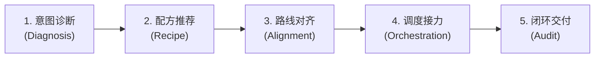

# at-workflow 技能手册：全生命周期研发工作流总控路由指南

本文档为 `at-workflow` 技能的伴随使用与维护手册，指导开发者与多 Agent 协同系统根据当前研发情境（新特性、热修、重构、门面治理、发版交接）实现智能场景诊断、路线推荐与跨技能无缝调度。

---

## 1. 技能定位与核心价值

当技能库扩展至 31 个全生命周期专业技能时，开发者常面临“当前场景应该先用哪个技能、产出物如何传递给下一个技能”的选择成本。`at-workflow` 作为全库总控路由器与总调度中枢：
- **场景意图智能诊断**：通过决策树快速识别开发者诉求，精准推荐标准化流水线配方；
- **跨技能无缝接力调度**：明确上游输出与下游输入契约，让 31 个微内核技能像乐高积木一样紧密咬合；
- **全流程透明可视化看板**：实时渲染 Mermaid 阶段推进图与任务检查单，让研发全周期演进一目了然。

---

## 2. 架构拓扑与微内核设计

`at-workflow` 遵循微内核架构设计，物理目录保持清晰与高内聚：

```text
skills/at-workflow/
├── SKILL.md                                          # 核心编排入口（81 行轻量状态机）
├── references/                                       # 输入型知识层（按需 JIT 加载）
│   ├── protocols/
│   │   └── workflow-routing-protocol.md              # 四层拓扑、决策树、六大配方与契约矩阵
│   └── templates/
│       └── workflow-menu-template.md                 # 交互向导菜单、确认卡片与推进看板模板
└── examples/                                         # 案例样本层
    └── sample-workflow-orchestration.md              # 优惠券开发 6 大技能协同串联实战全流程
```

---

## 3. 渐进式工作流与状态机推演

`at-workflow` 采用五阶段工作流指导全生命周期调度演进：



1. **意图诊断**：解析开发者指令，依据意图决策树识别任务类型并探查代码仓库状态；
2. **配方推荐**：匹配特性流、热修流、重构流等经典配方，提取最小必要技能子集；
3. **路线对齐**：向开发者展示建议的调用链路与产出物预期，获取确认后锁定蓝图；
4. **调度接力**：按依赖拓扑逐步激活子技能，动态渲染状态看板并管理产出物跨阶段流转；
5. **闭环交付**：核对全链路交付物完整性，执行门禁与排版审计，生成效能收益复盘。

---

## 4. 核心协议与模板参考

- **路由协议**：[Workflow Routing Protocol](../../skills/at-workflow/references/protocols/workflow-routing-protocol.md) 详细定义了 31 项技能四层金字塔模型、决策树、经典配方与契约矩阵；
- **向导模板**：[Workflow Menu Template](../../skills/at-workflow/references/templates/workflow-menu-template.md) 提供了交互式场景菜单、确认卡片与推进看板 Markdown 模板；
- **实战样例**：[Sample Workflow Orchestration](../../skills/at-workflow/examples/sample-workflow-orchestration.md) 呈现了电商业务开发中 6 大技能端到端接力落地的真实样例。

---

## 5. 质量保证与度量指标

工作流调度执行前必须通过以下质量基线核验：
- **最小特权调度**：推荐技能必须高度精准，严禁无意义堆砌不相关技能增加上下文开销；
- **契约阶段卡点**：需求与设计未确立前严格阻断编写业务代码，执行前置防腐；
- **两级授权防线**：涉及 Git Commit 与 Git Push 时严格挂起并等待人类显式授权；
- **排版与规范自闭环**：向导卡片与所有流程文档 100% 遵循盘古之白排版与相对路径规范。
