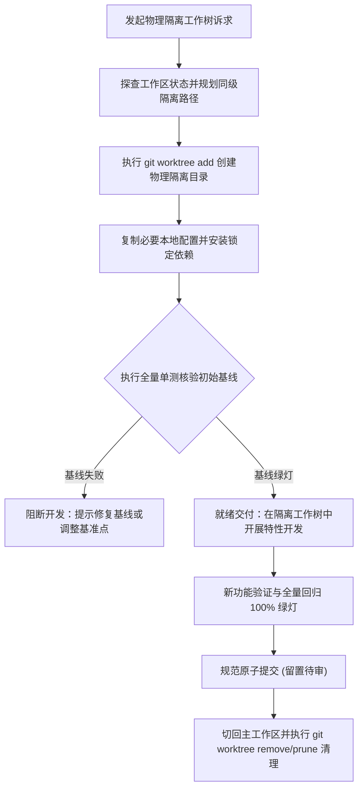

# `at-worktree` 技能使用指南：Git Worktree 物理环境多任务隔离

`at-worktree` 是一项基于 Git Worktree 原生能力的工程环境物理隔离技能。它帮助开发者在不污染当前工作区未暂存代码的前提下，创建完全独立、零污染的物理工作树目录，完成锁定依赖安装与测试基线核验，安全开展并行新特性开发、破坏性架构实验或紧急热修，并在完工后提供确定性的合并与资源回收闭环。

---

## 1. 何时使用 (When to Use)

- **主工作区存在脏改动时插入紧急热修**：当前功能正在编码但未暂存，需紧急修复线上 Bug，规避 `git stash` 带来的丢失与冲突风险；
- **并行开发多特性或多分支协作**：需要同时在两个甚至多个特性分支上编写、编译或调试代码，杜绝频繁 `git checkout` 导致的重新构建与依赖冲突；
- **破坏性架构实验与高风险改动**：拟尝试大规模框架升级、构建工具迁移或试验性重构，在物理隔离目录中验证，随时可一键抹除；
- **多智能体并发工作区隔离**：为不同的 AI Agent 分配完全独立的物理工作目录，杜绝多个 Agent 并发写入导致的文件读写竞争。

---

## 2. 调用语法与参数 (Syntax & Triggers)

### 自然语言唤醒 (推荐)
- “我当前工作区还有未提交的代码，请帮我在独立的 Git Worktree 中切出 hotfix-order 分支进行修复。”
- “使用 at-worktree 为特性 feat-payment-gateway 创建同级隔离工作树，安装依赖并核验测试基线。”
- “运行 at-worktree 完成特性分支的合并收尾，清理隔离目录并切回主工作区。”

### 显式斜杠命令 (若平台支持)
```bash
/at-worktree [新分支名称/任务标识] [基准提交或上游分支(可选)]
```

---

## 3. 前置依赖输入 (Prerequisites & Inputs)

- **目标任务/分支名称**：拟创建的隔离分支与工作树目录标识（如 `feat-export` 或 `fix-leak`）；
- **基准分支或提交点（可选）**：默认为最新的上游主干 `origin/main`；
- **环境依赖配置（可选）**：指示是否需拷贝本地私有配置文件（如 `.env.local`）或自定义依赖安装命令。

---

## 4. 执行过程交互 (Execution Flow & Human Interactions)

`at-worktree` 执行过程严格遵循工作区摸排、物理目录创建、环境对齐、基线核验与收尾清理：



1. **同级拓扑规划**：在 `<repo-name>-worktrees/` 下规划独立目录，规避父子嵌套；
2. **环境无缝对齐**：安全同步环境配置，执行冻结锁文件的确定性依赖安装；
3. **测试基线准入**：在编码前先跑通既有全量单测，建立绿灯基线，杜绝带着隐患开工；
4. **安全收尾回收**：支持完工后安全切离、清理工作树并修剪索引，保障主工作区毫发无损。

---

## 5. 交付产物与标准 (Outputs & Standards)

执行完毕后交付以下标准化产物：
- **物理隔离工作空间**：具备完整依赖与绿灯测试基线的物理工作树；
- **测试基线核验报告**：基线用例总数、测试耗时与全绿灯状态明细；
- **原子提交代码资产**：在隔离分支中完成的自闭环代码改动与新增测试；
- **干净的工作区复位状态**：收尾清理后主仓库工作区无任何污染残留，等待人类显式指令合并或推送。
