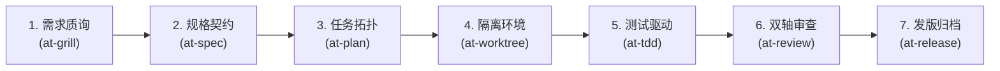

# 配方 1：全新特性从零到一敏捷开发流 (Feature Delivery Flow)

本文档提供在承接全新业务特性需求时，从模糊意图澄清、规格契约拟定、任务拓扑拆解、物理隔离分支、测试驱动实现到双轴审查与发版归档的完整实战配方。

---

## 1. 适用业务场景与核心价值

- **适用场景**：
  - 业务方提出全新功能诉求（如“增加优惠券秒杀防超卖机制”、“支持三方 OAuth2 授权登录”）；
  - 跨模块或涉及多个微服务的复杂业务特性开发；
  - 初始需求描述较为粗糙、存在未决技术分歧与潜在隐形假设的场景。
- **核心工程收益**：
  - **杜绝返工**：通过前置质询在写第一行代码前 100% 收敛边界；
  - **渐进可控**：拓扑感知任务图避免大步跳跃，示踪弹快速探路；
  - **质量兜底**：TDD 红绿循环结合标准/规格双轴代码审查，消除代码异味与坏味道。

---

## 2. 流水线状态机 (Workflow State Machine)



| 步骤 | 负责技能 | 核心输入 | 核心产出物 | 门禁准出标准 |
| :---: | :--- | :--- | :--- | :--- |
| **1** | `at-grill` | 原始自然语言需求 | 《设计决策树与权衡矩阵》 | 零未决前沿问题，构建者反审 6 大考点全通过 |
| **2** | `at-spec` | 质询决策共识 | `specs/changes/<id>/spec.md` | API 契约、数据模型与验收准则完整 |
| **3** | `at-plan` | 规格说明书 | `specs/changes/<id>/plan.md` | 拓扑依赖清晰，原子任务粒度 ≤ 2 小时 |
| **4** | `at-worktree` | 特性分支名 | 物理独立的 Worktree 目录 | 环境隔离，主工作区不受未完工代码污染 |
| **5** | `at-tdd` | 任务项与规格 | 业务源码 + 100% 绿灯单元测试 | 严格先红后绿，无假桩，分支覆盖率达标 |
| **6** | `at-review` | Git Diff 补丁 | 《标准与规格双轴审查报告》 | 0 严重缺陷，代码规范与业务契约 100% 对齐 |
| **7** | `at-release` | 最终审查通过分支 | 发布标签、更新日志与归档物 | 起飞检查清单全勾选，SemVer 语义版本锁定 |

---

## 3. 逐步交互指令与操作示范

### 阶段 1：需求反向质询与压力测试 (`at-grill`)
向 Agent 发起初始需求，主动要求压迫式澄清：

```text
/at-grill 我们计划在结算页增加“优惠券自动推荐与最优抵扣计算”特性，请对该需求进行深度质询与前沿探查。
```

**交互关键点**：
- Agent 自主扫描当前项目结算模块代码与数据结构（客观事实不向人类发问）；
- 提出分轮次前沿问题（如并发券状态锁定策略、门槛计算是否含运费、失效券降级方案）；
- 最终输出收敛的《共识决策备忘录》。

### 阶段 2：拟定增量变更规格书 (`at-spec`)
将澄清共识转化为机器与人类双重可信的工程规格：

```text
/at-spec 基于刚才 at-grill 达成的共识，生成特性 004-coupon-recommendation 的增量变更契约与验收准则。
```

**交付物**：落盘至 `specs/changes/004-coupon-recommendation/spec.md`。

### 阶段 3：微任务拓扑依赖拆解 (`at-plan`)
将规格书拆解为具备拓扑依赖关系的微任务清单：

```text
/at-plan 请根据 004-coupon-recommendation 的 spec.md，编排任务依赖拓扑与执行顺序。
```

**交付物**：落盘至 `specs/changes/004-coupon-recommendation/plan.md`，明确标记示踪弹任务（Task 1）与并行任务分支。

### 阶段 4：创建物理隔离的特性工作区 (`at-worktree`)
为防止长期特性研发污染当前工作区，建立隔离环境：

```text
/at-worktree create feat/coupon-recommendation
```

**效果**：Git Worktree 在独立目录准备完毕，主干工作区保持干净。

### 阶段 5：严密测试驱动开发三步循环 (`at-tdd`)
按任务拓扑依次推进编码，严格执行红灯先行：

```text
/at-tdd 推进 Task 2：编写优惠券最佳抵扣贪心算法与互斥券过滤逻辑。
```

**行为纪律**：
- 第一步：编写红灯失败测试（执行测试确认因未实现而红灯报错）；
- 第二步：编写极简满足逻辑使测试转为绿灯；
- 第三步：重构消除代码异味，保持绿灯。

### 阶段 6：规格与标准双轴代码审查 (`at-review`)
完成所有子任务后，触发严格代码审查门禁：

```text
/at-review 对比当前分支与 main 分支的改动，核验 spec 契约对齐度与代码工程标准。
```

**产出物**：生成审查报告，确认无越权改动、无安全漏洞且契约完全对齐。

### 阶段 7：上线起飞核验与发版归档 (`at-release`)
在合并并发布特性前执行发版门禁：

```text
/at-release prep-minor 准备发布 v1.2.0 版本，归档优惠券推荐特性。
```

**产出物**：更新 `CHANGELOG.md`，执行最终测试门禁自检，准备 Git 标签。

---

## 4. 端到端输入输出样例 (Example Walkthrough)

以真实“优惠券推荐”开发过程为例，全流程产物演进路径如下：

```text
1. 输入："结算页加券推荐"
   ↓ [at-grill]
2. 产出：澄清互斥券规则：品类券与全场券不可叠加；超时兜底策略：计算超 100ms 降级为不推荐；
   ↓ [at-spec]
3. 产出：specs/changes/004-coupon-recommendation/spec.md（含 CouponService.recommend API 定义）
   ↓ [at-plan]
4. 产出：specs/changes/004-coupon-recommendation/plan.md（4 个阶段，共 6 个原子任务）
   ↓ [at-tdd]
5. 产出：src/test/CouponServiceTest.java（18 个单测全绿）+ src/main/CouponService.java
   ↓ [at-review]
6. 产出：双轴审查 100% 通过（Specs 轴符合度 100%，Standards 轴 0 违规）
   ↓ [at-release]
7. 产出：发布归档完成，更新 CHANGELOG.md 与版本号 v1.2.0。
```

---

## 5. 踩坑预警与避坑指南 (Pitfall Alerts)

> [!WARNING]
> **避坑 1：杜绝假共识（False Consensus）**
> 在 `at-grill` 阶段，Agent 不得在未获人类明确确认前擅自默认关键业务规则。只要存在超过一种合理实现路径，必须提供选项并征询。

> [!CAUTION]
> **避坑 2：禁止跳步编写业务代码（No Spec, No Code）**
> 严禁在尚未生成 `spec.md` 与 `plan.md` 的情况下直接让 Agent 编码。缺乏契约保护的代码极易引入返工与边界遗漏。

> [!IMPORTANT]
> **避坑 3：守牢 Git 显式授权红线**
> 哪怕所有测试 100% 绿灯且审查通过，未收到人类“提交”或“推送”的显式字面指令前，代码必须保留在工作区供人工复核。

---

## 6. 相关资源与延伸阅读

- [配方 2：线上紧急缺陷排查与热修复流](./02-hotfix-debugging.md)
- [配方 5：跨会话大任务接力与长跑自治流](./05-autonomous-handoff.md)
- [at-grill 技能手册](../skills/at-grill.md)
- [at-tdd 技能手册](../skills/at-tdd.md)
