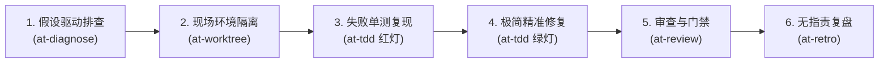

# 配方 2：线上紧急缺陷排查与热修复流 (Hotfix & Diagnostic Flow)

本文档提供在应对生产突发事故、偶发并发缺陷或疑难线上 Bug 时，从科学假设驱动根因排查、现场隔离、红灯单测复现、极简精准修复到双轴审查与无指责复盘（5 Whys）的完整实战配方。

---

## 1. 适用业务场景与核心价值

- **适用场景**：
  - 生产环境核心业务链路突发异常（如订单结算超时、库存偶发负数、消息消费乱序）；
  - 难以稳定复现的并发竞态缺陷或深层边界异常；
  - 需要在最短时间内止血并根治，且必须保证不引入次生破坏性变更的应急热修。
- **核心工程收益**：
  - **杜绝盲目试错**：以科学假设状态机代替无根据的代码乱改；
  - **复现测试固化资产**：强制先写出能稳定复现缺陷的红灯单测，将事故转化为永久防退化回归测试；
  - **根治系统性隐患**：通过无指责 5 Whys 复盘与防腐措施，彻底拔除导致事故的制度与技术病灶。

---

## 2. 流水线状态机 (Workflow State Machine)



| 步骤 | 负责技能 | 核心输入 | 核心产出物 | 门禁准出标准 |
| :---: | :--- | :--- | :--- | :--- |
| **1** | `at-diagnose` | 故障现象、报错堆栈、日志片段 | 《根因假设检验矩阵》 | 建立排他性假设，经过推演锁定真正根因 |
| **2** | `at-worktree` | 热修分支名 | 物理独立的 Worktree 热修环境 | 基线源自生产 tag，避免引入正在开发的未发布代码 |
| **3** | `at-tdd` (先红) | 根因机理与触发条件 | 稳定复现缺陷的失败测试用例 | 测试 100% 运行红灯，报错堆栈与生产完全吻合 |
| **4** | `at-tdd` (转绿) | 缺陷根因代码点 | 最小精准补丁代码 | 复现测试转为绿灯，全量存量单测 100% 保持通过 |
| **5** | `at-review` | 热修补丁 Diff | 《热修审查报告》 | 0 次生副作用，修改行数严格最小化，无破坏性改动 |
| **6** | `at-retro` | 故障时间线与修复全景 | `retros/YYYY-MM-DD-incident.md` | 5 Whys 溯源到位，形成 2~3 项具体可落地的工程防腐项 |

---

## 3. 逐步交互指令与操作示范

### 阶段 1：科学假设排错与根因定位 (`at-diagnose`)
提供事故症状与日志，激活排障状态机：

```text
/at-diagnose 生产日志报告大量“OptimisticLockException: 优惠券状态更新失败”，导致结算失败率上升 12%。请协助分析根因并建立检验假设。
```

**执行准则**：
- Agent 梳理调用栈与相关并发控制代码；
- 提出 2~3 个竞争假设（如重试机制缺失、缓存与数据库版本号不一致、事务隔离级别引起幻读）；
- 自主探查代码验证假设，排除伪因，锁定真正根因。

### 阶段 2：创建物理隔离热修环境 (`at-worktree`)
确保热修复严格基于生产最新稳定版本，不受本地未发布代码干扰：

```text
/at-worktree create hotfix/coupon-lock-opt v1.2.0
```

**效果**：独立工作树基于生产标签 `v1.2.0` 创建完毕，切换上下文进入该目录。

### 阶段 3：编写失败单测稳定复现缺陷 (`at-tdd` 红灯)
坚决禁止在没有复现测试前直接动业务代码：

```text
/at-tdd 请在 CouponLockTest 中编写多线程模拟并发抢券的测试用例，精确复现 OptimisticLockException 且未重试直接抛出的缺陷。
```

**验证标准**：执行测试，必须明确看到测试因断言失败或异常未捕获而**红灯**，报错行为与生产环境完全吻合。

### 阶段 4：最小精准补丁转绿灯 (`at-tdd` 转绿)
实施最小化防御修复：

```text
/at-tdd 针对该缺陷引入退避重试机制（指数退避 + 最大 3 次重试），使刚才的红灯测试转为绿灯。
```

**验证标准**：运行单测转为 100% 绿灯，且当前模块所有既有历史测试用例全部通过。

### 阶段 5：热修补丁双轴代码审查 (`at-review`)
在合并前严格控制修复变更半径：

```text
/at-review 审查 hotfix/coupon-lock-opt 分支的改动，核查是否存在递归死循环风险、线程池耗尽隐患与非预期副作用。
```

**审查重点**：重试耗时是否可控、超时熔断是否到位、Diff 是否保持在数十行内。

### 阶段 6：无指责事后复盘与工程防腐 (`at-retro`)
事故止血后，立即沉淀复盘文档：

```text
/at-retro 针对本次优惠券乐观锁重试缺失导致订单失败事故，执行无指责 5 Whys 复盘并制定防腐改进清单。
```

**交付物**：落盘至 `retros/2026-10-12-coupon-optimistic-lock.md`，制定后续针对并发写入的全链路压测与重试拦截规约。

---

## 4. 端到端输入输出样例 (Example Walkthrough)

```text
1. 故障接入：收到报警堆栈 "OptimisticLockException in CouponRepository.save"
   ↓ [at-diagnose]
2. 假设排查：排查发现高并发下两个请求同时使用同版本更新券状态，后者失败后未触发 Spring @Retryable
   ↓ [at-worktree]
3. 隔离分支：基于 v1.2.0 检出 hotfix/coupon-lock-opt 隔离目录
   ↓ [at-tdd]
4. 红灯复现：编写 CouponConcurrencyTest.concurrentUpdateShouldRetry，运行测试报错红灯（FAILED）
   ↓ [at-tdd]
5. 实施修复：添加受控重试逻辑与随机退避，重新运行单测，转为绿灯（PASSED，运行 12 次并发全部重试成功）
   ↓ [at-review]
6. 补丁审查：核验 Diff 仅修改 2 个文件共 18 行，无破坏性变更与全局锁争用
   ↓ [at-retro]
7. 事后复盘：输出 5 Whys 报告，沉淀改进项：在 CI 中增加并发冲突单测门禁。
```

---

## 5. 踩坑预警与避坑指南 (Pitfall Alerts)

> [!CAUTION]
> **避坑 1：严禁无复现单测直接盲改代码（No Repro, No Fix）**
> 很多热修“修好了一个 Bug 却引出了两个新 Bug”，根本原因是没有先写出稳定失败的测试用例就凭经验改代码。必须坚持红灯先行。

> [!WARNING]
> **避坑 2：警惕修复爆炸半径失控（Keep Diff Minimal）**
> 热修复追求高内聚与极简。严禁在热修分支顺便进行大重构、修改公共接口签名或更新无关第三方依赖。

> [!NOTE]
> **避坑 3：复盘不是“找人背锅”，而是“系统防腐”**
> 遵循无指责复盘原则，5 Whys 必须深挖到流程设计、测试覆盖度与监控告警漏洞，产出自动化门禁防线。

---

## 6. 相关资源与延伸阅读

- [配方 1：全新特性从零到一敏捷开发流](./01-feature-development.md)
- [配方 3：遗留存量代码治理与架构防腐流](./03-legacy-refactoring.md)
- [at-diagnose 技能手册](../skills/at-diagnose.md)
- [at-retro 技能手册](../skills/at-retro.md)
