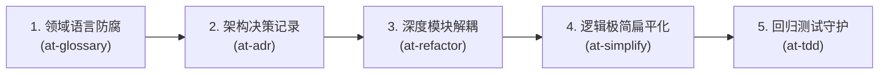

# 配方 3：遗留存量代码治理与架构防腐流 (Refactoring Flow)

本文档提供在面对存量遗留系统、千行大泥球“上帝类”（God Class）、深度嵌套面条代码与领域概念混乱时，从领域语言防腐、深度模块解耦、奥卡姆剃刀极简扁平化到单测守护网小步快跑的完整重构实战配方。

---

## 1. 适用业务场景与核心价值

- **适用场景**：
  - 核心服务类动辄超 800~1000 行，承担了从参数解析、复杂业务逻辑到持久层直接操作的多重职责；
  - 函数内部包含 4~5 层 `if-else` 或 `switch` 嵌套，圈复杂度（Cyclomatic Complexity）严重超标；
  - 领域概念混乱，同一实体在接口、Service 和数据库中名词不一（如 `order_status` 与 `state` 混用）；
  - 团队成员“不敢动代码”，生怕引发连锁退化反应。
- **核心工程收益**：
  - **领域模型清晰防腐**：依托根目录统一领域词汇表消除歧义；
  - **深度模块降低复杂度**：接口极简、实现强大，杜绝浅层形式主义拆分；
  - **测试安全网托底**：重构前后行为 100% 保持不变，向后兼容坚不可摧。

---

## 2. 流水线状态机 (Workflow State Machine)



| 步骤 | 负责技能 | 核心输入 | 核心产出物 | 门禁准出标准 |
| :---: | :--- | :--- | :--- | :--- |
| **1** | `at-glossary` | 遗留代码类名、字段与口语术语 | `GLOSSARY.md` (根目录统一术语) | 核心概念中英文严格映射，同名异义与异名同义全部消除 |
| **2** | `at-adr` | 重构动机与备选方案 | `docs/adr/000X-refactor.md` | MADR 3.0 规范，明确架构取舍与向后兼容契约 |
| **3** | `at-refactor` | 上帝类代码与模块调用图 | 职责解耦的深度模块与接口抽象 | 上帝类有效行数削减 ≥ 50%，公共接口保持 100% 兼容 |
| **4** | `at-simplify` | 长方法与深层嵌套逻辑 | 扁平化卫语句与奥卡姆极简代码 | 单函数嵌套层级 ≤ 2 层，消除防御过度代码 |
| **5** | `at-tdd` | 既有回归测试用例集 | 100% 绿灯且增加边界保护的单测 | 业务外部可观测行为零改变，单测覆盖率不降反升 |

---

## 3. 逐步交互指令与操作示范

### 阶段 1：统一领域术语与建立防腐字典 (`at-glossary`)
在对重构代码动手术前，首先澄清业务名词：

```text
/at-glossary 扫描当前订单核心代码，梳理所有与“取消订单、退款、冲正、关单”相关的命名不一致现象，并在根目录生成 GLOSSARY.md。
```

**产出物**：确立通用语言（Ubiquitous Language），约定统一使用 `OrderCancel` 与 `OrderRefund`，消除 `OrderClose` / `RollbackOrder` 混用。

### 阶段 2：固化架构决策记录 (`at-adr`)
若重构涉及模块拆分或设计模式变更，沉淀 ADR：

```text
/at-adr 针对 OrderManager 上帝类拆分为状态机驱动的 OrderStateEngine 与独立策略服务的重构方案，拟定 MADR 3.0 架构决策记录。
```

**交付物**：落盘至 `docs/adr/0005-split-order-manager.md`。

### 阶段 3：深度模块解耦与外部防腐适配 (`at-refactor`)
运用“深模块（Deep Module）”原则拆解复杂类：

```text
/at-refactor 对 OrderManager 进行微重构，将价格计算、库存冻结和优惠券核销抽取为高内聚的独立服务，原 OrderManager 作为薄 Facade 保持外部向后兼容。
```

**操作纪律**：
- 增量外拆新文件，原文件做轻量引用，控制 Git Diff；
- 严禁擅自修改已发布公开方法的参数签名与返回值类型。

### 阶段 4：奥卡姆剃刀极简与控制流扁平化 (`at-simplify`)
重构内部长方法，消灭深层缩进：

```text
/at-simplify 重构 OrderValidateService.validateOrder 方法，使用前置卫语句（Guard Clauses）替代当前的 4 层 if-else 嵌套。
```

**改进效果**：
- 控制流变为“单向瀑布流”；
- 异常条件在前置卫语句中立即中断返回；
- 核心快乐路径（Happy Path）直接平铺在方法底部。

### 阶段 5：回归测试安全网校验 (`at-tdd`)
执行全量自动化测试，验证重构无退化：

```text
/at-tdd 运行订单模块全量单元测试与集成测试，并为刚刚拆分的边界补充属性测试。
```

**准出检验**：测试 100% 绿灯，系统整体圈复杂度显著下降。

---

## 4. 端到端输入输出样例 (Example Walkthrough)

以重构拥有 1200 行的 `LegacyOrderService.java` 为例：

```text
1. 现状痛点：单个类 1200 行，processOrder 方法深达 5 层 if，掺杂优惠券、库存、积分与风控逻辑
   ↓ [at-glossary]
2. 术语对齐：确定 Points（积分）、Inventory（库存）、RiskControl（风控）标准字段命名
   ↓ [at-adr]
3. 决策落盘：编写 ADR-0005，决定采用责任链与领域事件解耦
   ↓ [at-refactor]
4. 深度拆解：抽取 RiskCheckService 与 OrderPriceEngine，Facade 接口保持原签名
   ↓ [at-simplify]
5. 卫语句重构：processOrder 方法由 160 行缩减至 28 行，消除 4 层嵌套
   ↓ [at-tdd]
6. 验证安全：运行 42 个存量测试，全部通过；新增边界单测 8 个，无破坏性退化。
```

---

## 5. 踩坑预警与避坑指南 (Pitfall Alerts)

> [!CAUTION]
> **避坑 1：严禁无安全网的大推倒式重写（The Big Bang Rewrite Trap）**
> 永远不要在缺乏单元测试的情况下尝试“推倒重来”。必须遵循小步快跑（Baby Steps），每次重构一个小类或小方法，并确保即时回归测试通过。

> [!WARNING]
> **避坑 2：警惕形式主义的“过度碎片化”**
> 拆分类不是为了将 1 个文件拆成 50 个只有 3 行的无意义微文件。遵循深模块原则：模块的接口应当尽可能窄小自解释，而其承载的业务能力应当丰富内聚。

> [!IMPORTANT]
> **避坑 3：誓死捍卫向后兼容性（Backward Compatibility）**
> 对外暴露的公共 API、RPC 契约与序列化对象，严禁未经全团队评估擅自删除字段或修改方法签名。存量调用方永远要求稳定。

---

## 6. 相关资源与延伸阅读

- [配方 1：全新特性从零到一敏捷开发流](./01-feature-development.md)
- [配方 2：线上紧急缺陷排查与热修复流](./02-hotfix-debugging.md)
- [at-refactor 技能手册](../skills/at-refactor.md)
- [at-simplify 技能手册](../skills/at-simplify.md)
