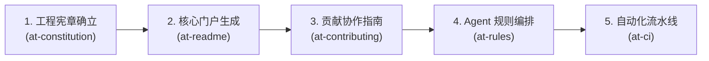

# 配方 4：开源门面装修与工程规约建设流 (Open-Source Governance Flow)

本文档提供在孵化新开源项目、商业化产品开源发布或对存量开源仓库进行工程正规化改造时，从架构宪章确立、工业级项目门户生成、标准化贡献者指引、Agent 行为准则编排到 GitHub Actions CI 流水线门禁落地的完整实战配方。

---

## 1. 适用业务场景与核心价值

- **适用场景**：
  - 新建开源软件工程，亟需打造国际化高规格的项目主门面（README）；
  - 准备向全球开源社区开放，需要建立标准的 PR 协作流程、Issue 模板与分支管理策略（CONTRIBUTING）；
  - 团队引入 AI Agent 结对编程，需要制定明确的机器工程行为规约与安全底线（AGENTS.md）；
  - 缺乏全自动化质量防线，需要配置 GitHub Actions 流水线实现代码格式、静态检查与单测强制核验。
- **核心工程收益**：
  - **顶级门面形象**：通过标准状态徽标、Mermaid 架构拓扑图与清晰的 Quickstart 降低开发者认知负荷；
  - **社区协作规范**：明确分支规范、Conventional Commits 提交纪律与 PR 合并门槛；
  - **自动化铁律护航**：通过 CI 流水线将所有工程规约转变为代码提交时的物理阻断门禁。

---

## 2. 流水线状态机 (Workflow State Machine)



| 步骤 | 负责技能 | 核心输入 | 核心产出物 | 门禁准出标准 |
| :---: | :--- | :--- | :--- | :--- |
| **1** | `at-constitution` | 项目定位与架构红线 | `docs/constitution.md` | 刚性工程守卫确立，零容忍违规项明确 |
| **2** | `at-readme` | 功能特性与架构图 | `README.md` (主门户) | 包含 CI 徽标、拓扑图、快速上手、特性矩阵与索引表 |
| **3** | `at-contributing` | 协作策略与分支模型 | `CONTRIBUTING.md` | 覆盖 PR 生命周期、环境搭建、提交规范与 DCO/CLA 说明 |
| **4** | `at-rules` | 团队 AI 编码红线 | `AGENTS.md` / `.cursorrules` | 机器可读与人类可读规约对齐，零绝对路径泄漏防御固化 |
| **5** | `at-ci` | 构建命令与门禁脚本 | `.github/workflows/ci.yml` | 语法 100% 合法，本地与云端 Runner 构建全部绿灯 |

---

## 3. 逐步交互指令与操作示范

### 阶段 1：确立项目刚性工程宪章 (`at-constitution`)
首先定义项目的“宪法级”守卫原则：

```text
/at-constitution 为分布式缓存组件项目确立工程宪章，重点约束：零外部非标准依赖、向后兼容性保护与并发安全底线。
```

**产出物**：形成工程宪章核心原则，禁止任何破坏性变更绕过审核。

### 阶段 2：打造高颜值项目核心门户 (`at-readme`)
根据项目技术栈与特性生成国际级 README：

```text
/at-readme 扫描当前代码库，生成具备 CI 状态徽标、Mermaid 核心架构图、30 秒快速开始和核心特性表格的完整 README.md。
```

**展示要素**：
- 顶部状态徽标（Build Passing、License Apache-2.0、Version v1.0.0 等）；
- 核心价值与一句话定位；
- 开放标准 Mermaid 架构图；
- 快速开始代码片段（直接复制可运行）。

### 阶段 3：拟定开源贡献者指南 (`at-contributing`)
规范社区开发者的参与路径：

```text
/at-contributing 生成 CONTRIBUTING.md，制定 Fork & Pull Request 流程、Conventional Commits 提交消息格式规范与单测覆盖率基线。
```

**核心章节**：
- 本地开发环境初始化；
- Git 分支命名约定（`feat/*`、`fix/*`、`docs/*`）；
- 提交前自检清单（`format` 与 `test` 命令）。

### 阶段 4：编排 Agent 专属行为规约 (`at-rules`)
确保任何 AI 工具接入本项目时服从统一标准：

```text
/at-rules 为当前仓库编排针对现代 Agent 基础设施的统一 AGENTS.md 规范，强制要求盘古之白排版与 Git 显式授权。
```

**落盘物**：根目录 `AGENTS.md`，并在需要时映射至 `.cursor/rules/`。

### 阶段 5：配置 GitHub Actions 流水线自动化门禁 (`at-ci`)
将上述所有规范用流水线严格锁死：

```text
/at-ci 编写 .github/workflows/ci.yml，针对 push 与 pull_request 触发，并行执行代码格式校验、静态检查与多平台矩阵测试。
```

**验证标准**：通过 GitHub Actions 语法解析，确保流水线步骤自闭环且失败时正确阻断。

---

## 4. 端到端输入输出样例 (Example Walkthrough)

```text
1. 初始状态：空仓库或仅有一段简单代码，无任何规范文档
   ↓ [at-constitution]
2. 产出：确立“依赖零膨胀、测试覆盖率 ≥ 85%、绝对向后兼容”宪章
   ↓ [at-readme]
3. 产出：根目录 README.md（含 Mermaid 架构图、特性列表、安装与调用样例）
   ↓ [at-contributing]
4. 产出：根目录 CONTRIBUTING.md（含 PR 模板说明、分支命名规范、Commit 规范）
   ↓ [at-rules]
5. 产出：根目录 AGENTS.md（含盘古之白排版规则、零绝对路径红线、双级授权纪律）
   ↓ [at-ci]
6. 产出：.github/workflows/ci.yml（包含 format-check、lint、test、validate 四道门禁）
7. 最终成效：新贡献者可在 5 分钟内顺利跑通单测并提交合规 PR，CI 自动拦截一切违规代码。
```

---

## 5. 踩坑预警与避坑指南 (Pitfall Alerts)

> [!WARNING]
> **避坑 1：杜绝虚假与静态写死的徽标（Broken Badges）**
> README 中的 Build Status 徽标必须真实链接至 GitHub Actions 流水线状态，严禁使用未挂钩真实 CI 的静态假徽标图片。

> [!CAUTION]
> **避坑 2：防止规约与开发环境脱节（Executable Specs）**
> 在 `CONTRIBUTING.md` 中说明的构建与单测指令，必须在干净的全新机器环境中实测通过。严禁写入依赖开发者本地特有全局工具的魔法指令。

> [!NOTE]
> **避坑 3：排版一致性（Pangu Spacing）是国际化开源项目的细节门面**
> 所有 Markdown 文档必须保证中西文、数字之间保留一个半角空格，展示工业级的文档审美与工程严谨性。

---

## 6. 相关资源与延伸阅读

- [配方 1：全新特性从零到一敏捷开发流](./01-feature-development.md)
- [配方 3：遗留存量代码治理与架构防腐流](./03-legacy-refactoring.md)
- [at-readme 技能手册](../skills/at-readme.md)
- [at-ci 技能手册](../skills/at-ci.md)
