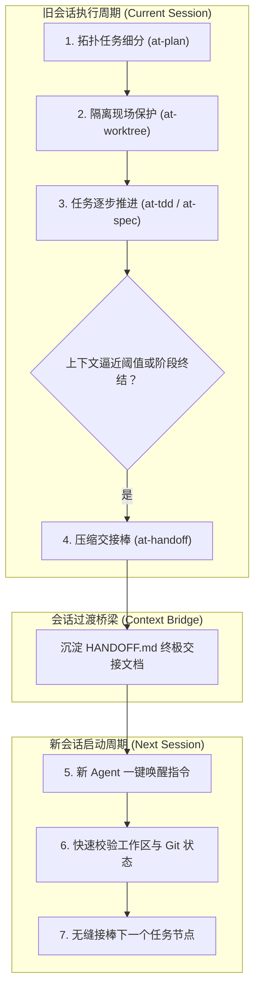

# 配方 5：跨会话大任务接力与长跑自治流 (Autonomous Handoff Flow)

本文档提供在应对周期长、步骤多、复杂度高的超大型研发战役时，通过任务拓扑拆解、物理隔离分支现场保护、四象限无损上下文压缩与新会话一键热启动接力的完整长跑自治实战配方。

---

## 1. 适用业务场景与核心价值

- **适用场景**：
  - 架构大重构或多模块演进，单次会话包含几十次工具调用与大量代码生成；
  - 对话 Token 消耗逼近上下文窗口极限（Context Exhaustion），模型出现注意力衰减、遗忘早期约定或幻觉增多；
  - 跨会话接力（今日工作未完需明日续跑）、跨开发人员移交或跨客户端模型切换（如从 Claude 切换至 Antigravity / Gemini）。
- **核心工程收益**：
  - **信息零丢失**：四象限结构化压缩过滤掉冗余会话噪音，精准萃取任务状态机；
  - **断点秒级恢复**：新会话通过预置指令模板一键唤醒，10 秒内重建全量上下文认知；
  - **长跑自治可靠**：配合 Git Worktree 物理分支隔离，确保长期研发与主干稳定互不干扰。

---

## 2. 流水线状态机 (Workflow State Machine)



| 步骤 | 负责技能 | 核心输入 | 核心产出物 | 门禁准出标准 |
| :---: | :--- | :--- | :--- | :--- |
| **1** | `at-plan` | 规格说明或宏观目标 | `plan.md` (微任务拓扑图) | 任务标记完成度状态明确，依赖无死锁环 |
| **2** | `at-worktree` | 任务专属分支名 | 物理独立的 Worktree 目录 | 工作区独立，主干与长跑分支物理隔离 |
| **3** | `at-tdd` 等 | 阶段子任务 | 业务代码与单测产出物 | 已完工任务单测 100% 保持绿灯 |
| **4** | `at-handoff` | 完整会话轨迹与 Git Diff | `HANDOFF.md` 交接文档 | 包含四象限信息、下一个会话执行目标与一键唤醒指令 |
| **5** | 新会话唤醒 | `HANDOFF.md` 引用 | 恢复认知的新 Agent 状态机 | 新 Agent 正确识别断点任务，无认知偏差直接开工 |

---

## 3. 逐步交互指令与操作示范

### 阶段 1：全局任务拓扑编排与状态标记 (`at-plan`)
启动前将宏观任务拆解为清晰的拓扑依赖图：

```text
/at-plan 将电商微服务拆分战役拆解为 5 大里程碑与 20 个原子任务，并在 plan.md 中建立拓扑图。
```

在执行过程中，实时同步打勾更新任务完成状态（`[x]` 与 `[ ]`）。

### 阶段 2：在专属 Worktree 开展研发并监控上下文 (`at-worktree`)
在物理隔离分支推进研发：

```text
/at-worktree create feat/split-order-service
```

当感知到会话轮次增多（例如单次会话超过 20~30 轮对话）或响应速度下降时，主动发起交接准备。

### 阶段 3：执行上下文无损压缩与现场封存 (`at-handoff`)
在结束当前会话前，发起交接封存：

```text
/at-handoff 当前已顺利完成 Milestone 2 的全部 4 个子任务，Milestone 3 尚未开始。请帮我生成跨会话交接文档 HANDOFF.md。
```

**产出物**：生成高度结构化的 `HANDOFF.md`，必须包含以下四象限要素：
1. **项目全貌与成果看板**：完成项、通过的门禁、最新 Commit 哈希；
2. **工单与任务体系推进状态**：全景表格与各里程碑闭环状态；
3. **下一个会话执行目标**：明确下一个新会话第 1 步具体要做什么；
4. **新会话一键唤醒指令模板 (Copy & Paste)**：供人类直接复制粘贴唤醒新 Agent 的格式化指令。

### 阶段 4：新会话无缝接棒与热启动续跑
打开全新会话窗口，复制粘贴上一阶段生成的唤醒指令：

```text
请熟悉交接文档：docs/HANDOFF.md

我们已圆满完成 Milestone 1 与 Milestone 2，代码已全部通过门禁。
现在正式开始 Milestone 3：
1. 目标：完成库存服务独立微服务拆分
2. 约束：先用 at-worktree 检查工作区，继续严格执行 TDD 与零绝对路径纪律。
请输出您的开工规划！
```

**效果**：新会话的 Agent 读取 `HANDOFF.md` 后，瞬间获得 100% 精确的背景认知，直接切入 Milestone 3，零无效寒暄。

---

## 4. 端到端输入输出样例 (Example Walkthrough)

以一个需要 3 天跨 4 个会话完成的核心系统微服务改造为例：

```text
会话 1：
- 执行 at-plan 拆分 M1~M4 任务；
- 执行 M1 任务并全部绿灯；
- 会话轮次达到 25 轮，执行 at-handoff 生成 HANDOFF.md（包含 M1 闭环与 M2 待办）；
- 结束会话 1。

会话 2：
- 发送唤醒指令引用 HANDOFF.md；
- 新 Agent 识别到当前断点为 M2（订单状态机抽取）；
- 在隔离 worktree 推进 M2 编码与单测；
- M2 完工后再次调用 at-handoff 更新 HANDOFF.md，记录最新 commit；
- 结束会话 2。
```

全流程信息无损传递，任务稳步推进，单次会话上下文始终保持在极度敏捷的黄金低消耗区间。

---

## 5. 踩坑预警与避坑指南 (Pitfall Alerts)

> [!IMPORTANT]
> **避坑 1：未提交或脏修改必须在交接前处理清晰（Clean Working Tree）**
> 在生成 `HANDOFF.md` 前，必须明确当前工作区的 Git 状态。若有正在推进的修改，必须在交接文档中显式说明未完工文件与断点行数，避免新 Agent 误操作丢弃代码。

> [!CAUTION]
> **避坑 2：警惕交接文档成为“冗余流水账”**
> `HANDOFF.md` 是高密度机器认知桥梁，不是聊天记录的复读机。必须过滤掉所有无效探索、重试报错信息与寒暄，仅保留事实、状态、结论与待办指令。

> [!WARNING]
> **避坑 3：一键唤醒指令必须自解释且开箱即用**
> 唤醒模板必须包含具体文档路径与关键工程红线提示，让新 Agent 无需人类二次补充背景即可立即进入高效状态。

---

## 6. 相关资源与延伸阅读

- [配方 1：全新特性从零到一敏捷开发流](./01-feature-development.md)
- [配方 2：线上紧急缺陷排查与热修复流](./02-hotfix-debugging.md)
- [at-plan 技能手册](../skills/at-plan.md)
- [at-handoff 技能手册](../skills/at-handoff.md)
