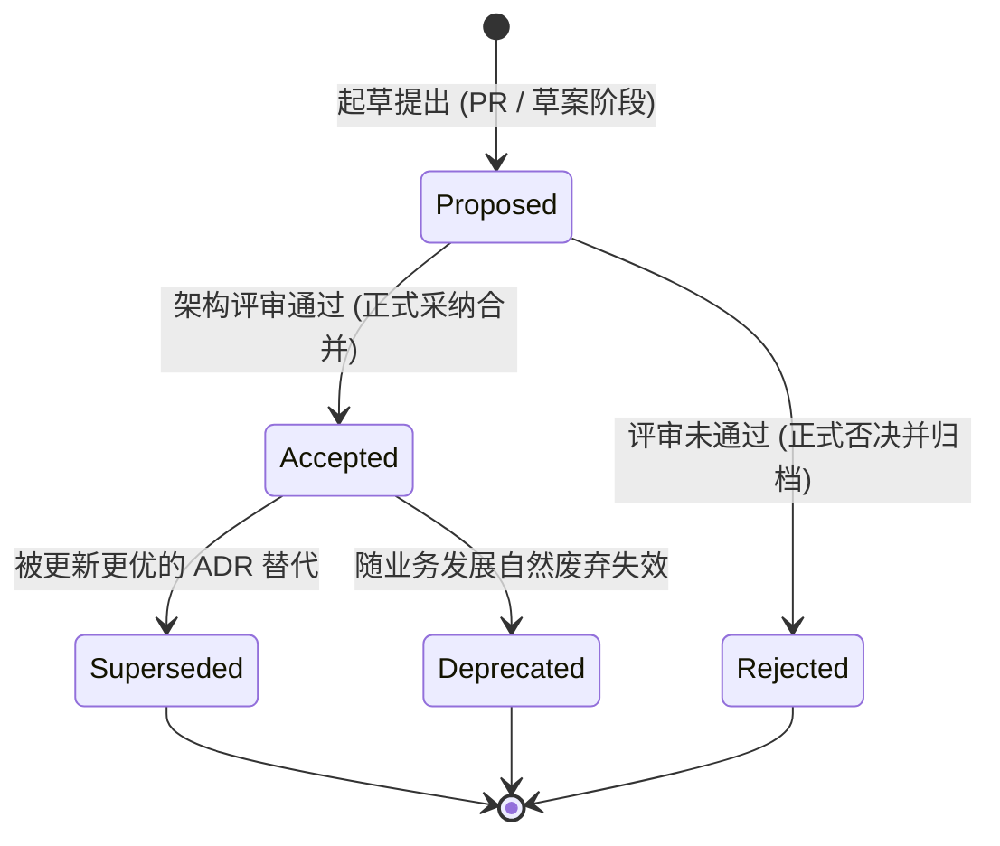

# 架构决策记录生命周期与治理协议 (ADR Lifecycle Protocol)

本文档规范了 `at-adr` 技能在系统演进过程中识别、起草、审议、演进及归档《架构决策记录》（Architecture Decision Record, ADR）的工程执行标准。

---

## 目录 (Table of Contents)
- [1. 核心理论：架构决策可追溯性与 MADR 3.0](#1-核心理论架构决策可追溯性与-madr-30)
- [2. ADR 生命周期状态机与流转规则](#2-adr-生命周期状态机与流转规则)
- [3. 决策驱动力与选项正交对比方法论](#3-决策驱动力与选项正交对比方法论)
- [4. 正负后果权衡与隐性技术债纳管](#4-正负后果权衡与隐性技术债纳管)
- [5. 物理存储拓扑与索引维护规范](#5-物理存储拓扑与索引维护规范)

---

## 1. 核心理论：架构决策可追溯性与 MADR 3.0

代码能够说明“系统是如何实现的”，但无法解释“为什么这样设计而不是那样设计”。
ADR（遵循轻量级 Markdown Architectural Decision Records 规范）的核心价值在于：
- **记录当时上下文**：保留做出决策时面临的技术制约、业务压力与假设；
- **记录被否决的方案**：详述当时评估过哪些替代路线以及否决它们的确凿理由，防止后来者重新掉入历史陷阱；
- **不可随意篡改**：ADR 是历史事件记录，一旦 `Accepted` 严禁直接改写历史结论；若发生方向改变，必须通过新的 ADR 标记 `Superseded` 替代它。

---

## 2. ADR 生命周期状态机与流转规则

ADR 的生命周期由以下确定性状态机严密管辖：

- **`Proposed`（提议中）**：由架构师或 Agent 起草，处于团队评审或技术 Spike 验证阶段；
- **`Accepted`（已采纳）**：经团队达成共识或人类显式授权确认，成为当前项目遵循的既定架构基准；
- **`Rejected`（已否决）**：方案经评估后不予采纳，保留记录以备未来查考；
- **`Superseded`（已被替代）**：决策被后续的某个新 ADR（如 `ADR-0012`）推翻或升级，元数据中必须显式双向链接；
- **`Deprecated`（已废弃）**：相关功能或技术栈已完全下线退役。

---

## 3. 决策驱动力与选项正交对比方法论

起草 ADR 时严禁先入为主直接抛出单一方案，必须结构化列出至少 2~3 个可行备选选项：
1. **决策驱动力 (Decision Drivers)**：列出影响决策的关键推力（如高吞吐吞吐量 SLA、团队学习曲线、许可证风险、维护成本）；
2. **正交选项对比矩阵**：
   - 选项 A（拟采纳方案）；
   - 选项 B（常见业界替代方案）；
   - 选项 C（保持现状或最小化妥协方案）；
3. **针对每个选项的客观利弊分析**：
   - 优良特性 (Good, because...)；
   - 负面缺陷与妥协 (Bad, because...)。

---

## 4. 正负后果权衡与隐性技术债纳管

任何架构决策都是一种妥协（Trade-off），不存在“完美无瑕”的技术方案：
- **正面成果 (Positive Consequences)**：明确预期收益，为未来的成功指标提供度量锚点；
- **负面代价与技术债 (Negative Consequences & Debt)**：
  - 诚实记录引入的运维复杂度、额外存储开销或生态锁定风险；
  - 若决策中包含权宜之计（Temporary Workaround），必须标注技术债标签（`technical-debt`）并设立赎还里程碑。

---

## 5. 物理存储拓扑与索引维护规范

- **存放路径**：推荐统一存放在工程源码根目录下的 `docs/adr/` 或 `doc/architecture/decisions/`；
- **文件命名契约**：统一采用四位序号加 kebab-case 短横线（如 `0001-use-rocksdb-for-embedded-storage.md`）；
- **总索引目录维护**：在 `docs/adr/README.md` 中维护统一表格，汇总每个 ADR 的编号、标题、当前状态、生效日期与责任人。
