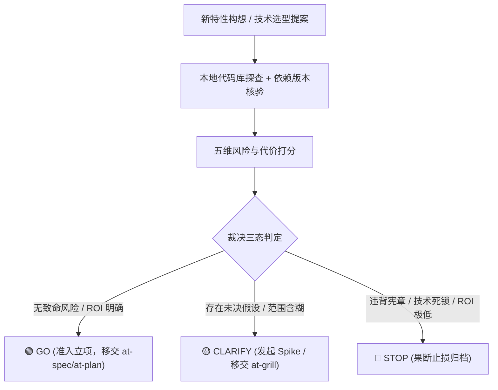

# 可行性决策矩阵与证据驱动裁决协议 (Decision Matrix Protocol)

本文档规范了 `at-assess` 技能在开展需求预研、方案可行性评估与技术选型 Spike 时的度量维度、证据链要求与裁决准则。

---

## 目录 (Table of Contents)
- [1. 核心理论：证据驱动评估机制](#1-核心理论证据驱动评估机制)
- [2. 评估五大硬核维度](#2-评估五大硬核维度)
- [3. 决策三态裁决准则 (Go / Clarify / Stop)](#3-决策三态裁决准则-go--clarify--stop)
- [4. 技术 Spike 探针设计规范](#4-技术-spike-探针设计规范)
- [5. 评估交付门禁与流转路由](#5-评估交付门禁与流转路由)

---

## 1. 核心理论：证据驱动评估机制

在软件工程中，轻率启动缺乏可行性论证的方案常导致巨大的研发资源浪费。`at-assess` 遵循**证据驱动预研原则**：
- **拒绝拍脑袋推测**：任何关于“可行”或“不可行”的断言，必须依托代码库扫描、官方依赖版本验证或最小 PoC 实验结果；
- **成本与收益正交度量**：不仅评估技术能否实现，更评估长期维护成本与潜在架构反噬；
- **及早止损 (Fail Fast)**：发现致命硬伤时果断裁决 STOP，避免沉没成本。

---

## 2. 评估五大硬核维度

评估过程中，Agent 必须从以下 5 个正交维度开展量化分析：

| 评估维度 | 考察核心 | 风险警示信号 (Red Flags) |
| :--- | :--- | :--- |
| **1. 技术可行性 (Feasibility)** | 目标方案是否与现有框架生态兼容？有无技术死锁？ | 强依赖已废弃（EOL）组件；底层连接模型冲突 |
| **2. 改动复杂度 (Complexity)** | 涉及改动的模块数量与爆炸半径有多大？ | 迫使多达数十个核心存量类进行侵入式修改 |
| **3. 安全与合规 (Security)** | 是否引入新的数据泄露暴露面或越权漏洞？ | 引入不受控的外部反射调用；存在注入风险 |
| **4. 维护与运维 (Operability)** | 上线后监控排障成本多高？团队能否平滑兜底？ | 缺乏全链路 Trace 追踪；单点故障无法降级 |
| **5. 投入产出比 (ROI)** | 解决该问题带来的业务/性能增益是否配得上研发成本？ | 耗时数周重构仅提升 0.1% 的非核心吞吐 |

---

## 3. 决策三态裁决准则 (Go / Clarify / Stop)

1. **🟢 GO (准予推进)**：
   - 满足条件：五维综合得分良好，无任何致命风险，实现路径清晰且技术栈合规；
   - 下一步：移交 `at-spec` 拟定增量规格，或移交 `at-plan` 进行工序拆解。
2. **🟡 CLARIFY (澄清补全)**：
   - 满足条件：核心思路可行，但存在 1~2 个关键未决假设（如依赖版本支持情况或业务优先级）；
   - 下一步：移交 `at-grill` 展开深度反向质询，或制定限定 2 小时内的微型 Spike 实验探针。
3. **🔴 STOP (终止归档)**：
   - 满足条件：触碰项目架构刚性红线、技术实现存在不可调和的死锁，或 ROI 严重倒挂；
   - 下一步：输出终止理由备忘录，阻止低效投入。

---

## 4. 技术 Spike 探针设计规范

当进入 CLARIFY 状态需要验证技术盲区时，遵循最小 Spike 原则：
- **时间盒 (Timebox)**：探针调研与验证代码严格限定在极短时间窗口内；
- **抛弃型原型 (Throwaway)**：Spike 代码仅用于验证假设，严禁直接带病合入生产代码库；
- **明确产出**：回答一个二元问题（如“组件 X 是否支持在 Java 17 上安全序列化？”）。

---

## 5. 评估交付门禁与流转路由

- 评估报告必须包含五维打分卡与证据链出处；
- 正文严禁包含任何 `file:///` 或本地物理盘符；
- 结论必须具备唯一确定的建议判定，严禁模棱两可。
