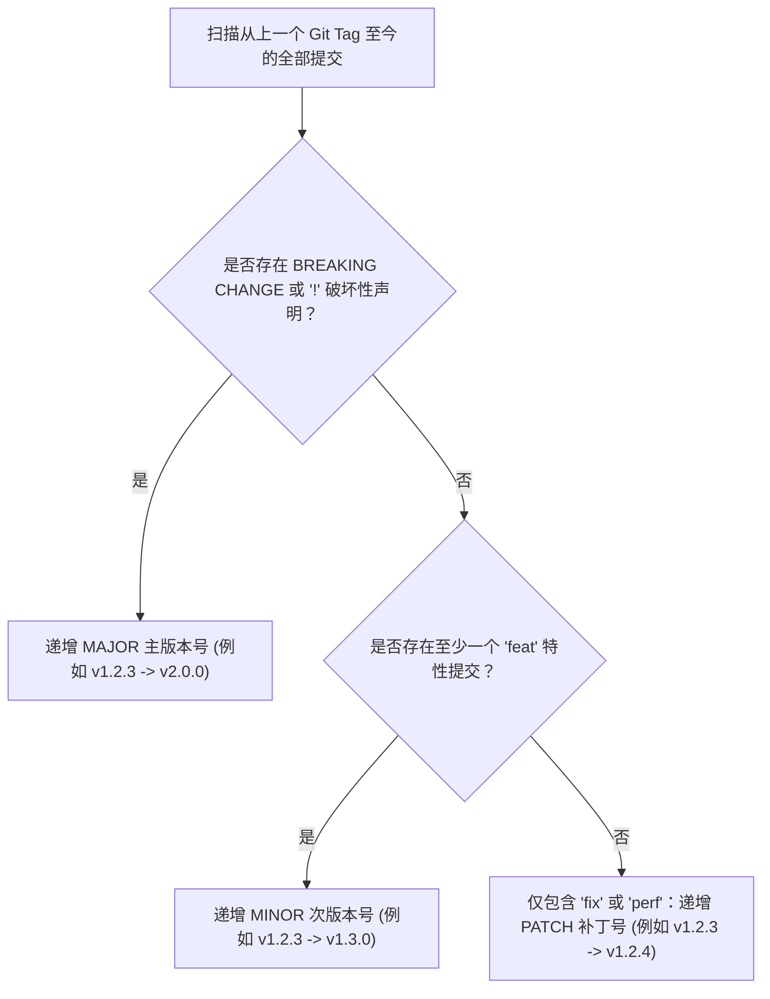

# Git 提交解析与变更日志自动分类协议 (Changelog Extraction Protocol)

本协议系统规范了如何基于 Git Commit 历史与 Conventional Commits 规范，自动提取、归类、过滤并生成符合 Keep a Changelog 规范的工业级变更日志（CHANGELOG.md）。

---

## 目录 (Table of Contents)

- [1. Keep a Changelog 核心分类体系](#1-keep-a-changelog-核心分类体系)
- [2. Conventional Commits 到 Changelog 映射规则](#2-conventional-commits-到-changelog-映射规则)
- [3. 杂音提交过滤与信息增量提炼法则](#3-杂音提交过滤与信息增量提炼法则)
- [4. SemVer 语义化版本递增决策算法](#4-semver-语义化版本递增决策算法)
- [5. 增量追加与版本打标工作流](#5-增量追加与版本打标工作流)

---

## 1. Keep a Changelog 核心分类体系

依据国际标准的 Keep a Changelog 规范，每一次版本的变更内容收敛为以下 6 大标准分节：

1. **`Added`**：新增加的功能与对外开放能力；
2. **`Changed`**：对既有功能的调整、重构优化或破坏性行为改变；
3. **`Deprecated`**：已废弃并在未来即将被移除的功能特性；
4. **`Removed`**：本次版本已彻底删除的废弃功能或类；
5. **`Fixed`**：修复的业务缺陷、逻辑漏洞或崩溃 Bug；
6. **`Security`**：修复的安全脆弱性漏洞、依赖升级与加密强化。

---

## 2. Conventional Commits 到 Changelog 映射规则

| Conventional Commit 类型 | 映射目标 Changelog 节 | 示例提交信息 |
| :--- | :--- | :--- |
| `feat` / `feat(scope)` | `### Added` | `feat(auth): 新增基于 WebAuthn 的无密码登录能力` |
| `refactor` / `perf` | `### Changed` | `perf(query): 优化订单大表分页执行计划，消除 N+1` |
| `fix` / `fix(scope)` | `### Fixed` | `fix(order): 修复并发支付时的余额竞态扣减缺陷` |
| `sec` / `security` | `### Security` | `sec(jwt): 升级依赖并修复 CVE-2026-1024 令牌越权漏洞` |
| 带有 `BREAKING CHANGE` | `### Changed` (置顶标注) | `feat(api)!: 变更对外 RESTful 分页响应字段结构` |

---

## 3. 杂音提交过滤与信息增量提炼法则

CHANGELOG 是写给**用户与下游开发者**看的，不是写给 Git 机器看的：

### 3.1 强制过滤的杂音提交
- **琐碎代码格式化**：`style` 类型（如格式化空格、微调换行）；
- **日常维护与依赖构建**：`chore`、`build`（无直接业务影响的琐碎升级）；
- **CI 流水线微调**：`ci`（如调整 GitHub Actions 执行参数）；
- **无意义的占位提交**：`fix bug`、`update code`、`merge branch`。

### 3.2 信息增量提炼与自然语言润色
- 剥离纯内部实现术语，将其转译为面向消费者的价值表达；
- 每条日志末尾关联 GitHub Issue/PR 编号（如 `([#42](https://github.com/org/repo/issues/42))`）。

---

## 4. SemVer 语义化版本递增决策算法

根据 Git 历史中提交类型的最大影响度，自动决议下一个语义化版本号（`vMAJOR.MINOR.PATCH`）：

---

## 5. 增量追加与版本打标工作流

1. **`[Unreleased]` 节维护**：所有日常合并的 PR 增量记录在 `[Unreleased]` 顶部小节下；
2. **正式发版归档**：发版时将 `[Unreleased]` 重命名为 `[vX.Y.Z] - YYYY-MM-DD`，并创建新的空 `[Unreleased]` 节；
3. **底部比对链接**：在 CHANGELOG 底部自动生成 GitHub 两次 Tag 间的 Diff 比对超链接（如 `[v1.1.0]: https://github.com/owner/repo/compare/v1.0.0...v1.1.0`）。
