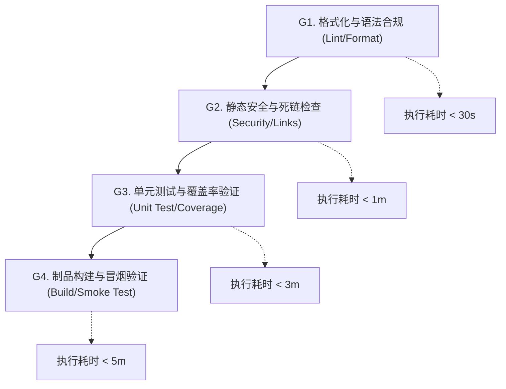

# CI/CD 质量门禁与自动化集成协议 (CI Quality Gate Protocol)

本文档定义现代软件交付体系中持续集成（CI）与持续部署（CD）流水线的分层门禁准则、失败熔断策略与安全合规标准。

---

## 目录 (Table of Contents)

- [1. 质量门禁分层模型与通过基线](#1-质量门禁分层模型与通过基线)
- [2. 静态检查与安全合规基线](#2-静态检查与安全合规基线)
- [3. 自动化测试与覆盖率熔断机制](#3-自动化测试与覆盖率熔断机制)
- [4. 流水线依赖缓存与性能优化](#4-流水线依赖缓存与性能优化)
- [5. 制品构建与版本发布门禁](#5-制品构建与版本发布门禁)

---

## 1. 质量门禁分层模型与通过基线

持续集成流水线采用由轻到重、快速失败（Fail-Fast）的四级漏斗门禁模型：

### 1.1 门禁通过准则 (Gate Criteria)
1. **阻断级（Blocker）**：任何阶段出现语法错误、死链或安全漏洞，流水线立即中断并向 PR 发送阻断状态；
2. **零容忍警告**：配置 Linter 严格模式，禁止将 Warning 遗留在主干分支；
3. **隔离执行环境**：每个构建任务必须运行在独立的容器或无状态虚拟机沙箱中。

---

## 2. 静态检查与安全合规基线

### 2.1 格式化与排版规范
- 代码统一由受管格式化工具处理（如 Prettier、Black、Checkstyle、Spotless）；
- 文档与 Markdown 必须满足盘古之白（中西文/数字空格）与相对路径合规性；
- 禁止包含 `file:///`、`C:/`、`D:/` 等本地宿主绝对路径。

### 2.2 凭据与敏感信息扫描
- 在 PR 流水线中集成 Secret 扫描（如 TruffleHog、Gitleaks）；
- 阻断包含真实 API Key、私钥或密码的提交合入主分支。

---

## 3. 自动化测试与覆盖率熔断机制

### 3.1 单元测试准则
- 单元测试运行必须实现 100% 确定性，严禁依赖外部真实网络服务；
- 外部依赖与时间系统必须通过 Mock 或内存假对象（In-Memory Fixture）模拟。

### 3.2 覆盖率熔断底线
- 核心领域逻辑分支覆盖率不得低于 80%；
- PR 增量代码覆盖率不得低于存量代码基线，禁止覆盖率负向漂移。

---

## 4. 流水线依赖缓存与性能优化

为保证开发者获得即时反馈，CI 流水线执行时间应控制在 5 分钟以内：

- **依赖缓存机制**：合理利用 `actions/cache` 或语言原生缓存机制缓存本地依赖库（如 Maven `~/.m2`、npm `~/.npm`、pip `~/.cache/pip`）；
- **缓存键设计**：以清单文件哈希（如 `package-lock.json`、`pom.xml`）作为 Cache Key，确保依赖更新时自动失效重下；
- **并发任务编排**：独立的代码检查、单元测试与文档校验步骤应配置为矩阵并行执行。

---

## 5. 制品构建与版本发布门禁

### 5.1 不可变制品基线
- 一次构建，多处交付：同一 Git Commit 仅编译打包一次不可变制品（Docker 镜像、JAR 包、Zip 归档）；
- 制品命名遵循语义化版本规范，严禁覆盖同名 Release 制品。

### 5.2 生产发布二次确认
- 生产环境发布作业必须配置 GitHub Environments 审批保护规则；
- 需由至少一名代码负责人（Code Owner）显式批准后方可触发部署动作。
