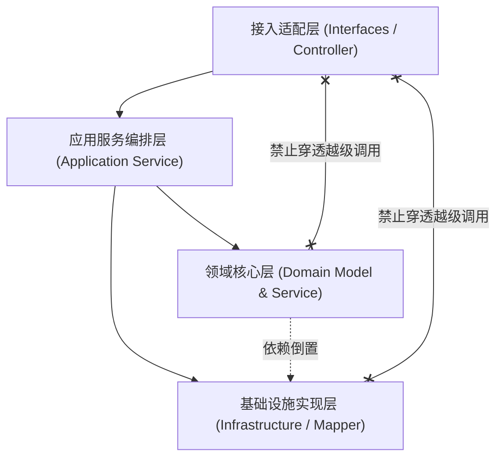

# 全栈电商微服务项目工程宪章范例 (Sample Engineering Constitution)

本文档展示了一个高并发全栈电商系统在实际研发中制定的工程宪章真实样例。

---

## 目录 (Table of Contents)
- [1. 宪章基本信息与法律效力](#1-宪章基本信息与法律效力)
- [2. 技术栈白名单与版本底线](#2-技术栈白名单与版本底线)
- [3. 模块边界与架构分层禁止项](#3-模块边界与架构分层禁止项)
- [4. 编码规范与关键不变式契约](#4-编码规范与关键不变式契约)
- [5. 安全红线与生产零凭据守则](#5-安全红线与生产零凭据守则)
- [6. 特批豁免与技术债追踪](#6-特批豁免与技术债追踪)

---

## 1. 宪章基本信息与法律效力

- **系统名称**：MegaMall 分布式电商核心平台
- **宪章版本**：v1.2.0
- **生效日期**：2026-03-15
- **修订责任人**：架构委员会 (Ateng)
- **工程效力**：本宪章系本工程代码、CI 门禁与 Agent 自治执行的顶层法典。任何代码提交若违背本宪章，PR 将被直接拒绝，CI 流程立即熔断。

---

## 2. 技术栈白名单与版本底线

| 技术领域 | 官方白名单技术栈 | 严格禁止引入 |
| :--- | :--- | :--- |
| **后端运行时** | JDK 17 (Eclipse Temurin LTS) | 严禁 JDK 8/11 或非 LTS 镜像 |
| **基础微服务框架** | Spring Boot 3.2.x, Spring Cloud 2023.x | 禁止混用 Quarkus 或 Micronaut |
| **持久层 & 数据库** | MyBatis-Plus 3.5.5, MySQL 8.0.35 | 严禁引入 Hibernate/JPA 或非标 ORM |
| **缓存中间件** | Redis 7.2 Cluster (Redisson 客户端) | 严禁私建 Jedis 连接池或内存级静态 Map 缓存 |
| **消息中间件** | Apache RocketMQ 5.2.0 | 严禁混用 Kafka 或 RabbitMQ |
| **前端技术栈** | Vue 3.4+, TypeScript 5.3+, Pinia 2.1+ | 严禁在主工程混入 React 或裸 jQuery |

---

## 3. 模块边界与架构分层禁止项

系统严格服从 DDD 四层清晰架构，定义明确的调用流向：

1. **绝对禁止越级穿透**：Controller 严禁直接调用 Repository/Mapper，必须经由 Application/Domain 服务层收敛；
2. **绝对禁止双向依赖**：模块间严禁循环引用，通用共享契约统一抽取至 `mall-common-api`；
3. **DO 实体严禁出域**：持久层数据对象（`*DO`）严禁透传至 Controller 返回给前端，必须转换组装为 `*VO`。

---

## 4. 编码规范与关键不变式契约

1. **空安全与集合契约**：
   - 任何 Service 查询方法在无匹配数据时，**必须返回空集合**（如 `Collections.emptyList()`），严禁返回 `null`；
   - 实体类单查返回 `null` 时，业务调用处必须立即通过卫语句进行判空保护。
2. **防循环数据库穿透 (No N+1)**：
   - 严禁在 `for`、`while` 或 `forEach` 循环体内执行 SQL 查询或 RPC 调用；
   - 必须通过批量接口（如 `listByIds`、`batchQueryUser`）预先批量拉取并在内存映射。
3. **单例并发安全**：
   - 所有 Spring Bean 必须保持绝对无状态，禁止定义可变成员变量；
   - 复杂计算必须使用方法局部变量，杜绝非线程安全集合导致的并发竞态。

---

## 5. 安全红线与生产零凭据守则

1. **零明文密码**：
   - `application.yml` 与配置文件中禁止出现数据库密码、OSS Secret 与微信支付私钥明文；
   - 所有敏感凭据统一从环境变量 `${MALL_DB_PASSWORD}` 或保密中心读取；
2. **零数据越权**：
   - 所有业务查询接口必须在 SQL 层面显式拼接当前租户 `tenant_id` 与用户 `user_id`，严禁信任前端传入的所有权凭据；
3. **日志脱敏防暴**：
   - 打印日志必须对手机号、身份证、银行卡进行掩码脱敏（如 `138****1234`）；
   - 严禁打印完整报文未经处理的超大 Base64 文件流。

---

## 6. 特批豁免与技术债追踪

当因紧急线上保障或特殊历史遗留系统对接无法遵循宪章时：
- **前置审批**：必须经由架构师（Ateng）文字确认；
- **ADR 归档**：必须生成 ADR 并关联 Issue 编号；
- **技术债还清期限**：所有特批代码必须在 14 个自然日内重构对齐，逾期未还将在站会上进行技术债红榜通报。
