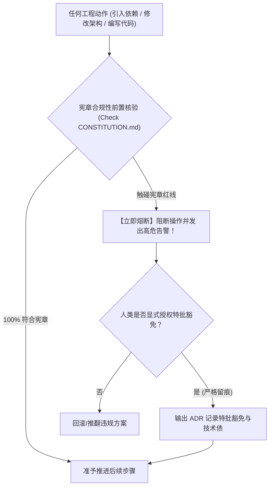

# 工程宪章刚性执行与前置熔断协议 (Guardrail Enforcement Protocol)

本文档规范了 `at-constitution` 技能制定的项目工程宪章（`CONSTITUTION.md`）在全生命周期研发中的前置守卫核验、违规熔断机制与豁免审批流程。

---

## 目录 (Table of Contents)
- [1. 核心理论：法律级工程刚性约束](#1-核心理论法律级工程刚性约束)
- [2. 宪章在全生命周期的前置守卫机制](#2-宪章在全生命周期的前置守卫机制)
- [3. 违规即熔断 (Circuit Breaker) 原则](#3-违规即熔断-circuit-breaker-原则)
- [4. 显式授权与受控豁免机制](#4-显式授权与受控豁免机制)
- [5. 宪章版本演进与守卫准出标准](#5-宪章版本演进与守卫准出标准)

---

## 1. 核心理论：法律级工程刚性约束

在多 Agent 协同与自治长跑中，缺乏顶层制度约束会导致技术栈野蛮扩散与架构底线破损。
`at-constitution` 确立**项目工程宪章 (Constitution)** 的法律地位：
- **高于任何局部优化**：任何“为了图快”而违背宪章的行为均属非法；
- **全阶段前置守卫**：从需求预研（`at-assess`）、规格拟定（`at-spec`）到代码审查（`at-review`），全流程必须首先校验宪章符合度；
- **机器可强制验证**：宪章中的规约必须清晰、二元（符合 vs 违背），杜绝模棱两可。

---

## 2. 宪章在全生命周期的前置守卫机制

宪章作为全局前置切面嵌入各个技能：
1. **可行性预研 (`at-assess`)**：优先核查提案是否引入了宪章禁止的组件或架构模式；
2. **增量规格拟定 (`at-spec`)**：规格必须继承宪章中声明的通用不变式（如空集合安全契约、零明文凭据）；
3. **工序拆解 (`at-plan`)**：微任务必须包含宪章规定的质量门禁指令（如必须通过 `validate.py`）；
4. **测试驱动开发 (`at-tdd`)**：严禁在测试中混入真实外网地址或生产凭据；
5. **代码审查 (`at-review`)**：任何违背宪章的改动直接标定为 🔴 Blocker 阻断项。

---

## 3. 违规即熔断 (Circuit Breaker) 原则

一旦扫描到以下任一触碰宪章红线的行为，Agent 必须立即**强制熔断停机**：
- **未授权依赖引入**：在 `pom.xml` 或 `package.json` 中擅自引入非白名单第三方依赖；
- **破坏无状态设计**：在单例服务中定义可变共享成员变量；
- **持久层 N+1 穿透**：在循环体内发起数据库查询或远程 RPC；
- **凭据裸露泄露**：在代码、配置或文档中写入明文密码、API Token 或物理本地绝对路径。

---

## 4. 显式授权与受控豁免机制

项目宪章是刚性的，但在极端业务场景下允许受控豁免：
1. **人类双重确认**：必须由人类开发者在对话框中显式给出明确豁免指令；
2. **强制 ADR 留痕**：任何豁免必须强制唤起 `at-adr` 记录《架构偏差决策记录》，注明背负的技术债务与计划还债周期。

---

## 5. 宪章版本演进与守卫准出标准

- 宪章文件默认存放于工程根目录 `CONSTITUTION.md`（或 `docs/CONSTITUTION.md`）；
- 每次修订必须标注修订人、生效日期与关联版本号；
- 正文严格遵循盘古之白排版规范，全文档杜绝任何 `file:///` 或本地物理盘符泄漏。
