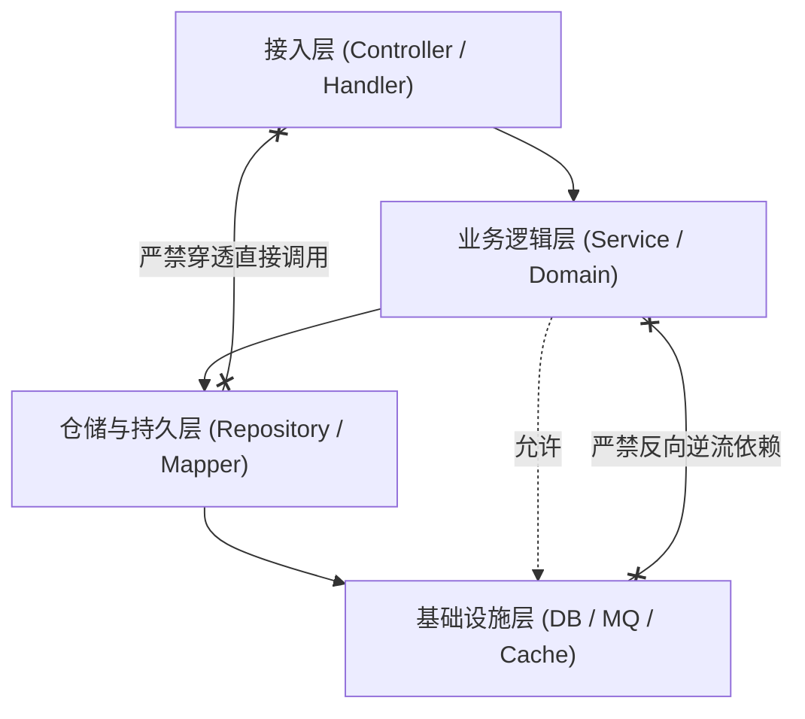

# 项目工程宪章规范模板 (Project Engineering Constitution Template)

本文档提供标准工程宪章（`CONSTITUTION.md`）落地模板。工程宪章具备项目级法律地位，为全生命周期研发与多 Agent 协同提供刚性守卫红线。

---

## 目录 (Table of Contents)
- [1. 宪章元数据与效力说明](#1-宪章元数据与效力说明)
- [2. 技术栈白名单与版本基线](#2-技术栈白名单与版本基线)
- [3. 架构分层与依赖流向红线](#3-架构分层与依赖流向红线)
- [4. 代码质量与反模式绝对禁止项](#4-代码质量与反模式绝对禁止项)
- [5. 空安全、并发与事务契约](#5-空安全并发与事务契约)
- [6. 安全合规与零明文凭据底线](#6-安全合规与零明文凭据底线)
- [7. 运维观测性与日志标准](#7-运维观测性与日志标准)
- [8. 特批豁免与 ADR 登记流程](#8-特批豁免与-adr-登记流程)

---

## 1. 宪章元数据与效力说明

```markdown
# [项目名称] 工程宪章 (Engineering Constitution)

- **宪章版本**：v1.0.0
- **生效日期**：[YYYY-MM-DD]
- **维护组织/架构委员会**：[团队/架构组名称]
- **最高效力声明**：本宪章是本项目研发、重构与 Agent 自治执行的最高工程准则。任何局部优化、临时改动均不得违背本宪章，违背即触发前置熔断。
```

---

## 2. 技术栈白名单与版本基线

必须显式声明官方支持的技术基线，未经批准严禁引入非白名单组件：

| 领域分类 | 准入组件与基准版本 | 引入限制与约束 |
| :--- | :--- | :--- |
| **运行时基线** | [如 JDK 17 LTS / Node.js 20 LTS] | 严禁使用已 EOL 或非 LTS 运行环境 |
| **核心框架** | [如 Spring Boot 3.2+ / Next.js 14+] | 遵循官方推荐依赖管理机制 (BOM) |
| **持久层 & ORM** | [如 MyBatis-Plus 3.5+ / Prisma] | 严禁同一工程混用多套 ORM 框架 |
| **数据库** | [如 MySQL 8.0+ / PostgreSQL 16+] | 严禁直接依赖未经验证的实验性存储 |
| **缓存与消息** | [如 Redis 7.x / Apache Kafka 3.x] | 严禁绕过受管基础设施私建客户端 |
| **第三方工具包** | [如 Hutool / Apache Commons / Lodash] | 优先使用标准库，严禁引入功能重叠库 |

---

## 3. 架构分层与依赖流向红线

严密定义系统架构边界，杜绝越级穿透与循环依赖：



- **单向无环依赖**：高层依赖低层，严禁任何逆向反流或模块间循环依赖（Circular Dependency）；
- **防腐与模型解耦**：接入层交互必须采用 DTO/VO，严禁持久层实体（Entity/DO）直接对外暴露或跨域穿透；
- **深模块设计原则**：业务模块必须封装内部实现细节，仅暴露简洁且完备的公共接口。

---

## 4. 代码质量与反模式绝对禁止项

以下行为触碰宪章红线，代码审查与门禁直接标定为 🔴 Blocker 熔断项：

- ❌ **严禁上帝类 (God Class)**：单文件代码行数严禁超过 [如 500 行]，复杂逻辑必须拆分为独立职责类；
- ❌ **严禁魔数硬编码**：禁止代码中充斥未解释的字面量常数与配置，必须收敛为常量或枚举；
- ❌ **严禁吞没异常**：禁止空的 `catch` 块、仅打印堆栈或未作语义转译的裸异常外抛；
- ❌ **严禁标准输出污染**：正式环境严禁使用 `System.out.println`、`console.log` 或 `print`，必须使用工程受管日志器。

---

## 5. 空安全、并发与事务契约

保障系统高并发与复杂业务流转中的绝对健壮性：

- **集合返回契约**：查询列表/集合无匹配数据时，**必须返回空集合**（如 `Collections.emptyList()`、`[]`），**严禁返回 `null`**；
- **单对象卫语句防御**：单实体查询无匹配时允许返回 `null`，但调用方必须在前置使用卫语句显式判空或使用 `Optional`，严禁未经防御的链式调用；
- **单例无状态性**：公共单例 Bean/服务必须保持无状态，严禁使用非线程安全容器（如标准 `HashMap`）共享可变业务状态；
- **事务与循环防穿透**：严禁在循环体内发起数据库查询、写入或远程 RPC 调用（杜绝 N+1 陷阱），必须采用批量接口。

---

## 6. 安全合规与零明文凭据底线

守护信息安全与数据隐私生命线：

- **零明文不变量 (Zero-Secret)**：代码库、提交记录、配置模板及文档中**绝对禁止包含明文密码、API Token、私钥或生产凭据**；
- **敏感数据占位与注入**：所有凭据必须通过系统环境变量或受管 KMS/配置中心注入，文档中统一使用 `YOUR_API_TOKEN` 或 `${ENV_VAR}` 占位；
- **防 SQL 注入与脚本攻击**：持久层一律强制参数化绑定，严禁字符串拼接 SQL；对外输出必须实施 XSS/HTML 转义防御。

---

## 7. 运维观测性与日志标准

保障系统在生产环境的高可排障性与追踪透明度：

- **全链路追踪 (Traceability)**：跨系统调用与异步消息必须透传 `TraceId`，并在日志中统一输出 MDC 上下文；
- **日志分级清晰**：
  - `DEBUG`：仅限本地排错，严禁带入生产环境；
  - `INFO`：记录核心业务关键状态跃迁与操作审计；
  - `WARN`：非致命降级事件，系统可自愈但需预警；
  - `ERROR`：必须附带清晰的上下文要素与因果链，杜绝无效日志风暴。

---

## 8. 特批豁免与 ADR 登记流程

当项目遇到不可抗力或特殊临时场景确需违背本宪章时，必须服从以下刚性审批流程：

1. **发起特批申请**：由开发者提出技术豁免原因、影响范围与还债计划；
2. **人类双重确认**：必须获得项目负责人/架构委员会显式文字授权；
3. **强制 ADR 登记**：唤起 `at-adr` 生成《架构决策记录》（标定状态为 `Superseded` 或带技术债标签），归档留痕；
4. **偿还截止日期**：设立明确的技术债偿还时间盒（不超过 2 个迭代周期），逾期未还视为严重工程缺陷。
