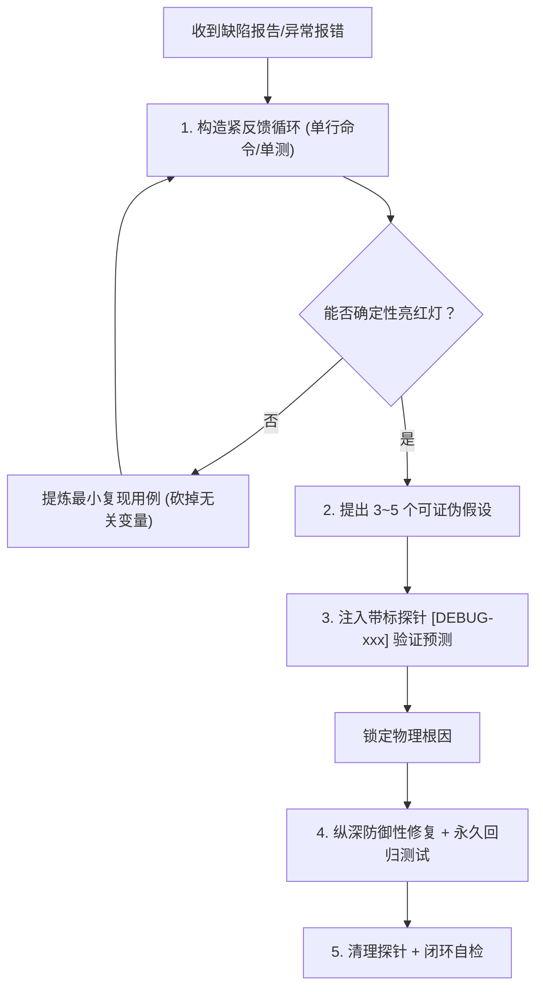

# 系统化根因排错执行协议 (Systematic Debugging Protocol)

本文档规范了 `at-diagnose` 技能在追踪疑难缺陷、性能劣化与非确定性故障时的科学排错四步法与纪律准则。

---

## 目录 (Table of Contents)
- [1. 核心铁律：无紧反馈循环不推测根因](#1-核心铁律无紧反馈循环不推测根因)
- [2. 四阶段系统化排错生命周期](#2-四阶段系统化排错生命周期)
- [3. 可证伪假设 (Falsifiable Hypotheses) 生成法](#3-可证伪假设-falsifiable-hypotheses-生成法)
- [4. 临时探针打标与一键清理机制](#4-临时探针打标与一键清理机制)
- [5. 深度防御修复与反打补丁准则](#5-深度防御修复与反打补丁准则)

---

## 1. 核心铁律：无紧反馈循环不推测根因

许多工程师与 Agent 在遇到 Bug 时的第一反应是“肉眼死盯代码猜原因”，这往往导致漫无边际的试错与破坏性乱改。`at-diagnose` 树立硬性铁律：
- **反馈循环为先**：在提出任何修复理论前，必须先构造出一条**确定性变红的自动化反馈命令 (Tight Feedback Loop)**；
- **红灯可复现性**：该命令必须能稳定驱动缺陷链路并在数秒内触发故障表现；
- **若无反馈循环，严禁动手术改代码**！

---

## 2. 四阶段系统化排错生命周期

### 阶段 1：紧反馈循环与最小重现 (Feedback Loop & Minimization)
1. **构造测试探针**：优先使用失败单测，其次为微型脚本（curl/CLI），必须单命令可跑；
2. **剔除冗余依赖 (Minimise)**：逐一砍掉无关的输入参数、数据字典与依赖服务，直到只剩下不可或缺的故障诱因；
3. **非确定性故障提升复现率**：针对偶发并发 Bug，通过压力循环 100 次或窄化时钟窗口，将复现率拉升至可稳定观测状态。

### 阶段 2：可证伪假设与探针证据链 (Falsifiable Hypotheses & Evidence)
1. **穷举 3~5 个假设**：禁止单一假设先入为主，必须罗列 3~5 个排序假设；
2. **必须可证伪**：清晰陈述“若原因属于假设 A，则改变变量 B 时故障必将消失/加剧”；
3. **单变量验证**：一次只改变一个因素，观察反馈循环是否验证预测。

### 阶段 3：纵深防御性修复 (Deep Defensive Fix)
1. **坚决反对表面打补丁 (Anti-Band-Aid)**：
   - 严禁单纯在调用点包一个空的 `try-catch` 或无意义判空；
   - 必须顺着调用栈回溯到错误数据产生的源头（Root Cause）；
2. **契约加固**：在入参前置断言、状态机卫语句处实施纵深防御。

### 阶段 4：回归锁定、探针清理与复盘 (Regression Lock & Cleanup)
1. 将最小复现用例固化为永久单元测试；
2. 一网打尽清理所有 `[DEBUG-...]` 临时打印日志；
3. 输出根因复盘备忘录。

---

## 3. 可证伪假设 (Falsifiable Hypotheses) 生成法

无效假设与有效假设的判别：
- ❌ **无效的玄学假设**：“感觉这里的异步逻辑可能有点问题。”（不可验证，无法证伪）
- ✔️ **有效可证伪假设**：“由于线程池拒绝策略采用默认 DiscardPolicy，在大流量突发时任务被静默丢弃导致 Future 永不完成。预测：若将拒绝策略改为 CallerRunsPolicy，该超时报错将立即消失。”

---

## 4. 临时探针打标与一键清理机制

排查复杂链路必须插桩打印时，遵循**零污染协议**：
1. **唯一前缀打标**：所有临时插入的打印语句统一添加带有随机 Token 的前缀，例如 `log.info("[DEBUG-f8c2] trace state: {}", state);`；
2. **排错完成单步清除**：排查完毕后，通过全局搜索该前缀一键清退，绝不让临时代码泄漏到生产。

---

## 5. 深度防御修复与反打补丁准则

修复完成核验清单：
- [ ] 原始反馈循环命令已由红灯完全变绿；
- [ ] 永久回归测试用例已纳入工程单测套件；
- [ ] 所有临时插桩代码已 100% 清理；
- [ ] 修复代码严格遵循单一职责，无无关排版改动。
